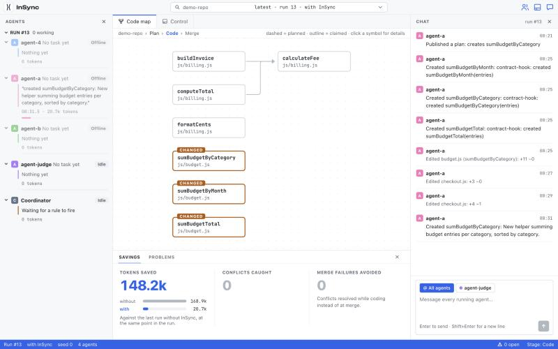
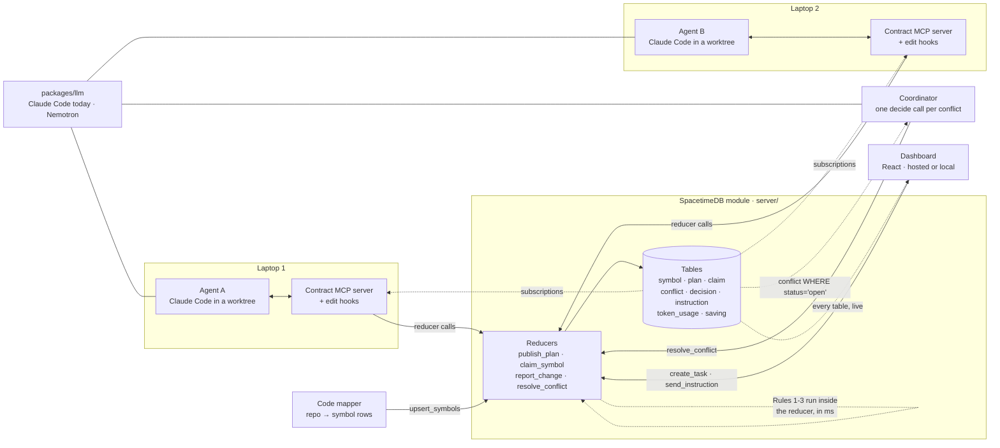

# Contract

Live coordination for AI coding agents. A shared SpacetimeDB server lets a team's
coding agents see each other's plans as they work, so conflicting changes are caught
while code is being written, not at merge time. A coordinator agent resolves
conflicts and a live dashboard shows everything. Every model call goes through one
provider switch: workers run on Claude Code, and the coordinator runs on NVIDIA Nemotron
or Claude (`COORDINATOR_PROVIDER`).

> Contract isn't another coding agent. It's what lets your team's coding agents work like a team.

Built at HackUTD 2026. Full spec: [docs/SPEC.md](docs/SPEC.md).



## 60-second quickstart

One laptop, the built-in demo repo, driven from the dashboard:

From the repo root (the folder with `package.json`), on an up-to-date `main` (`npm run control`
only exists there). First time only, copy `.env.example` to `.env` (`cp` on macOS/Linux/PowerShell,
`copy` in Windows cmd) and set `SPACETIME_HOST=wss://maincloud.spacetimedb.com` and
`SPACETIME_DB_NAME=contract-hackutd26`. Then:

```bash
git checkout main
git pull
npm install
npm run control
```

`npm run control` opens the dashboard, already paired to this laptop.

`npm error Missing script: "control"` means you're in the wrong folder or on an old branch:
`cd` to the repo root and run `git checkout main`, `git pull`, then `npm install`.
These commands work the same on macOS, Linux and Windows; run them one per line (Windows
PowerShell 5.1 doesn't accept `&&`).

In the dashboard's **Chat** tab, type what you want built, the way you'd prompt a coding agent:

> Add late fees to invoices, and have another agent format receipt dates.

Contract plans it, starts a coordinator and a session, puts one agent on each independent
piece, catches the conflicts between them while they type, and merges and runs the checks when
they finish. A second laptop joins the same run with `npm run control` and the same `.env`.

## Architecture

Agents never talk to each other. Everything goes through one SpacetimeDB module: agents write
plans, claims and change reports with reducers, and every other process (the other agents, the
coordinator, the dashboard) gets the result pushed to it through a subscription.



- **Reducers can't reach the network**, so anything that calls a model or reads files (agents,
  coordinator, mapper) is a Node process that connects as a client.
- **Detection is free and instant.** The three rules below run inside `publish_plan`,
  `claim_symbol` and `report_change`. The coordinator model is only called after a rule fires,
  and its tokens are logged against Contract on the scoreboard.
- **Every panel is a subscription.** The dashboard writes nothing except new tasks and
  operator messages; two laptops and a hosted dashboard all see the same rows.

The end-to-end story, in order:

1. The mapper loads the repo's symbols and call edges into `symbol` and `symbol_edge`.
2. Agent A publishes a plan to change how `calculateFee` rounds, and claims it.
3. Agent B is midway through checkout code that calls `calculateFee`; its plan lists it as a dependency.
4. A's edit hook sees the signature change and calls `report_change`. Rule 1 finds B's dependency,
   opens a `conflict` row, sets B to `paused` and inserts an `instruction` for B.
5. B's MCP server gets the push and stops B mid-task. The coordinator gets the same push.
6. The coordinator makes one `decide()` call: A owns `calculateFee`, B updates to the new rounding.
   It writes a `decision` row with the reason and resolves the conflict.
7. B resumes with the new instruction. Both branches merge cleanly and the tests pass.

## How the rules work

All three are deterministic, run inside the reducer that receives the write, and never open a
second `open` conflict for the same kind, symbol and agent pair.

| Rule | Fires in | Trigger | What happens |
| --- | --- | --- | --- |
| 1. Broken dependency | `report_change` | X changes symbol S's signature or behavior, and Y's active plan depends on S, or modifies or creates a caller of S (`symbol_edge`, up to 3 hops) | `broken_dependency` conflict, Y paused, instruction to Y to wait for the coordinator |
| 2. Duplicate implementation | `publish_plan`, `report_change('created')` | X plans to create N and an existing symbol or another agent's planned create has the same normalized name, or the same parameter and return types plus a shared name token (`formatDate` vs `dateToString`) | `duplicate` conflict; if the match already exists, instruction to X: reuse it |
| 3. Claim contention | `claim_symbol`, `publish_plan` | X claims or plans to modify S while Y holds an unexpired claim | claim refused, `claim_contention` conflict |

Claims expire when an agent stops heartbeating (a scheduled reducer runs every 30 s), so a
crashed laptop never holds a symbol forever. An edit hook in each worker's Claude Code session
enforces the protocol locally: no edit to a mapped file without a declared plan, no edit to a
mapped symbol without a claim.

## Layout

```text
server/              SpacetimeDB module: tables, reducers, conflict checks
packages/client/     Contract client library + generated SpacetimeDB bindings
packages/llm/        Shared model wrapper (Claude Code today): calls, token + cost logging
agents/worker/       Worker agent loop and its tools
agents/coordinator/  Coordinator agent loop and prompts
mapper/              Code mapper: repo -> symbol rows
dashboard/           React web app
demo-repo/           Small TypeScript codebase with planted conflicts + tests
scripts/             run-demo.ts, reset.ts, seed.ts
```

## Setup

1. Node 22+ and the [SpacetimeDB CLI](https://spacetimedb.com/install).
2. `npm install`
3. `cp .env.example .env`, and log in to Claude Code on this laptop (`claude -p "hi"` should
   answer). `NVIDIA_API_KEY` (free, from build.nvidia.com) is only needed if you set
   `COORDINATOR_PROVIDER=nemotron`; everything runs on Claude Code without it.
4. `spacetime start`, then publish `server/` and generate bindings into
   `packages/client/src/bindings` (see the SpacetimeDB TypeScript quickstart).

## Shared cloud database (two laptops)

The demo database `contract-hackutd26` runs on SpacetimeDB maincloud, so both laptops
share it with no LAN setup. Only its owner's login can publish; anyone can connect.

1. In the repo root `.env` (every part loads it, whatever folder it runs from):

   ```bash
   SPACETIME_HOST=wss://maincloud.spacetimedb.com
   SPACETIME_DB_NAME=contract-hackutd26
   ```

2. Both laptops: `git pull && npm run reset`, so they start from the same `origin/main`.
3. Host laptop: `npm run coordinator` and `npm run dashboard` (each in its own terminal), then
   `npm run session -- start`. That ends any open run, clears the last run's state, opens a
   `with_contract` run and maps `demo-repo/`.
4. Each laptop starts its own agent with a different `--id`, and tells it what to build:

   ```bash
   npm run worker -- --id agent-a --prompt "Add late fees to invoices..."
   ```

   Or start it with `--wait` and type the task into the dashboard's **New task** form:

   ```bash
   npm run worker -- --id agent-b --wait
   ```

   Workers branch from `origin/main`. When a worker finishes, it pushes `agent/<id>` to origin
   (`--no-push` skips that).
5. When every agent is done, run this on either laptop:

   ```bash
   npm run session -- merge
   ```

   It fetches every agent's branch, merges them in `.worktrees/merge-<run>` and runs unit
   tests, typecheck and check-dupes. If those fail, a local agent gets a merge-fix pass.
   Then it ends the run. Add `--integration` when the agents ran the two canned tasks
   (`agents/worker/src/tasks.ts`), and `--push` to push the merge branch.

To check who is online (a worker heartbeats every 15 s and goes stale after 60 s):

```bash
spacetime sql --server maincloud contract-hackutd26 "SELECT id, machine, status, last_heartbeat FROM agent"
```

`npm run demo` stays the single-laptop A/B benchmark (both modes, canned tasks, scoreboard).

After a change to `server/`, the owner republishes with `npm run publish:cloud -w @contract/server`.
Keep live tests local (they wipe their database); they default to `ws://localhost:3000`.

## Running it from the dashboard

The easiest way: open the dashboard's **Chat** tab and say what you want, the way you'd prompt a
coding agent ("Add late fees to invoices, and have another agent format receipt dates").
Contract plans it (one `decide()` call through `packages/llm`), starts the coordinator and a
session if they aren't running, puts one agent on each independent piece, and merges and runs
the checks when they all finish. While agents work, follow-ups ("make it round half up") go to
them as messages. It needs one daemon running on the laptop
that does the work:

In the repo root (older branches have no control script):

```bash
git checkout main
git pull
npm install
npm run control
```

On the first run it opens the dashboard in your browser, already linked to this laptop.

The daemon connects out to SpacetimeDB as this laptop's `machine` row; nothing listens on a port,
so the hosted dashboard drives it the same as a local one. Set `CONTRACT_DASHBOARD_URL` to your
hosted dashboard so the link points there (default `http://localhost:5173`). Pairing is once per
browser: the code works once, expires after 10 minutes, and never reaches the database (the
browser sends a hash of it with its own identity). Press Enter in the daemon's terminal for a new
code. When no browser is paired yet, the daemon opens the link itself (`--no-open` to skip,
`--open` to force). The daemon keeps its identity in `.contract/identities.json`, so pairings survive restarts.
The code only ever appears in the terminal on purpose: the dashboard is a public page, so a code or
"pair" button shown there would let anyone who opens it run commands on your laptop. Seeing the
terminal is the proof that you're at the laptop. A private/Incognito window forgets its identity
when closed, so it needs a new code each time; use a normal window to pair once.
**Manual controls** under the chat start and stop each piece yourself (coordinator, session,
workers, judge, merge, reset) and show each process's output. Only paired browsers can send it
commands, every command goes through a fixed allowlist, and it runs things only on the laptop
it runs on (each laptop runs its own). Workers push `agent/<id>` to origin as usual.

**Several people, one dashboard.** Each browser drives only the laptop it paired with, so pair with
the laptop whose terminal printed the code (yours), and have teammates run `npm run control` on
their own laptops and pair their own browsers. Everyone still sees the same run, agents, chat and
changes, because they share one database; the Control tab lists the other laptops online and the
repo each one is on. If two laptops have the same hostname, the second daemon picks
`<hostname>-xxxx` and remembers it in `.contract/control.json` (`--machine <name>` overrides).

## Joining from a new laptop

```bash
npm run join -- --agent agent-b --name "Agent B" --owner Bob
```

Checks Node, `.env`, the `claude` login and git, registers the agent, and prints the worker
command. Only one coordinator and one watching mapper run per database (a second one
refuses to start). Rehearsal steps and network fallbacks: `docs/two-laptop-rehearsal.md`.

To join from your own Claude Code, Cursor or Codex session instead of our worker:
`npm run join -- --agent dana --client claude-code` (see `docs/join-contract.md`).

## Your own repo

Contract works on any git repository, not only `demo-repo/` (issue #18). The easiest way:
run `npm run control`, open the dashboard's **Chat** tab and paste a GitHub link
(`owner/name` works too) into **Repository**. From the command line, pick it with
`--repo <path|git URL>` or `CONTRACT_TARGET` in `.env`; a folder inside a repo works too.

```bash
npm run session -- start --repo ../my-app --tasks tasks.json   # maps it, queues tasks
npm run worker -- --id agent-a --repo ../my-app --wait          # on each laptop
npm run session -- merge --repo ../my-app                       # merge + run its checks
npm run reset -- --repo ../my-app
```

`tasks.json` is `[{ "agent": "agent-a", "task": "Add a dark mode toggle" }]`.

- **Checks.** The merge runs the commands in the target's `contract.json`
  (`{ "checks": { "unit tests": "pytest -q" } }`), else `CONTRACT_TEST_CMD`, else what it
  detects: `npm test`, `python -m pytest -q`, `go test ./...`, `cargo test`, `mvn -q test` /
  `./gradlew test`, `bundle exec rspec`, `vendor/bin/phpunit`, `dotnet test`. Workers may run
  those without asking.
- **Dependencies.** Each worker worktree and the merge worktree get an install step detected
  from lockfiles (`npm ci`, `pnpm`/`yarn`/`bun install`, a `.venv` with pip, `uv sync`,
  `poetry install`, `go mod download`, `cargo fetch`, `bundle install`, `composer install`,
  `dotnet restore`). Tools missing on the laptop are skipped. Override with
  `"install": "make deps"` in `contract.json`, or turn it off with `"install": false`.
  `node_modules`, `.venv` and friends are never committed to agent branches.
- **Worktrees.** The demo's are `.worktrees/<id>`; another repo's are
  `.worktrees/<name>-<hash>/<id>`, so switching repos never reuses a folder.
- **Push access.** The repo needs an `origin` you can push to for the two-laptop flow
  (workers push `agent/<id>` there); a local-only repo works on one laptop.
- **Code map folders.** Tests and tooling folders (`test/`, `tests/`, `__tests__/`, `scripts/`)
  are left out of the code map. If your app's code lives in one, or a folder should never be
  mapped, say so in `contract.json`: `"map": { "include": ["scripts"], "exclude": ["demo-repo"] }`.
  This monorepo's own `contract.json` does exactly that, so Contract can run on itself
  (`--repo .`); keep agents out of `server/` there, since a schema change needs
  `npm run generate -w @contract/server` and a publish, which no agent should do.
- **Languages.** The code map reads TypeScript and JavaScript (ES modules), plus Python, Go,
  Java, Rust, Ruby, PHP, C# and C/C++ through tree-sitter. For those, call edges are matched by
  name, so they're approximate.

## Benchmark

`npm run bench` runs every scenario in `scripts/scenarios.ts` (the planted rounding +
duplicate case, a duplicate helper, claim contention, a signature change with several
callers, and a no-conflict control) in both modes, then rewrites this table
(`--scenarios a,b --runs N` to narrow it; `--report-only` to rebuild it from recorded runs).

The table below is a first, small sample (1 run per mode, 2 scenarios, generated with
`npm run bench -- --scenarios claim-contention,control --runs 1`); run the full benchmark
(`npm run bench -- --runs 3`) before quoting a number.

<!-- bench:begin -->
Across 2 scenario(s) and 4 runs, Contract saved **26%** of the cost (0% of tokens) and left 0/2 merges broken vs 1/2 without it.

| Scenario | Runs (without / with) | Cost without | Cost with | Saved | Tokens without | Tokens with | Wasted without | Broken merges without | Broken merges with |
| --- | --- | --- | --- | --- | --- | --- | --- | --- | --- |
| Claim contention (both modify calculateFee) | 1 / 1 | $0.89 | $0.30 | 66% | 1274.1k | 931.6k | 978.6k | 1/1 | 0/1 |
| Control: unrelated changes | 1 / 1 | $0.29 | $0.33 | -15% | 906.5k | 1147.4k | 0 | 0/1 | 0/1 |

_Generated 2026-11-08T07:33:30.039Z by `npm run bench`. Averages per run; tokens include cache reads (cost is what was billed)._
<!-- bench:end -->

## Latency

An edit on one laptop should show up on the other laptop's dashboard in well under a second.
Each Claude Code edit runs two hooks (`agents/worker/src/claim-guard.ts` before it,
`hook.ts` after it). They are thin: they hand the file to the agent's **sidecar** over
`127.0.0.1` (port file in `.contract/sidecar/<agent>.json`). The sidecar runs inside the
worker, or inside `npm run watch-agent` for a joined editor, and keeps one open SpacetimeDB
connection with the parser loaded. With no sidecar, the hooks fall back to doing the work
themselves, about 1 s slower.

```bash
npm run latency                      # this laptop: each hook stage, old path vs sidecar
npm run latency -- --echo            # laptop B: answer pings until Ctrl-C
npm run latency -- --ping --n 20     # laptop A: round trip via laptop B (median / p95)
```

Measured on one MacBook against Maincloud (medians):

| Stage | Before (fresh process per edit) | After (sidecar) |
| --- | --- | --- |
| PostToolUse hook process | 988 ms (tsx 177 + mapper import 395 + connect 157 + subscribe 35 + reducer 33 + parse/diff) | 161 ms (hands off and exits) |
| PreToolUse claim guard | 943 ms | 151 ms (answers from the cache) |
| Sidecar parse + diff + reducer call | n/a | 55 ms |
| Server to another connection (`onInsert`) | 36 ms | 36 ms |
| **Edit to another dashboard (estimated)** | **~990 ms** | **~220 ms** |

What is left is mostly the `tsx` start for the hook process.

## Commands

```bash
npm run mapper -- --repo ../demo-repo --watch
npm run coordinator
npm run worker -- --id agent-a --task 1 --mode with_contract
npm run worker -- --id agent-b --prompt "..."   # or --wait (dashboard New task form)
npm run session -- start | merge
npm run dashboard
npm run demo -- --mode without_contract --seed 7
npm run reset
npm run typecheck
npm run latency        # edit-to-dashboard timings (see Latency)
```

## License

MIT, see [LICENSE](LICENSE).
