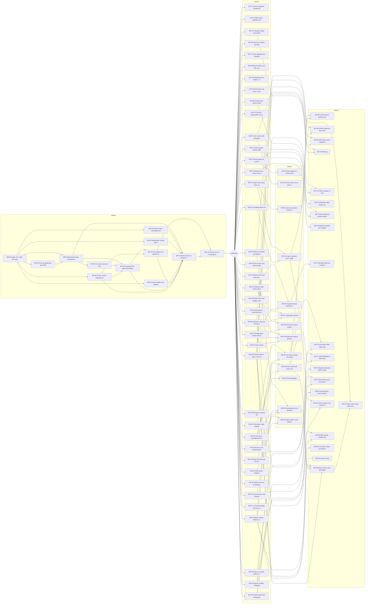

# Playground build plan (parallel work packages)

Read `REQUIREMENTS.md` first (decisions D1-D10, module layout, types). Feature IDs and their status live in `FEATURES.md`; full feature text is in `domains/*.md`. Every package below lists the files it owns exclusively; two packages that run at the same time never own the same file. When a package needs a file owned by an earlier package, ownership passes to it only after the earlier one is merged.

## How the waves work

- **Wave 0** is the foundation refactor. Nothing else starts until WP-12 is merged, because Wave 0 creates every file and slot the later packages fill. Inside Wave 0, packages run in stages (below); a package may start early against the frozen interfaces in `core/types.ts` but merges only after the packages it depends on.
- **Waves 1-3** are feature packages. A package may start as soon as every package in its "Depends on" is merged, even if its wave has not "started". Wave numbers are the earliest possible start, P0 first.
- **Frozen files** (`core/types.ts`, `ui/Playground.tsx`, `actions/index.ts`, `core/gate.ts`, `core/snap.ts`) change only through the orchestrator: optional fields or new slots, announced to every running agent.
- **Sizes**: S about 1 h, M 1.5-3 h, L about 4 h of one Sonnet agent. Two Wave 0 packages are L by choice (noted); every later package is S or M.
- **Risk tiers**: `high` = shared foundation; reviewer traces callers outside the diff and re-runs all playground tests. `normal` = feature code; reviewer runs the acceptance checks. `comment-only` = docs or data; skim.

## Wave 0: foundation

| Stage | Packages (parallel inside a stage) | Starts after | Merge order |
| --- | --- | --- | --- |
| A | WP-01 | nothing | WP-01 |
| B | WP-02, WP-03 (early), WP-05, WP-06, WP-07, WP-09 | WP-01 merged | WP-02 before WP-03; others any order |
| C | WP-04, WP-08, WP-10 (early), WP-11 (early) | WP-03 merged (WP-08 also needs WP-09) | WP-04, WP-08, WP-10, WP-11 |
| D | integration of the early starters | WP-08 merged | WP-10, then WP-11 (rewires the page, deletes engine.ts) |
| E | WP-12 | WP-11 merged | WP-12 |

"Early" means the package starts against the frozen interfaces in `core/types.ts` and runs its vitest and browser checks after rebasing on the packages it depends on. Spine: WP-01 → WP-02 → WP-03 → WP-08 → WP-10 → WP-11 → WP-12, about 15 hours wall-clock with the early starts (about 23 agent-hours if run strictly in sequence). Max parallelism in Wave 0 is 6 (stage B). WP-11 (board) and WP-12 (shell) cannot overlap because both carve `Playground.tsx`; WP-10 does not touch `Playground.tsx` so it can run beside WP-11.

### WP-01: Types, ids, order, tree, geometry

- **Goal**: Freeze the shared types and the pure helpers every other package builds on.
- **Features**: HISTORY-27 (P0), HISTORY-2 (P0), HISTORY-4 (P0), HISTORY-3 (P0), SELECT-40 (P0), ALIGN-33 (P0), HISTORY-40 (P1), HISTORY-41 (P1), SHELL-22 (P0)
- **Owns**: `core/types.ts`, `core/ids.ts`, `core/order.ts`, `core/geom.ts`, `core/tree.ts`, `core/*.test.ts (these modules)`, `dashboard/package.json (add vitest ^3.2.7 devDependency only)`
- **Read-only**: `docs/playground/REQUIREMENTS.md sections 5-7`, `engine.ts (Shape today)`
- **Depends on**: none (stage A)
- **Size**: M, about 2 h
- **Acceptance**:
  - [ ] `core/types.ts` matches REQUIREMENTS section 7 and compiles (`npx tsc --noEmit` in dashboard).
  - [ ] vitest: `between(a,b)` property test (10k random inserts keep strict order, keys stay < 40 chars); `newId` 100k ids unique.
  - [ ] vitest: `absRect` of a child three levels deep equals parent offsets summed; `toLocal(toWorld(p))` round-trips.
  - [ ] `npm test -w @contract/dashboard` runs the new tests and the existing `test/model.test.ts`.
- **Risk**: high. Reviewer traces: Every later package imports these types: check field names against REQUIREMENTS section 7 and the contradictions list; check nothing imports React.
- **Agent brief** (paste as-is):

```text
You are building WP-01 "Types, ids, order, tree, geometry" for the Contract playground in `/Users/bryan/git/HackUTD2026/dashboard/src/playground/`.
Goal: Freeze the shared types and the pure helpers every other package builds on.
Features: HISTORY-27, HISTORY-2, HISTORY-4, HISTORY-3, SELECT-40, ALIGN-33, HISTORY-40, HISTORY-41, SHELL-22. Read each one's section (Interaction, Acceptance, Edge cases) in `docs/playground/domains/alignment.md`, `docs/playground/domains/history.md`, `docs/playground/domains/keys-share-shell.md`, `docs/playground/domains/selection.md`.
Read first: `docs/playground/REQUIREMENTS.md` (sections 5-7) and the WP-01 section of `docs/playground/TASKS.md` (acceptance list); then `CLAUDE.md`.
You own (create or edit only these): core/types.ts, core/ids.ts, core/order.ts, core/geom.ts, core/tree.ts, core/*.test.ts (these modules), dashboard/package.json (add vitest ^3.2.7 devDependency only).
Read-only for you: docs/playground/REQUIREMENTS.md sections 5-7, engine.ts (Shape today).
Already merged before you start: none.
Rules: stay inside `dashboard/src/playground/` and only the files you own (listed above); TypeScript ESM, no new dependencies (vitest is the only test dep, already declared); never edit `core/types.ts`, `ui/Playground.tsx`, `actions/index.ts`, `core/gate.ts`, `core/snap.ts` or another package's files: if a type or seam is missing, stop and report it; no React or DOM in `core/`, `presence/`, `agents/`; every document change goes through `board.exec` / `board.gesture` (never write the store directly); humans win every conflict; no model calls in the browser; keep secrets out of the repo; prefer simple readable code.
Verify: `cd dashboard && npx tsc --noEmit && npx vitest run`; add a `*.test.ts` next to every pure module you add or change. Browser checks are run by the reviewer (`npm run dashboard`, open `#/playground`).
Report (max 150 words): files changed, feature IDs done or partial, tests added and their result, what you did NOT test (list the browser checks), and any seam or type you needed but could not add.
```

### WP-02: Pure op application and LWW

- **Goal**: Implement `applyOp` as a pure, idempotent, order-insensitive function with field-level LWW and tombstones.
- **Features**: HISTORY-35 (P0), HISTORY-36 (P0), AGENT-2 (P0)
- **Owns**: `core/ops.ts`, `core/ops.test.ts`
- **Read-only**: `core/types.ts`, `core/tree.ts`, `core/order.ts`
- **Depends on**: WP-01 (stage B)
- **Size**: M, about 2 h
- **Acceptance**:
  - [ ] vitest: applying the same envelope twice equals applying it once.
  - [ ] vitest: two `set` ops on different fields of one shape from two actors both survive in any order; same field resolves by (lamport, actor).
  - [ ] vitest: `remove` then `set` keeps the tombstone (delete wins); `restore` brings back the same id and props.
  - [ ] vitest: `place` into a deleted parent leaves the child at root (no orphan crash).
- **Risk**: high. Reviewer traces: Read HISTORY "Op semantics" and "Per-actor undo scoping"; confirm stamps are recorded per field including `place` and `deleted`.
- **Agent brief** (paste as-is):

```text
You are building WP-02 "Pure op application and LWW" for the Contract playground in `/Users/bryan/git/HackUTD2026/dashboard/src/playground/`.
Goal: Implement `applyOp` as a pure, idempotent, order-insensitive function with field-level LWW and tombstones.
Features: HISTORY-35, HISTORY-36, AGENT-2. Read each one's section (Interaction, Acceptance, Edge cases) in `docs/playground/domains/history.md`, `docs/playground/domains/multiplayer-agents.md`.
Read first: `docs/playground/REQUIREMENTS.md` (sections 5-7) and the WP-02 section of `docs/playground/TASKS.md` (acceptance list); then `CLAUDE.md`.
You own (create or edit only these): core/ops.ts, core/ops.test.ts.
Read-only for you: core/types.ts, core/tree.ts, core/order.ts.
Already merged before you start: WP-01.
Rules: stay inside `dashboard/src/playground/` and only the files you own (listed above); TypeScript ESM, no new dependencies (vitest is the only test dep, already declared); never edit `core/types.ts`, `ui/Playground.tsx`, `actions/index.ts`, `core/gate.ts`, `core/snap.ts` or another package's files: if a type or seam is missing, stop and report it; no React or DOM in `core/`, `presence/`, `agents/`; every document change goes through `board.exec` / `board.gesture` (never write the store directly); humans win every conflict; no model calls in the browser; keep secrets out of the repo; prefer simple readable code.
Verify: `cd dashboard && npx tsc --noEmit && npx vitest run`; add a `*.test.ts` next to every pure module you add or change. Browser checks are run by the reviewer (`npm run dashboard`, open `#/playground`).
Report (max 150 words): files changed, feature IDs done or partial, tests added and their result, what you did NOT test (list the browser checks), and any seam or type you needed but could not add.
```

### WP-03: Document store, transactions and React hooks

- **Goal**: Build the `DocStore` outside React with transactions, gesture frames, a change feed and `useSyncExternalStore` hooks.
- **Features**: HISTORY-1 (P0), HISTORY-5 (P0), HISTORY-7 (P0), HISTORY-9 (P0), HISTORY-34 (P1), HISTORY-39 (P0)
- **Owns**: `core/store.ts`, `core/react.ts`, `core/store.test.ts`
- **Read-only**: `core/types.ts`, `core/ops.ts`, `core/tree.ts`, `core/ids.ts`
- **Depends on**: WP-01, WP-02 (stage B)
- **Size**: M, about 3 h
- **Note**: May start in stage B against the `applyOp` signature in types.ts; merge after WP-02.
- **Acceptance**:
  - [ ] vitest: `begin` + 60 `apply` calls + `commit` produces exactly one Tx with an inverse that restores the base values.
  - [ ] vitest: `abort` restores base values and records nothing; `commit` with zero net change returns null.
  - [ ] vitest: a 100-op dispatch notifies subscribers once (microtask batching); `subscribeShape(id)` fires only for that id.
  - [ ] vitest: `snapshot()` then `load()` round-trips shapes, lamport and actor seqs; `log()` is append-only.
- **Risk**: high. Reviewer traces: Trace how `rev` bumps and how `onChange` feeds spatial index and events; no React import outside `core/react.ts`.
- **Agent brief** (paste as-is):

```text
You are building WP-03 "Document store, transactions and React hooks" for the Contract playground in `/Users/bryan/git/HackUTD2026/dashboard/src/playground/`.
Goal: Build the `DocStore` outside React with transactions, gesture frames, a change feed and `useSyncExternalStore` hooks.
Features: HISTORY-1, HISTORY-5, HISTORY-7, HISTORY-9, HISTORY-34, HISTORY-39. Read each one's section (Interaction, Acceptance, Edge cases) in `docs/playground/domains/history.md`.
Read first: `docs/playground/REQUIREMENTS.md` (sections 5-7) and the WP-03 section of `docs/playground/TASKS.md` (acceptance list); then `CLAUDE.md`.
You own (create or edit only these): core/store.ts, core/react.ts, core/store.test.ts.
Read-only for you: core/types.ts, core/ops.ts, core/tree.ts, core/ids.ts.
Already merged before you start: WP-01, WP-02. May start in stage B against the `applyOp` signature in types.ts; merge after WP-02.
Rules: stay inside `dashboard/src/playground/` and only the files you own (listed above); TypeScript ESM, no new dependencies (vitest is the only test dep, already declared); never edit `core/types.ts`, `ui/Playground.tsx`, `actions/index.ts`, `core/gate.ts`, `core/snap.ts` or another package's files: if a type or seam is missing, stop and report it; no React or DOM in `core/`, `presence/`, `agents/`; every document change goes through `board.exec` / `board.gesture` (never write the store directly); humans win every conflict; no model calls in the browser; keep secrets out of the repo; prefer simple readable code.
Verify: `cd dashboard && npx tsc --noEmit && npx vitest run`; add a `*.test.ts` next to every pure module you add or change. Browser checks are run by the reviewer (`npm run dashboard`, open `#/playground`).
Report (max 150 words): files changed, feature IDs done or partial, tests added and their result, what you did NOT test (list the browser checks), and any seam or type you needed but could not add.
```

### WP-04: Per-actor undo and redo

- **Goal**: Give every actor its own undo/redo stack whose undo emits new ops and skips fields another actor changed since.
- **Features**: HISTORY-10 (P0), HISTORY-11 (P0), HISTORY-12 (P0), HISTORY-8 (P1), HISTORY-13 (P1), HISTORY-14 (P1), HISTORY-15 (P1), AGENT-24 (P1)
- **Owns**: `core/undo.ts`, `core/undo.test.ts`
- **Read-only**: `core/types.ts`, `core/store.ts`, `core/ops.ts`
- **Depends on**: WP-03 (stage C)
- **Size**: M, about 2.5 h
- **Acceptance**:
  - [ ] vitest: human moves A, agent recolours A, human undo moves A back and keeps the agent colour.
  - [ ] vitest: undo of a create removes the shape; redo restores the same id; undo of delete restores children and order.
  - [ ] vitest: nudge runs with the same coalesce key within 1 s become one entry; `revertTx(by, txId)` applies the same filter.
  - [ ] vitest: undo with every field superseded returns false and reports the superseding actor.
- **Risk**: high. Reviewer traces: Read HISTORY "Per-actor undo scoping"; check redo after skip, and that undo never writes fields whose stamp changed.
- **Agent brief** (paste as-is):

```text
You are building WP-04 "Per-actor undo and redo" for the Contract playground in `/Users/bryan/git/HackUTD2026/dashboard/src/playground/`.
Goal: Give every actor its own undo/redo stack whose undo emits new ops and skips fields another actor changed since.
Features: HISTORY-10, HISTORY-11, HISTORY-12, HISTORY-8, HISTORY-13, HISTORY-14, HISTORY-15, AGENT-24. Read each one's section (Interaction, Acceptance, Edge cases) in `docs/playground/domains/history.md`, `docs/playground/domains/multiplayer-agents.md`.
Read first: `docs/playground/REQUIREMENTS.md` (sections 5-7) and the WP-04 section of `docs/playground/TASKS.md` (acceptance list); then `CLAUDE.md`.
You own (create or edit only these): core/undo.ts, core/undo.test.ts.
Read-only for you: core/types.ts, core/store.ts, core/ops.ts.
Already merged before you start: WP-03.
Rules: stay inside `dashboard/src/playground/` and only the files you own (listed above); TypeScript ESM, no new dependencies (vitest is the only test dep, already declared); never edit `core/types.ts`, `ui/Playground.tsx`, `actions/index.ts`, `core/gate.ts`, `core/snap.ts` or another package's files: if a type or seam is missing, stop and report it; no React or DOM in `core/`, `presence/`, `agents/`; every document change goes through `board.exec` / `board.gesture` (never write the store directly); humans win every conflict; no model calls in the browser; keep secrets out of the repo; prefer simple readable code.
Verify: `cd dashboard && npx tsc --noEmit && npx vitest run`; add a `*.test.ts` next to every pure module you add or change. Browser checks are run by the reviewer (`npm run dashboard`, open `#/playground`).
Report (max 150 words): files changed, feature IDs done or partial, tests added and their result, what you did NOT test (list the browser checks), and any seam or type you needed but could not add.
```

### WP-05: Camera store, coordinate math and rAF scheduler

- **Goal**: Move the camera out of React into a store with pure coordinate helpers and one shared rAF loop that sleeps when idle.
- **Features**: CANVAS-1 (P0), CANVAS-2 (P0), CANVAS-4 (P0), CANVAS-34 (P0), CANVAS-39 (P0)
- **Owns**: `core/camera.ts`, `core/raf.ts`, `core/goto.ts (stub: instant jump, frozen signature `goTo(target, opts?)`)`, `core/camera.test.ts`
- **Read-only**: `core/types.ts`, `core/geom.ts`
- **Depends on**: WP-01 (stage B)
- **Size**: M, about 2.5 h
- **Acceptance**:
  - [ ] vitest: `screenToWorld(worldToScreen(p))` round-trips within 1e-9 for z in [0.02, 256]; `zoomAt` keeps the pointer world point fixed.
  - [ ] vitest: `fitRect` of a rect larger than the view yields z < 1; z clamps to [0.02, 256] without x/y drift.
  - [ ] vitest (fake rAF): two `setCam` calls in one frame flush once; scheduler stops when no subscriber is dirty.
- **Risk**: normal. Reviewer traces: Check the scheduler pauses on `document.hidden` and clamps dt to 100 ms on return.
- **Agent brief** (paste as-is):

```text
You are building WP-05 "Camera store, coordinate math and rAF scheduler" for the Contract playground in `/Users/bryan/git/HackUTD2026/dashboard/src/playground/`.
Goal: Move the camera out of React into a store with pure coordinate helpers and one shared rAF loop that sleeps when idle.
Features: CANVAS-1, CANVAS-2, CANVAS-4, CANVAS-34, CANVAS-39. Read each one's section (Interaction, Acceptance, Edge cases) in `docs/playground/domains/canvas.md`.
Read first: `docs/playground/REQUIREMENTS.md` (sections 5-7) and the WP-05 section of `docs/playground/TASKS.md` (acceptance list); then `CLAUDE.md`.
You own (create or edit only these): core/camera.ts, core/raf.ts, core/goto.ts (stub: instant jump, frozen signature `goTo(target, opts?)`), core/camera.test.ts.
Read-only for you: core/types.ts, core/geom.ts.
Already merged before you start: WP-01.
Rules: stay inside `dashboard/src/playground/` and only the files you own (listed above); TypeScript ESM, no new dependencies (vitest is the only test dep, already declared); never edit `core/types.ts`, `ui/Playground.tsx`, `actions/index.ts`, `core/gate.ts`, `core/snap.ts` or another package's files: if a type or seam is missing, stop and report it; no React or DOM in `core/`, `presence/`, `agents/`; every document change goes through `board.exec` / `board.gesture` (never write the store directly); humans win every conflict; no model calls in the browser; keep secrets out of the repo; prefer simple readable code.
Verify: `cd dashboard && npx tsc --noEmit && npx vitest run`; add a `*.test.ts` next to every pure module you add or change. Browser checks are run by the reviewer (`npm run dashboard`, open `#/playground`).
Report (max 150 words): files changed, feature IDs done or partial, tests added and their result, what you did NOT test (list the browser checks), and any seam or type you needed but could not add.
```

### WP-06: Spatial grid, hit-test and snap facade

- **Goal**: Provide the shared spatial index, the single hit-test, and a frozen `core/snap.ts` facade with no-op implementations.
- **Features**: CANVAS-19 (P0), SELECT-47 (P1), ALIGN-9 (P0), CANVAS-21 (P0)
- **Owns**: `core/spatial.ts`, `core/hittest.ts`, `core/snap.ts (facade, frozen after this WP)`, `core/snap/move.ts (stub)`, `core/snap/resize.ts (stub)`, `core/spatial.test.ts`, `core/hittest.test.ts`
- **Read-only**: `core/types.ts`, `core/tree.ts`, `core/geom.ts`
- **Depends on**: WP-01 (stage B)
- **Size**: M, about 3 h
- **Note**: Snap facade signature: `snapMove(box: Rect, ctx: SnapCtx): SnapResult`, `snapResize(box, handle, ctx)`, `snapCreate(pt, ctx)`; `SnapCtx = { actor, ignore: Set<ShapeId>, thresholdWorld, parent: ShapeId|null }`; `SnapResult = { dx, dy, lines, gaps }`; plus `snapResult` store for guides.
- **Acceptance**:
  - [ ] vitest: `queryRect` equals a brute-force scan for 1k random rects over 5k shapes; 5k-shape query < 0.5 ms.
  - [ ] vitest: a point outside an ellipse but inside its box misses; tolerance is `4/z` world units; hidden never hit, locked skipped unless asked.
  - [ ] vitest: default hit returns the top-level child of a frame; `deep: true` returns the deepest descendant; topmost sibling wins.
  - [ ] `snapMove/snapResize/snapCreate` exist with the signatures in this WP brief and return the input unchanged.
- **Risk**: normal. Reviewer traces: Check the index updates from `DocStore.onChange` (not per render) and that hit order follows `flatten` order.
- **Agent brief** (paste as-is):

```text
You are building WP-06 "Spatial grid, hit-test and snap facade" for the Contract playground in `/Users/bryan/git/HackUTD2026/dashboard/src/playground/`.
Goal: Provide the shared spatial index, the single hit-test, and a frozen `core/snap.ts` facade with no-op implementations.
Features: CANVAS-19, SELECT-47, ALIGN-9, CANVAS-21. Read each one's section (Interaction, Acceptance, Edge cases) in `docs/playground/domains/alignment.md`, `docs/playground/domains/canvas.md`, `docs/playground/domains/selection.md`.
Read first: `docs/playground/REQUIREMENTS.md` (sections 5-7) and the WP-06 section of `docs/playground/TASKS.md` (acceptance list); then `CLAUDE.md`.
You own (create or edit only these): core/spatial.ts, core/hittest.ts, core/snap.ts (facade, frozen after this WP), core/snap/move.ts (stub), core/snap/resize.ts (stub), core/spatial.test.ts, core/hittest.test.ts.
Read-only for you: core/types.ts, core/tree.ts, core/geom.ts.
Already merged before you start: WP-01. Snap facade signature: `snapMove(box: Rect, ctx: SnapCtx): SnapResult`, `snapResize(box, handle, ctx)`, `snapCreate(pt, ctx)`; `SnapCtx = { actor, ignore: Set<ShapeId>, thresholdWorld, parent: ShapeId|null }`; `SnapResult = { dx, dy, lines, gaps }`; plus `snapResult` store for guides.
Rules: stay inside `dashboard/src/playground/` and only the files you own (listed above); TypeScript ESM, no new dependencies (vitest is the only test dep, already declared); never edit `core/types.ts`, `ui/Playground.tsx`, `actions/index.ts`, `core/gate.ts`, `core/snap.ts` or another package's files: if a type or seam is missing, stop and report it; no React or DOM in `core/`, `presence/`, `agents/`; every document change goes through `board.exec` / `board.gesture` (never write the store directly); humans win every conflict; no model calls in the browser; keep secrets out of the repo; prefer simple readable code.
Verify: `cd dashboard && npx tsc --noEmit && npx vitest run`; add a `*.test.ts` next to every pure module you add or change. Browser checks are run by the reviewer (`npm run dashboard`, open `#/playground`).
Report (max 150 words): files changed, feature IDs done or partial, tests added and their result, what you did NOT test (list the browser checks), and any seam or type you needed but could not add.
```

### WP-07: Action registry, key dispatcher, prefs, flags, toast API

- **Goal**: Create the one action registry and keydown dispatcher with focus contexts, plus the prefs, flags and toast stores.
- **Features**: KEYS-1 (P0), KEYS-2 (P0), KEYS-6 (P0), KEYS-18 (P1), SHELL-29 (P0), SHELL-24 (P0)
- **Owns**: `core/actions.ts`, `core/keys.ts`, `core/prefs.ts`, `core/flags.ts`, `core/toast.ts`, `actions/index.ts (frozen after this WP)`, `actions/*.ts (empty `export const actions: Action[] = []` files for every id group in REQUIREMENTS)`, `core/keys.test.ts`
- **Read-only**: `core/types.ts`
- **Depends on**: WP-01 (stage B)
- **Size**: M, about 2.5 h
- **Acceptance**:
  - [ ] vitest: no two actions share a binding in the same context; `Mod` renders as the platform symbol.
  - [ ] vitest: dispatcher ignores keys when the context is `text-edit` or `chat` unless the action lists that context; punctuation matches by `e.code`.
  - [ ] vitest: prefs survive a corrupt JSON value (fallback to defaults) and private-mode exceptions.
- **Risk**: normal. Reviewer traces: Check the browser-clash list (Cmd+D/G/[/]/=/-/0/K/R) is preventDefault-ed only in canvas context.
- **Agent brief** (paste as-is):

```text
You are building WP-07 "Action registry, key dispatcher, prefs, flags, toast API" for the Contract playground in `/Users/bryan/git/HackUTD2026/dashboard/src/playground/`.
Goal: Create the one action registry and keydown dispatcher with focus contexts, plus the prefs, flags and toast stores.
Features: KEYS-1, KEYS-2, KEYS-6, KEYS-18, SHELL-29, SHELL-24. Read each one's section (Interaction, Acceptance, Edge cases) in `docs/playground/domains/keys-share-shell.md`.
Read first: `docs/playground/REQUIREMENTS.md` (sections 5-7) and the WP-07 section of `docs/playground/TASKS.md` (acceptance list); then `CLAUDE.md`.
You own (create or edit only these): core/actions.ts, core/keys.ts, core/prefs.ts, core/flags.ts, core/toast.ts, actions/index.ts (frozen after this WP), actions/*.ts (empty `export const actions: Action[] = []` files for every id group in REQUIREMENTS), core/keys.test.ts.
Read-only for you: core/types.ts.
Already merged before you start: WP-01.
Rules: stay inside `dashboard/src/playground/` and only the files you own (listed above); TypeScript ESM, no new dependencies (vitest is the only test dep, already declared); never edit `core/types.ts`, `ui/Playground.tsx`, `actions/index.ts`, `core/gate.ts`, `core/snap.ts` or another package's files: if a type or seam is missing, stop and report it; no React or DOM in `core/`, `presence/`, `agents/`; every document change goes through `board.exec` / `board.gesture` (never write the store directly); humans win every conflict; no model calls in the browser; keep secrets out of the repo; prefer simple readable code.
Verify: `cd dashboard && npx tsc --noEmit && npx vitest run`; add a `*.test.ts` next to every pure module you add or change. Browser checks are run by the reviewer (`npm run dashboard`, open `#/playground`).
Report (max 150 words): files changed, feature IDs done or partial, tests added and their result, what you did NOT test (list the browser checks), and any seam or type you needed but could not add.
```

### WP-08: Command API, gate and window.board shim

- **Goal**: Implement `createBoard()` with `exec(batch)`, `gesture()`, undo/redo/revert and the gate, and make `window.board` a thin shim over it.
- **Features**: AGENT-1 (P0), SELECT-46 (P0), AGENT-4 (P1)
- **Owns**: `core/commands.ts`, `core/gate.ts (frozen after this WP)`, `core/devtools.ts`, `core/{bench,stress,perf}.ts (no-op stubs wired into window.board)`, `core/commands.test.ts`
- **Read-only**: `core/types.ts`, `core/store.ts`, `core/undo.ts`, `core/tree.ts`, `core/order.ts`, `core/events.ts (interface)`, `presence/locks.ts, presence/claims.ts (stubs from WP-09)`
- **Depends on**: WP-03, WP-04, WP-09 (stage C)
- **Size**: M, about 3 h
- **Acceptance**:
  - [ ] vitest: one batch creates a frame and 10 children via `$0` back-references; subscribers see one change.
  - [ ] vitest: an invalid command in an `atomic` batch rolls back the whole batch; re-sending the same `opId` returns `duplicate: true` and changes nothing.
  - [ ] vitest: `shape.reparent` with `keepWorld` keeps the absolute position; `shape.group` creates a group whose box is the union.
  - [ ] vitest: the gate stub allows everything; replacing `locks.check` with a deny makes agent commands fail with `locked` and human commands succeed.
  - [ ] Console: `board.exec({...})` works; legacy `board.addShape/updateShape/shapes()` still work.
- **Risk**: high. Reviewer traces: Trace every Command to the ops it emits and the BoardEvents it fires; confirm gestures use store transactions and the gate runs per command.
- **Agent brief** (paste as-is):

```text
You are building WP-08 "Command API, gate and window.board shim" for the Contract playground in `/Users/bryan/git/HackUTD2026/dashboard/src/playground/`.
Goal: Implement `createBoard()` with `exec(batch)`, `gesture()`, undo/redo/revert and the gate, and make `window.board` a thin shim over it.
Features: AGENT-1, SELECT-46, AGENT-4. Read each one's section (Interaction, Acceptance, Edge cases) in `docs/playground/domains/multiplayer-agents.md`, `docs/playground/domains/selection.md`.
Read first: `docs/playground/REQUIREMENTS.md` (sections 5-7) and the WP-08 section of `docs/playground/TASKS.md` (acceptance list); then `CLAUDE.md`.
You own (create or edit only these): core/commands.ts, core/gate.ts (frozen after this WP), core/devtools.ts, core/{bench,stress,perf}.ts (no-op stubs wired into window.board), core/commands.test.ts.
Read-only for you: core/types.ts, core/store.ts, core/undo.ts, core/tree.ts, core/order.ts, core/events.ts (interface), presence/locks.ts, presence/claims.ts (stubs from WP-09).
Already merged before you start: WP-03, WP-04, WP-09.
Rules: stay inside `dashboard/src/playground/` and only the files you own (listed above); TypeScript ESM, no new dependencies (vitest is the only test dep, already declared); never edit `core/types.ts`, `ui/Playground.tsx`, `actions/index.ts`, `core/gate.ts`, `core/snap.ts` or another package's files: if a type or seam is missing, stop and report it; no React or DOM in `core/`, `presence/`, `agents/`; every document change goes through `board.exec` / `board.gesture` (never write the store directly); humans win every conflict; no model calls in the browser; keep secrets out of the repo; prefer simple readable code.
Verify: `cd dashboard && npx tsc --noEmit && npx vitest run`; add a `*.test.ts` next to every pure module you add or change. Browser checks are run by the reviewer (`npm run dashboard`, open `#/playground`).
Report (max 150 words): files changed, feature IDs done or partial, tests added and their result, what you did NOT test (list the browser checks), and any seam or type you needed but could not add.
```

### WP-09: Events, actors, selection and presence bus

- **Goal**: Add the event bus, actor registry, per-actor selection and the ephemeral presence bus with lock and claim stubs.
- **Features**: AGENT-3 (P0), AGENT-5 (P0), SELECT-1 (P0), MULTI-18 (P0)
- **Owns**: `core/events.ts`, `core/actors.ts`, `presence/bus.ts`, `presence/selection.ts`, `presence/locks.ts (stub: `check` allows)`, `presence/claims.ts (stub: `check` allows)`, `presence/*.test.ts, core/events.test.ts`
- **Read-only**: `core/types.ts`, `core/store.ts`
- **Depends on**: WP-01 (stage B)
- **Size**: M, about 2.5 h
- **Acceptance**:
  - [ ] vitest: a subscriber with `{kinds:["shape.updated"], shapeIds:[a]}` receives only matching events in seq order.
  - [ ] vitest: presence publishes from 50 actors in one frame are delivered as one batch; selection for actor A never affects actor B.
  - [ ] vitest: actor ids follow `${kind}-${short}`; colours are assigned without repeats for the first 12.
- **Risk**: high. Reviewer traces: Confirm nothing presence-related is written to the DocStore and that selection is not undoable.
- **Agent brief** (paste as-is):

```text
You are building WP-09 "Events, actors, selection and presence bus" for the Contract playground in `/Users/bryan/git/HackUTD2026/dashboard/src/playground/`.
Goal: Add the event bus, actor registry, per-actor selection and the ephemeral presence bus with lock and claim stubs.
Features: AGENT-3, AGENT-5, SELECT-1, MULTI-18. Read each one's section (Interaction, Acceptance, Edge cases) in `docs/playground/domains/multiplayer-agents.md`, `docs/playground/domains/selection.md`.
Read first: `docs/playground/REQUIREMENTS.md` (sections 5-7) and the WP-09 section of `docs/playground/TASKS.md` (acceptance list); then `CLAUDE.md`.
You own (create or edit only these): core/events.ts, core/actors.ts, presence/bus.ts, presence/selection.ts, presence/locks.ts (stub: `check` allows), presence/claims.ts (stub: `check` allows), presence/*.test.ts, core/events.test.ts.
Read-only for you: core/types.ts, core/store.ts.
Already merged before you start: WP-01.
Rules: stay inside `dashboard/src/playground/` and only the files you own (listed above); TypeScript ESM, no new dependencies (vitest is the only test dep, already declared); never edit `core/types.ts`, `ui/Playground.tsx`, `actions/index.ts`, `core/gate.ts`, `core/snap.ts` or another package's files: if a type or seam is missing, stop and report it; no React or DOM in `core/`, `presence/`, `agents/`; every document change goes through `board.exec` / `board.gesture` (never write the store directly); humans win every conflict; no model calls in the browser; keep secrets out of the repo; prefer simple readable code.
Verify: `cd dashboard && npx tsc --noEmit && npx vitest run`; add a `*.test.ts` next to every pure module you add or change. Browser checks are run by the reviewer (`npm run dashboard`, open `#/playground`).
Report (max 150 words): files changed, feature IDs done or partial, tests added and their result, what you did NOT test (list the browser checks), and any seam or type you needed but could not add.
```

### WP-10: Port engine.ts to agents/ on the command API

- **Goal**: Turn today's engine into the scripted driver, templates, choreographer and a minimal runtime that act only through `Board` and presence.
- **Features**: HISTORY-38 (P0), AGENT-6 (P0), AGENT-23 (P0), AGENT-27 (P1)
- **Owns**: `agents/runtime.ts`, `agents/choreographer.ts`, `agents/scripted.ts`, `agents/templates.ts`, `agents/intent.ts`, `agents/*.test.ts`
- **Read-only**: `core/types.ts`, `core/commands.ts`, `presence/bus.ts`, `core/actors.ts`
- **Depends on**: WP-08, WP-09 (stage C)
- **Size**: L, about 4 h
- **Note**: May start in stage C against the `Board` interface; merges after WP-08. L kept whole: it is mostly moving existing code; splitting it would put two agents in the same 468-line file.
- **Acceptance**:
  - [ ] vitest (no React): spawn 3 scripted agents against a fresh board; after the build loop each frame has children with `parent = frameId` and every op has `actor = agent-*`.
  - [ ] vitest: `board.undo("agent-x")` removes that agent's last template build in one step.
  - [ ] vitest: choreographer with a seeded RNG produces identical cursor paths twice; a 40-layer plan finishes in <= 20 s simulated at 1x.
  - [ ] `grep -n setShapes agents/` finds nothing; `engine.ts` is left untouched (WP-11 deletes it when it rewires the page).
- **Risk**: high. Reviewer traces: Diff behaviour against the old engine.ts: templates, parseEdit, typing per character (one tx per text layer), slot choice; check no React import.
- **Agent brief** (paste as-is):

```text
You are building WP-10 "Port engine.ts to agents/ on the command API" for the Contract playground in `/Users/bryan/git/HackUTD2026/dashboard/src/playground/`.
Goal: Turn today's engine into the scripted driver, templates, choreographer and a minimal runtime that act only through `Board` and presence.
Features: HISTORY-38, AGENT-6, AGENT-23, AGENT-27. Read each one's section (Interaction, Acceptance, Edge cases) in `docs/playground/domains/history.md`, `docs/playground/domains/multiplayer-agents.md`.
Read first: `docs/playground/REQUIREMENTS.md` (sections 5-7) and the WP-10 section of `docs/playground/TASKS.md` (acceptance list); then `CLAUDE.md`.
You own (create or edit only these): agents/runtime.ts, agents/choreographer.ts, agents/scripted.ts, agents/templates.ts, agents/intent.ts, agents/*.test.ts.
Read-only for you: core/types.ts, core/commands.ts, presence/bus.ts, core/actors.ts.
Already merged before you start: WP-08, WP-09. May start in stage C against the `Board` interface; merges after WP-08. L kept whole: it is mostly moving existing code; splitting it would put two agents in the same 468-line file.
Rules: stay inside `dashboard/src/playground/` and only the files you own (listed above); TypeScript ESM, no new dependencies (vitest is the only test dep, already declared); never edit `core/types.ts`, `ui/Playground.tsx`, `actions/index.ts`, `core/gate.ts`, `core/snap.ts` or another package's files: if a type or seam is missing, stop and report it; no React or DOM in `core/`, `presence/`, `agents/`; every document change goes through `board.exec` / `board.gesture` (never write the store directly); humans win every conflict; no model calls in the browser; keep secrets out of the repo; prefer simple readable code.
Verify: `cd dashboard && npx tsc --noEmit && npx vitest run`; add a `*.test.ts` next to every pure module you add or change. Browser checks are run by the reviewer (`npm run dashboard`, open `#/playground`).
Report (max 150 words): files changed, feature IDs done or partial, tests added and their result, what you did NOT test (list the browser checks), and any seam or type you needed but could not add.
```

### WP-11: Board carve-out: viewport, nested rendering, gesture skeleton

- **Goal**: Move the board out of Playground.tsx into ui/board/ rendering nested shapes from the store, with the gesture pipeline skeleton and overlay slots.
- **Features**: CANVAS-15 (P1)
- **Owns**: `ui/board/Board.tsx`, `ui/board/ShapeView.tsx`, `render/style.ts`, `ui/text/TextView.tsx (initial)`, `ui/gestures/pipeline.ts (skeleton)`, `ui/gestures/{select,move,resize,create,marquee,pan,text,comment,rotate}.ts (ported behaviour; rotate empty)`, `ui/board/{DotGrid.tsx,wheel.ts,culling.ts,cursor.ts} (stubs: today's grid, today's wheel, `isVisible` = true, `cursorFor` = default)`, `ui/overlays/*.tsx (empty slots: SelectionBox, Readout, Hover, Marquee, SmartGuides, RemoteSelections, Claims, OffscreenChips, Measure)`, `styles/board.css`, `engine.ts (delete after switching Playground.tsx to `agents/runtime.ts`)`
- **Read-only**: `core/types.ts`, `core/camera.ts`, `core/raf.ts`, `core/hittest.ts`, `core/snap.ts`, `core/react.ts`, `core/commands.ts`, `presence/selection.ts`, `Playground.tsx (source to carve)`
- **Depends on**: WP-03, WP-05, WP-06, WP-07, WP-08, WP-09, WP-10 (stage C)
- **Size**: L, about 4 h
- **Note**: Implements decision D5 (the CANVAS-33 renderer decision); the CANVAS-33 benchmark is WP-32. Starts in stage C against frozen interfaces; merges after WP-08, WP-09 and WP-10.
- **Acceptance**:
  - [ ] Browser: today's behaviours still work: draw frame/rect/ellipse/text, move, corner resize, delete, pan, zoom, comment tool.
  - [ ] Browser: a frame built by an agent renders children nested in its DOM node and clipped; moving the frame moves children.
  - [ ] React Profiler: wheel zoom causes zero Board re-renders; `render/style.ts` renders fills, strokes, radius, opacity, effects, rotation, clip and all text fields.
  - [ ] `npx tsc --noEmit` passes; Playground.tsx no longer contains pointer or render code for shapes.
- **Risk**: high. Reviewer traces: Check every gesture goes through `board.gesture` (no store writes), the overlay layer is screen-space, and slots are mounted.
- **Agent brief** (paste as-is):

```text
You are building WP-11 "Board carve-out: viewport, nested rendering, gesture skeleton" for the Contract playground in `/Users/bryan/git/HackUTD2026/dashboard/src/playground/`.
Goal: Move the board out of Playground.tsx into ui/board/ rendering nested shapes from the store, with the gesture pipeline skeleton and overlay slots.
Features: CANVAS-15. Read each one's section (Interaction, Acceptance, Edge cases) in `docs/playground/domains/canvas.md`.
Read first: `docs/playground/REQUIREMENTS.md` (sections 5-7) and the WP-11 section of `docs/playground/TASKS.md` (acceptance list); then `CLAUDE.md`.
You own (create or edit only these): ui/board/Board.tsx, ui/board/ShapeView.tsx, render/style.ts, ui/text/TextView.tsx (initial), ui/gestures/pipeline.ts (skeleton), ui/gestures/{select,move,resize,create,marquee,pan,text,comment,rotate}.ts (ported behaviour; rotate empty), ui/board/{DotGrid.tsx,wheel.ts,culling.ts,cursor.ts} (stubs: today's grid, today's wheel, `isVisible` = true, `cursorFor` = default), ui/overlays/*.tsx (empty slots: SelectionBox, Readout, Hover, Marquee, SmartGuides, RemoteSelections, Claims, OffscreenChips, Measure), styles/board.css, engine.ts (delete after switching Playground.tsx to `agents/runtime.ts`).
Read-only for you: core/types.ts, core/camera.ts, core/raf.ts, core/hittest.ts, core/snap.ts, core/react.ts, core/commands.ts, presence/selection.ts, Playground.tsx (source to carve).
Already merged before you start: WP-03, WP-05, WP-06, WP-07, WP-08, WP-09, WP-10. Implements decision D5 (the CANVAS-33 renderer decision); the CANVAS-33 benchmark is WP-32. Starts in stage C against frozen interfaces; merges after WP-08, WP-09 and WP-10.
Rules: stay inside `dashboard/src/playground/` and only the files you own (listed above); TypeScript ESM, no new dependencies (vitest is the only test dep, already declared); never edit `core/types.ts`, `ui/Playground.tsx`, `actions/index.ts`, `core/gate.ts`, `core/snap.ts` or another package's files: if a type or seam is missing, stop and report it; no React or DOM in `core/`, `presence/`, `agents/`; every document change goes through `board.exec` / `board.gesture` (never write the store directly); humans win every conflict; no model calls in the browser; keep secrets out of the repo; prefer simple readable code.
Verify: `cd dashboard && npx tsc --noEmit && npx vitest run`; add a `*.test.ts` next to every pure module you add or change. Browser checks are run by the reviewer (`npm run dashboard`, open `#/playground`).
Report (max 150 words): files changed, feature IDs done or partial, tests added and their result, what you did NOT test (list the browser checks), and any seam or type you needed but could not add.
```

### WP-12: Shell carve-out: composition root, slots, style split

- **Goal**: Make `ui/Playground.tsx` the composition root, split the chrome into shell components and empty slots, and split the CSS with tokens.
- **Features**: SHELL-6 (P0)
- **Owns**: `Playground.tsx (one-line re-export)`, `ui/Playground.tsx (frozen after this WP)`, `ui/shell/{TopBar,Toolbar,Panels,Toasts,ContextMenu,Dialog,ErrorBoundary,Tooltip,FollowBanner}.tsx`, `ui/chat/ChatPanel.tsx (moved)`, `ui/{PresenceList,AgentsPanel,Cursors,ZoomMenu,CommandPalette,DebugHud,Minimap,DemoBar,HelpOverlay,Present}.tsx (slots)`, `ui/layers/LayersPanel.tsx, ui/inspector/Inspector.tsx + sections/{Align,Layout,Layer,Fill,Stroke,Effects,Text}.tsx (slots)`, `ui/comments/{Pins,PinPopover,CommentList}.tsx (slots)`, `styles/tokens.css, styles/base.css, styles/*.css (split of playground.css)`, `ChatPanel.tsx, playground.css (delete after move)`
- **Read-only**: `core/types.ts`, `ui/board/Board.tsx`, `agents/runtime.ts`, `core/*`
- **Depends on**: WP-10, WP-11 (stage E)
- **Size**: M, about 2.5 h
- **Acceptance**:
  - [ ] Browser: the page looks as before (light board, left chat/layers, right panel, top bar); every slot renders without errors.
  - [ ] Every colour in styles/*.css comes from a `--pg-*` token in `styles/tokens.css`.
  - [ ] `ui/Playground.tsx` has no business logic beyond wiring (< 200 lines).
- **Risk**: high. Reviewer traces: Check the slot list matches REQUIREMENTS section 6 so Wave 1 never needs to touch ui/Playground.tsx.
- **Agent brief** (paste as-is):

```text
You are building WP-12 "Shell carve-out: composition root, slots, style split" for the Contract playground in `/Users/bryan/git/HackUTD2026/dashboard/src/playground/`.
Goal: Make `ui/Playground.tsx` the composition root, split the chrome into shell components and empty slots, and split the CSS with tokens.
Features: SHELL-6. Read each one's section (Interaction, Acceptance, Edge cases) in `docs/playground/domains/keys-share-shell.md`.
Read first: `docs/playground/REQUIREMENTS.md` (sections 5-7) and the WP-12 section of `docs/playground/TASKS.md` (acceptance list); then `CLAUDE.md`.
You own (create or edit only these): Playground.tsx (one-line re-export), ui/Playground.tsx (frozen after this WP), ui/shell/{TopBar,Toolbar,Panels,Toasts,ContextMenu,Dialog,ErrorBoundary,Tooltip,FollowBanner}.tsx, ui/chat/ChatPanel.tsx (moved), ui/{PresenceList,AgentsPanel,Cursors,ZoomMenu,CommandPalette,DebugHud,Minimap,DemoBar,HelpOverlay,Present}.tsx (slots), ui/layers/LayersPanel.tsx, ui/inspector/Inspector.tsx + sections/{Align,Layout,Layer,Fill,Stroke,Effects,Text}.tsx (slots), ui/comments/{Pins,PinPopover,CommentList}.tsx (slots), styles/tokens.css, styles/base.css, styles/*.css (split of playground.css), ChatPanel.tsx, playground.css (delete after move).
Read-only for you: core/types.ts, ui/board/Board.tsx, agents/runtime.ts, core/*.
Already merged before you start: WP-10, WP-11.
Rules: stay inside `dashboard/src/playground/` and only the files you own (listed above); TypeScript ESM, no new dependencies (vitest is the only test dep, already declared); never edit `core/types.ts`, `ui/Playground.tsx`, `actions/index.ts`, `core/gate.ts`, `core/snap.ts` or another package's files: if a type or seam is missing, stop and report it; no React or DOM in `core/`, `presence/`, `agents/`; every document change goes through `board.exec` / `board.gesture` (never write the store directly); humans win every conflict; no model calls in the browser; keep secrets out of the repo; prefer simple readable code.
Verify: `cd dashboard && npx tsc --noEmit && npx vitest run`; add a `*.test.ts` next to every pure module you add or change. Browser checks are run by the reviewer (`npm run dashboard`, open `#/playground`).
Report (max 150 words): files changed, feature IDs done or partial, tests added and their result, what you did NOT test (list the browser checks), and any seam or type you needed but could not add.
```

## Wave 1

All Wave 1 packages depend only on Wave 0 (WP-12 merged) and own disjoint files, so all 39 can run at once. In practice review bandwidth limits it: run 8-10 at a time, starting with the packages on the demo path (marked in the concurrency table).

### WP-13: Gesture pipeline, escape ladder, cancel

- **Goal**: Make the pointer pipeline a clean state machine (pressed, drag threshold, mode) with Escape cancel and click-away deselect.
- **Features**: SELECT-9 (P0), SELECT-10 (P0), SELECT-26 (P0)
- **Owns**: `ui/gestures/pipeline.ts`
- **Read-only**: `ui/gestures/*.ts (other modes)`, `core/commands.ts`
- **Depends on**: WP-12
- **Size**: M, about 2 h
- **Acceptance**:
  - [ ] Browser: a click with < 3 px movement never moves a shape; Esc mid-drag restores the exact start position and records no undo entry.
  - [ ] Browser: Esc ladder: closes popover, then exits text edit, then clears selection, then returns to Move tool.
  - [ ] Window blur during a drag aborts the gesture.
- **Risk**: normal. Reviewer traces: Check abort calls `gesture.abort()` and releases soft locks.
- **Agent brief** (paste as-is):

```text
You are building WP-13 "Gesture pipeline, escape ladder, cancel" for the Contract playground in `/Users/bryan/git/HackUTD2026/dashboard/src/playground/`.
Goal: Make the pointer pipeline a clean state machine (pressed, drag threshold, mode) with Escape cancel and click-away deselect.
Features: SELECT-9, SELECT-10, SELECT-26. Read each one's section (Interaction, Acceptance, Edge cases) in `docs/playground/domains/selection.md`.
Read first: `docs/playground/REQUIREMENTS.md` (sections 5-7) and the WP-13 section of `docs/playground/TASKS.md` (acceptance list); then `CLAUDE.md`.
You own (create or edit only these): ui/gestures/pipeline.ts.
Read-only for you: ui/gestures/*.ts (other modes), core/commands.ts.
Already merged before you start: WP-12.
Rules: stay inside `dashboard/src/playground/` and only the files you own (listed above); TypeScript ESM, no new dependencies (vitest is the only test dep, already declared); never edit `core/types.ts`, `ui/Playground.tsx`, `actions/index.ts`, `core/gate.ts`, `core/snap.ts` or another package's files: if a type or seam is missing, stop and report it; no React or DOM in `core/`, `presence/`, `agents/`; every document change goes through `board.exec` / `board.gesture` (never write the store directly); humans win every conflict; no model calls in the browser; keep secrets out of the repo; prefer simple readable code.
Verify: `cd dashboard && npx tsc --noEmit && npx vitest run`; add a `*.test.ts` next to every pure module you add or change. Browser checks are run by the reviewer (`npm run dashboard`, open `#/playground`).
Report (max 150 words): files changed, feature IDs done or partial, tests added and their result, what you did NOT test (list the browser checks), and any seam or type you needed but could not add.
```

### WP-14: Click select, shift/deep select, click hierarchy, double-click enter

- **Goal**: Implement Figma click semantics: topmost container child, Shift toggle, Cmd deep select, double-click to enter groups or edit text.
- **Features**: SELECT-2 (P0), SELECT-3 (P0), SELECT-4 (P0), SELECT-5 (P0), SELECT-6 (P0)
- **Owns**: `ui/gestures/select.ts`
- **Read-only**: `core/hittest.ts`, `presence/selection.ts`, `ui/gestures/pipeline.ts`
- **Depends on**: WP-12
- **Size**: M, about 2.5 h
- **Acceptance**:
  - [ ] Browser: clicking a child of an agent frame selects the frame's top-level child; Cmd-click selects the deepest layer.
  - [ ] Browser: Shift-click adds and removes; double-click a group enters it; double-click text opens the editor.
  - [ ] Clicking an ellipse outside its curve but inside its box selects what is underneath.
- **Risk**: normal. Reviewer traces: Check selection writes go through `selection.set` so agents and layers panel see them.
- **Agent brief** (paste as-is):

```text
You are building WP-14 "Click select, shift/deep select, click hierarchy, double-click enter" for the Contract playground in `/Users/bryan/git/HackUTD2026/dashboard/src/playground/`.
Goal: Implement Figma click semantics: topmost container child, Shift toggle, Cmd deep select, double-click to enter groups or edit text.
Features: SELECT-2, SELECT-3, SELECT-4, SELECT-5, SELECT-6. Read each one's section (Interaction, Acceptance, Edge cases) in `docs/playground/domains/selection.md`.
Read first: `docs/playground/REQUIREMENTS.md` (sections 5-7) and the WP-14 section of `docs/playground/TASKS.md` (acceptance list); then `CLAUDE.md`.
You own (create or edit only these): ui/gestures/select.ts.
Read-only for you: core/hittest.ts, presence/selection.ts, ui/gestures/pipeline.ts.
Already merged before you start: WP-12.
Rules: stay inside `dashboard/src/playground/` and only the files you own (listed above); TypeScript ESM, no new dependencies (vitest is the only test dep, already declared); never edit `core/types.ts`, `ui/Playground.tsx`, `actions/index.ts`, `core/gate.ts`, `core/snap.ts` or another package's files: if a type or seam is missing, stop and report it; no React or DOM in `core/`, `presence/`, `agents/`; every document change goes through `board.exec` / `board.gesture` (never write the store directly); humans win every conflict; no model calls in the browser; keep secrets out of the repo; prefer simple readable code.
Verify: `cd dashboard && npx tsc --noEmit && npx vitest run`; add a `*.test.ts` next to every pure module you add or change. Browser checks are run by the reviewer (`npm run dashboard`, open `#/playground`).
Report (max 150 words): files changed, feature IDs done or partial, tests added and their result, what you did NOT test (list the browser checks), and any seam or type you needed but could not add.
```

### WP-15: Selection box, corner and edge resize with modifiers

- **Goal**: Draw the selection box with 8 handles and implement resize with Shift (ratio) and Alt (from center) through a pure `resizeBox`.
- **Features**: SELECT-12 (P0), SELECT-13 (P0), SELECT-14 (P0), SELECT-15 (P0), SELECT-16 (P0), ALIGN-5 (P1)
- **Owns**: `ui/overlays/SelectionBox.tsx`, `ui/gestures/resize.ts`, `core/resize.ts`, `core/resize.test.ts`, `styles/overlays.css`
- **Read-only**: `core/snap.ts`, `core/camera.ts`
- **Depends on**: WP-12
- **Size**: M, about 2.5 h
- **Acceptance**:
  - [ ] vitest: `resizeBox` for each handle with and without Shift/Alt; dragging past the anchor flips; min size 1.
  - [ ] Browser: handles stay 8 px at any zoom; multi-selection box resizes all members proportionally.
  - [ ] One resize drag = one undo entry.
- **Risk**: normal. Reviewer traces: Check resize calls `snapResize` (no-op until WP-52) and works on children in parent space.
- **Agent brief** (paste as-is):

```text
You are building WP-15 "Selection box, corner and edge resize with modifiers" for the Contract playground in `/Users/bryan/git/HackUTD2026/dashboard/src/playground/`.
Goal: Draw the selection box with 8 handles and implement resize with Shift (ratio) and Alt (from center) through a pure `resizeBox`.
Features: SELECT-12, SELECT-13, SELECT-14, SELECT-15, SELECT-16, ALIGN-5. Read each one's section (Interaction, Acceptance, Edge cases) in `docs/playground/domains/alignment.md`, `docs/playground/domains/selection.md`.
Read first: `docs/playground/REQUIREMENTS.md` (sections 5-7) and the WP-15 section of `docs/playground/TASKS.md` (acceptance list); then `CLAUDE.md`.
You own (create or edit only these): ui/overlays/SelectionBox.tsx, ui/gestures/resize.ts, core/resize.ts, core/resize.test.ts, styles/overlays.css.
Read-only for you: core/snap.ts, core/camera.ts.
Already merged before you start: WP-12.
Rules: stay inside `dashboard/src/playground/` and only the files you own (listed above); TypeScript ESM, no new dependencies (vitest is the only test dep, already declared); never edit `core/types.ts`, `ui/Playground.tsx`, `actions/index.ts`, `core/gate.ts`, `core/snap.ts` or another package's files: if a type or seam is missing, stop and report it; no React or DOM in `core/`, `presence/`, `agents/`; every document change goes through `board.exec` / `board.gesture` (never write the store directly); humans win every conflict; no model calls in the browser; keep secrets out of the repo; prefer simple readable code.
Verify: `cd dashboard && npx tsc --noEmit && npx vitest run`; add a `*.test.ts` next to every pure module you add or change. Browser checks are run by the reviewer (`npm run dashboard`, open `#/playground`).
Report (max 150 words): files changed, feature IDs done or partial, tests added and their result, what you did NOT test (list the browser checks), and any seam or type you needed but could not add.
```

### WP-16: Live size, position and distance readouts

- **Goal**: Show W x H under the selection and X/Y while moving, updated per frame without React renders of the board.
- **Features**: SELECT-30 (P0)
- **Owns**: `ui/overlays/Readout.tsx`
- **Read-only**: `presence/selection.ts`, `core/camera.ts`
- **Depends on**: WP-12
- **Size**: S, about 1 h
- **Acceptance**:
  - [ ] Browser: pill shows rounded W x H; while dragging shows X, Y; stays legible at 10% and 800% zoom.
- **Risk**: normal. Reviewer traces: None beyond the diff.
- **Agent brief** (paste as-is):

```text
You are building WP-16 "Live size, position and distance readouts" for the Contract playground in `/Users/bryan/git/HackUTD2026/dashboard/src/playground/`.
Goal: Show W x H under the selection and X/Y while moving, updated per frame without React renders of the board.
Features: SELECT-30. Read each one's section (Interaction, Acceptance, Edge cases) in `docs/playground/domains/selection.md`.
Read first: `docs/playground/REQUIREMENTS.md` (sections 5-7) and the WP-16 section of `docs/playground/TASKS.md` (acceptance list); then `CLAUDE.md`.
You own (create or edit only these): ui/overlays/Readout.tsx.
Read-only for you: presence/selection.ts, core/camera.ts.
Already merged before you start: WP-12.
Rules: stay inside `dashboard/src/playground/` and only the files you own (listed above); TypeScript ESM, no new dependencies (vitest is the only test dep, already declared); never edit `core/types.ts`, `ui/Playground.tsx`, `actions/index.ts`, `core/gate.ts`, `core/snap.ts` or another package's files: if a type or seam is missing, stop and report it; no React or DOM in `core/`, `presence/`, `agents/`; every document change goes through `board.exec` / `board.gesture` (never write the store directly); humans win every conflict; no model calls in the browser; keep secrets out of the repo; prefer simple readable code.
Verify: `cd dashboard && npx tsc --noEmit && npx vitest run`; add a `*.test.ts` next to every pure module you add or change. Browser checks are run by the reviewer (`npm run dashboard`, open `#/playground`).
Report (max 150 words): files changed, feature IDs done or partial, tests added and their result, what you did NOT test (list the browser checks), and any seam or type you needed but could not add.
```

### WP-17: Hover highlight and marquee selection

- **Goal**: Add hover outlines and rubber-band selection on empty canvas, replacing empty-drag panning.
- **Features**: SELECT-7 (P0), SELECT-8 (P0), CANVAS-6 (P1)
- **Owns**: `ui/gestures/marquee.ts`, `ui/overlays/Hover.tsx`, `ui/overlays/Marquee.tsx`
- **Read-only**: `core/spatial.ts`, `core/hittest.ts`, `presence/selection.ts`
- **Depends on**: WP-12
- **Size**: M, about 2 h
- **Acceptance**:
  - [ ] Browser: dragging on empty canvas draws a marquee; touched top-level layers are selected; Shift adds.
  - [ ] Browser: hovering a layer shows a 1 px outline; Space+drag still pans.
  - [ ] Marquee over 2k shapes stays at 60 fps (uses `queryRect`).
- **Risk**: normal. Reviewer traces: Check the pan fallback is removed only from marquee.ts, not from pan.ts.
- **Agent brief** (paste as-is):

```text
You are building WP-17 "Hover highlight and marquee selection" for the Contract playground in `/Users/bryan/git/HackUTD2026/dashboard/src/playground/`.
Goal: Add hover outlines and rubber-band selection on empty canvas, replacing empty-drag panning.
Features: SELECT-7, SELECT-8, CANVAS-6. Read each one's section (Interaction, Acceptance, Edge cases) in `docs/playground/domains/canvas.md`, `docs/playground/domains/selection.md`.
Read first: `docs/playground/REQUIREMENTS.md` (sections 5-7) and the WP-17 section of `docs/playground/TASKS.md` (acceptance list); then `CLAUDE.md`.
You own (create or edit only these): ui/gestures/marquee.ts, ui/overlays/Hover.tsx, ui/overlays/Marquee.tsx.
Read-only for you: core/spatial.ts, core/hittest.ts, presence/selection.ts.
Already merged before you start: WP-12.
Rules: stay inside `dashboard/src/playground/` and only the files you own (listed above); TypeScript ESM, no new dependencies (vitest is the only test dep, already declared); never edit `core/types.ts`, `ui/Playground.tsx`, `actions/index.ts`, `core/gate.ts`, `core/snap.ts` or another package's files: if a type or seam is missing, stop and report it; no React or DOM in `core/`, `presence/`, `agents/`; every document change goes through `board.exec` / `board.gesture` (never write the store directly); humans win every conflict; no model calls in the browser; keep secrets out of the repo; prefer simple readable code.
Verify: `cd dashboard && npx tsc --noEmit && npx vitest run`; add a `*.test.ts` next to every pure module you add or change. Browser checks are run by the reviewer (`npm run dashboard`, open `#/playground`).
Report (max 150 words): files changed, feature IDs done or partial, tests added and their result, what you did NOT test (list the browser checks), and any seam or type you needed but could not add.
```

### WP-18: Move by drag, axis lock, reparent by drag

- **Goal**: Move selections as one gesture with Shift axis lock and reparent into or out of frames on drop.
- **Features**: SELECT-20 (P0), SELECT-21 (P0), SELECT-34 (P0)
- **Owns**: `ui/gestures/move.ts`
- **Read-only**: `core/tree.ts`, `core/snap.ts`, `core/commands.ts`
- **Depends on**: WP-12
- **Size**: M, about 2.5 h
- **Acceptance**:
  - [ ] Browser: dragging a rect into a frame makes it a child (layers tree shows it nested); dragging it out moves it to root; world position unchanged.
  - [ ] Browser: Shift locks to the dominant axis; one drag = one undo entry; undo restores the old parent.
  - [ ] Dragging a shape locked by an agent takes over the lock (human wins).
- **Risk**: normal. Reviewer traces: Check reparent uses `shape.reparent` with `keepWorld` and `frameAt` ignores the dragged set.
- **Agent brief** (paste as-is):

```text
You are building WP-18 "Move by drag, axis lock, reparent by drag" for the Contract playground in `/Users/bryan/git/HackUTD2026/dashboard/src/playground/`.
Goal: Move selections as one gesture with Shift axis lock and reparent into or out of frames on drop.
Features: SELECT-20, SELECT-21, SELECT-34. Read each one's section (Interaction, Acceptance, Edge cases) in `docs/playground/domains/selection.md`.
Read first: `docs/playground/REQUIREMENTS.md` (sections 5-7) and the WP-18 section of `docs/playground/TASKS.md` (acceptance list); then `CLAUDE.md`.
You own (create or edit only these): ui/gestures/move.ts.
Read-only for you: core/tree.ts, core/snap.ts, core/commands.ts.
Already merged before you start: WP-12.
Rules: stay inside `dashboard/src/playground/` and only the files you own (listed above); TypeScript ESM, no new dependencies (vitest is the only test dep, already declared); never edit `core/types.ts`, `ui/Playground.tsx`, `actions/index.ts`, `core/gate.ts`, `core/snap.ts` or another package's files: if a type or seam is missing, stop and report it; no React or DOM in `core/`, `presence/`, `agents/`; every document change goes through `board.exec` / `board.gesture` (never write the store directly); humans win every conflict; no model calls in the browser; keep secrets out of the repo; prefer simple readable code.
Verify: `cd dashboard && npx tsc --noEmit && npx vitest run`; add a `*.test.ts` next to every pure module you add or change. Browser checks are run by the reviewer (`npm run dashboard`, open `#/playground`).
Report (max 150 words): files changed, feature IDs done or partial, tests added and their result, what you did NOT test (list the browser checks), and any seam or type you needed but could not add.
```

### WP-19: Arrange actions: nudge, z-order, group, ungroup, frame selection

- **Goal**: Register arrange actions (nudge, bring forward/back, group, ungroup, wrap in frame) as commands with Figma shortcuts.
- **Features**: SELECT-22 (P0), SELECT-29 (P0), SELECT-32 (P0), SELECT-33 (P1), LAYERS-12 (P0), LAYERS-13 (P0), KEYS-14 (P1)
- **Owns**: `actions/arrange.ts`, `actions/arrange.test.ts`
- **Read-only**: `core/commands.ts`, `core/actions.ts`
- **Depends on**: WP-12
- **Size**: M, about 2 h
- **Acceptance**:
  - [ ] Browser: arrows nudge 1, Shift+arrows 10; a run of nudges is one undo entry.
  - [ ] Browser: Cmd+G groups (layers show a group), Cmd+Shift+G ungroups, Cmd+Alt+G wraps in a frame; Cmd+] / Cmd+[ reorder.
  - [ ] Cmd+[ does not trigger browser Back.
- **Risk**: normal. Reviewer traces: None beyond the diff.
- **Agent brief** (paste as-is):

```text
You are building WP-19 "Arrange actions: nudge, z-order, group, ungroup, frame selection" for the Contract playground in `/Users/bryan/git/HackUTD2026/dashboard/src/playground/`.
Goal: Register arrange actions (nudge, bring forward/back, group, ungroup, wrap in frame) as commands with Figma shortcuts.
Features: SELECT-22, SELECT-29, SELECT-32, SELECT-33, LAYERS-12, LAYERS-13, KEYS-14. Read each one's section (Interaction, Acceptance, Edge cases) in `docs/playground/domains/keys-share-shell.md`, `docs/playground/domains/layers-props-text.md`, `docs/playground/domains/selection.md`.
Read first: `docs/playground/REQUIREMENTS.md` (sections 5-7) and the WP-19 section of `docs/playground/TASKS.md` (acceptance list); then `CLAUDE.md`.
You own (create or edit only these): actions/arrange.ts, actions/arrange.test.ts.
Read-only for you: core/commands.ts, core/actions.ts.
Already merged before you start: WP-12.
Rules: stay inside `dashboard/src/playground/` and only the files you own (listed above); TypeScript ESM, no new dependencies (vitest is the only test dep, already declared); never edit `core/types.ts`, `ui/Playground.tsx`, `actions/index.ts`, `core/gate.ts`, `core/snap.ts` or another package's files: if a type or seam is missing, stop and report it; no React or DOM in `core/`, `presence/`, `agents/`; every document change goes through `board.exec` / `board.gesture` (never write the store directly); humans win every conflict; no model calls in the browser; keep secrets out of the repo; prefer simple readable code.
Verify: `cd dashboard && npx tsc --noEmit && npx vitest run`; add a `*.test.ts` next to every pure module you add or change. Browser checks are run by the reviewer (`npm run dashboard`, open `#/playground`).
Report (max 150 words): files changed, feature IDs done or partial, tests added and their result, what you did NOT test (list the browser checks), and any seam or type you needed but could not add.
```

### WP-20: Draw tools, tool keys, cursor styles

- **Goal**: Finish frame/rect/ellipse creation (click default size, Shift square, Alt center, auto-parent, snap) with tool shortcuts and per-tool cursors.
- **Features**: SELECT-38 (P0), SELECT-39 (P0), KEYS-3 (P0), CANVAS-22 (P0), ALIGN-23 (P1)
- **Owns**: `ui/gestures/create.ts`, `actions/tools.ts`, `ui/board/cursor.ts`
- **Read-only**: `core/snap.ts`, `core/tree.ts`
- **Depends on**: WP-12
- **Size**: M, about 2 h
- **Acceptance**:
  - [ ] Browser: R then click creates 100x100 at the pointer; drag with Shift makes a square, with Alt grows from center.
  - [ ] Browser: a rect drawn inside a frame becomes its child; crosshair cursor for draw tools, grab for Hand, native arrow for Move.
  - [ ] Tool keys V F R O T C H switch tools; creation is one undo entry.
- **Risk**: normal. Reviewer traces: Check `body { cursor: none }` is gone and remote cursors still draw.
- **Agent brief** (paste as-is):

```text
You are building WP-20 "Draw tools, tool keys, cursor styles" for the Contract playground in `/Users/bryan/git/HackUTD2026/dashboard/src/playground/`.
Goal: Finish frame/rect/ellipse creation (click default size, Shift square, Alt center, auto-parent, snap) with tool shortcuts and per-tool cursors.
Features: SELECT-38, SELECT-39, KEYS-3, CANVAS-22, ALIGN-23. Read each one's section (Interaction, Acceptance, Edge cases) in `docs/playground/domains/alignment.md`, `docs/playground/domains/canvas.md`, `docs/playground/domains/keys-share-shell.md`, `docs/playground/domains/selection.md`.
Read first: `docs/playground/REQUIREMENTS.md` (sections 5-7) and the WP-20 section of `docs/playground/TASKS.md` (acceptance list); then `CLAUDE.md`.
You own (create or edit only these): ui/gestures/create.ts, actions/tools.ts, ui/board/cursor.ts.
Read-only for you: core/snap.ts, core/tree.ts.
Already merged before you start: WP-12.
Rules: stay inside `dashboard/src/playground/` and only the files you own (listed above); TypeScript ESM, no new dependencies (vitest is the only test dep, already declared); never edit `core/types.ts`, `ui/Playground.tsx`, `actions/index.ts`, `core/gate.ts`, `core/snap.ts` or another package's files: if a type or seam is missing, stop and report it; no React or DOM in `core/`, `presence/`, `agents/`; every document change goes through `board.exec` / `board.gesture` (never write the store directly); humans win every conflict; no model calls in the browser; keep secrets out of the repo; prefer simple readable code.
Verify: `cd dashboard && npx tsc --noEmit && npx vitest run`; add a `*.test.ts` next to every pure module you add or change. Browser checks are run by the reviewer (`npm run dashboard`, open `#/playground`).
Report (max 150 words): files changed, feature IDs done or partial, tests added and their result, what you did NOT test (list the browser checks), and any seam or type you needed but could not add.
```

### WP-21: Text editor: inline editing, caret, plain paste

- **Goal**: Rebuild the inline text editor: double-click to edit, Enter newline, Esc commit, plain-text paste, one tx per edit session.
- **Features**: TEXT-2 (P0), TEXT-3 (P0), TEXT-14 (P0)
- **Owns**: `ui/text/TextEditor.tsx`, `styles/text.css`
- **Read-only**: `ui/text/TextView.tsx`, `core/commands.ts`
- **Depends on**: WP-12
- **Size**: M, about 2.5 h
- **Acceptance**:
  - [ ] Browser: editor overlays the layer at the same size at any zoom; Enter inserts a newline; Esc commits; one undo entry per session.
  - [ ] Pasting rich text inserts plain text; keyboard shortcuts do not fire while editing (text-edit context).
- **Risk**: normal. Reviewer traces: Check the editor sets `data-pg-ctx="text-edit"` and acquires a soft lock while open.
- **Agent brief** (paste as-is):

```text
You are building WP-21 "Text editor: inline editing, caret, plain paste" for the Contract playground in `/Users/bryan/git/HackUTD2026/dashboard/src/playground/`.
Goal: Rebuild the inline text editor: double-click to edit, Enter newline, Esc commit, plain-text paste, one tx per edit session.
Features: TEXT-2, TEXT-3, TEXT-14. Read each one's section (Interaction, Acceptance, Edge cases) in `docs/playground/domains/layers-props-text.md`.
Read first: `docs/playground/REQUIREMENTS.md` (sections 5-7) and the WP-21 section of `docs/playground/TASKS.md` (acceptance list); then `CLAUDE.md`.
You own (create or edit only these): ui/text/TextEditor.tsx, styles/text.css.
Read-only for you: ui/text/TextView.tsx, core/commands.ts.
Already merged before you start: WP-12.
Rules: stay inside `dashboard/src/playground/` and only the files you own (listed above); TypeScript ESM, no new dependencies (vitest is the only test dep, already declared); never edit `core/types.ts`, `ui/Playground.tsx`, `actions/index.ts`, `core/gate.ts`, `core/snap.ts` or another package's files: if a type or seam is missing, stop and report it; no React or DOM in `core/`, `presence/`, `agents/`; every document change goes through `board.exec` / `board.gesture` (never write the store directly); humans win every conflict; no model calls in the browser; keep secrets out of the repo; prefer simple readable code.
Verify: `cd dashboard && npx tsc --noEmit && npx vitest run`; add a `*.test.ts` next to every pure module you add or change. Browser checks are run by the reviewer (`npm run dashboard`, open `#/playground`).
Report (max 150 words): files changed, feature IDs done or partial, tests added and their result, what you did NOT test (list the browser checks), and any seam or type you needed but could not add.
```

### WP-22: Text tool, placeholder, human edits of agent text

- **Goal**: Click with T to place an auto-width text, show a placeholder when empty, and mark human edits so agents do not overwrite them.
- **Features**: TEXT-1 (P0), TEXT-11 (P0), TEXT-15 (P0), SELECT-41 (P0)
- **Owns**: `ui/gestures/text.ts`, `ui/text/TextView.tsx`
- **Read-only**: `ui/text/TextEditor.tsx`, `core/commands.ts`
- **Depends on**: WP-12
- **Size**: S, about 1.5 h
- **Acceptance**:
  - [ ] Browser: T then click places a text and opens the editor; committing empty text deletes it.
  - [ ] Browser: editing agent-made text sets `humanEdited`; a later agent text write to it is refused with `forbidden` and the agent says so.
- **Risk**: normal. Reviewer traces: Check the `humanEdited` rule is enforced in the gate path (via command validation), not only in UI.
- **Agent brief** (paste as-is):

```text
You are building WP-22 "Text tool, placeholder, human edits of agent text" for the Contract playground in `/Users/bryan/git/HackUTD2026/dashboard/src/playground/`.
Goal: Click with T to place an auto-width text, show a placeholder when empty, and mark human edits so agents do not overwrite them.
Features: TEXT-1, TEXT-11, TEXT-15, SELECT-41. Read each one's section (Interaction, Acceptance, Edge cases) in `docs/playground/domains/layers-props-text.md`, `docs/playground/domains/selection.md`.
Read first: `docs/playground/REQUIREMENTS.md` (sections 5-7) and the WP-22 section of `docs/playground/TASKS.md` (acceptance list); then `CLAUDE.md`.
You own (create or edit only these): ui/gestures/text.ts, ui/text/TextView.tsx.
Read-only for you: ui/text/TextEditor.tsx, core/commands.ts.
Already merged before you start: WP-12.
Rules: stay inside `dashboard/src/playground/` and only the files you own (listed above); TypeScript ESM, no new dependencies (vitest is the only test dep, already declared); never edit `core/types.ts`, `ui/Playground.tsx`, `actions/index.ts`, `core/gate.ts`, `core/snap.ts` or another package's files: if a type or seam is missing, stop and report it; no React or DOM in `core/`, `presence/`, `agents/`; every document change goes through `board.exec` / `board.gesture` (never write the store directly); humans win every conflict; no model calls in the browser; keep secrets out of the repo; prefer simple readable code.
Verify: `cd dashboard && npx tsc --noEmit && npx vitest run`; add a `*.test.ts` next to every pure module you add or change. Browser checks are run by the reviewer (`npm run dashboard`, open `#/playground`).
Report (max 150 words): files changed, feature IDs done or partial, tests added and their result, what you did NOT test (list the browser checks), and any seam or type you needed but could not add.
```

### WP-23: Snap engine for moves

- **Goal**: Implement edge/center snapping for moves (screen threshold, Cmd to bypass, integer rounding, multi-selection) in `core/snap/move.ts`.
- **Features**: ALIGN-1 (P0), ALIGN-4 (P0), ALIGN-6 (P0), ALIGN-7 (P0), ALIGN-35 (P1), CANVAS-40 (P1), SELECT-17 (P1)
- **Owns**: `core/snap/move.ts`, `core/snap/candidates.ts`, `core/snap/move.test.ts`
- **Read-only**: `core/snap.ts`, `core/spatial.ts`, `core/tree.ts`
- **Depends on**: WP-12
- **Size**: M, about 3 h
- **Acceptance**:
  - [ ] vitest: a box 3 px (screen) from a sibling edge snaps; 8 px does not; hysteresis keeps a snap within threshold + 2 px.
  - [ ] vitest: snapping returns coincident lines for guides; results are integers when rounding is on.
  - [ ] Browser: holding Cmd while dragging disables snapping; 2k shapes keep 60 fps (viewport-culled candidates).
- **Risk**: normal. Reviewer traces: Check candidates exclude the moving set and its descendants and include the parent frame edges only via WP-52.
- **Agent brief** (paste as-is):

```text
You are building WP-23 "Snap engine for moves" for the Contract playground in `/Users/bryan/git/HackUTD2026/dashboard/src/playground/`.
Goal: Implement edge/center snapping for moves (screen threshold, Cmd to bypass, integer rounding, multi-selection) in `core/snap/move.ts`.
Features: ALIGN-1, ALIGN-4, ALIGN-6, ALIGN-7, ALIGN-35, CANVAS-40, SELECT-17. Read each one's section (Interaction, Acceptance, Edge cases) in `docs/playground/domains/alignment.md`, `docs/playground/domains/canvas.md`, `docs/playground/domains/selection.md`.
Read first: `docs/playground/REQUIREMENTS.md` (sections 5-7) and the WP-23 section of `docs/playground/TASKS.md` (acceptance list); then `CLAUDE.md`.
You own (create or edit only these): core/snap/move.ts, core/snap/candidates.ts, core/snap/move.test.ts.
Read-only for you: core/snap.ts, core/spatial.ts, core/tree.ts.
Already merged before you start: WP-12.
Rules: stay inside `dashboard/src/playground/` and only the files you own (listed above); TypeScript ESM, no new dependencies (vitest is the only test dep, already declared); never edit `core/types.ts`, `ui/Playground.tsx`, `actions/index.ts`, `core/gate.ts`, `core/snap.ts` or another package's files: if a type or seam is missing, stop and report it; no React or DOM in `core/`, `presence/`, `agents/`; every document change goes through `board.exec` / `board.gesture` (never write the store directly); humans win every conflict; no model calls in the browser; keep secrets out of the repo; prefer simple readable code.
Verify: `cd dashboard && npx tsc --noEmit && npx vitest run`; add a `*.test.ts` next to every pure module you add or change. Browser checks are run by the reviewer (`npm run dashboard`, open `#/playground`).
Report (max 150 words): files changed, feature IDs done or partial, tests added and their result, what you did NOT test (list the browser checks), and any seam or type you needed but could not add.
```

### WP-24: Smart guides overlay, align bar, agent snapping API

- **Goal**: Render red guides from the snap result, add the align bar (6 aligns) as commands, and expose `board.snap` so agents line up.
- **Features**: ALIGN-2 (P0), ALIGN-10 (P0), ALIGN-11 (P0)
- **Owns**: `ui/overlays/SmartGuides.tsx`, `core/align.ts`, `core/align.test.ts`, `ui/inspector/sections/Align.tsx`, `styles/guides.css`
- **Read-only**: `core/snap.ts`, `core/commands.ts`
- **Depends on**: WP-12
- **Size**: M, about 2.5 h
- **Acceptance**:
  - [ ] Browser: guides are 1 px red lines at any zoom during a snapped drag and vanish on drop; agent snaps draw in the agent colour.
  - [ ] vitest: align left/center/right/top/middle/bottom of 3 shapes returns one batch; one undo entry.
  - [ ] Scripted agents call `board.snap` when placing and their output is integer-aligned.
- **Risk**: normal. Reviewer traces: Check agent snap threshold is 2 world units and goes through the same facade.
- **Agent brief** (paste as-is):

```text
You are building WP-24 "Smart guides overlay, align bar, agent snapping API" for the Contract playground in `/Users/bryan/git/HackUTD2026/dashboard/src/playground/`.
Goal: Render red guides from the snap result, add the align bar (6 aligns) as commands, and expose `board.snap` so agents line up.
Features: ALIGN-2, ALIGN-10, ALIGN-11. Read each one's section (Interaction, Acceptance, Edge cases) in `docs/playground/domains/alignment.md`.
Read first: `docs/playground/REQUIREMENTS.md` (sections 5-7) and the WP-24 section of `docs/playground/TASKS.md` (acceptance list); then `CLAUDE.md`.
You own (create or edit only these): ui/overlays/SmartGuides.tsx, core/align.ts, core/align.test.ts, ui/inspector/sections/Align.tsx, styles/guides.css.
Read-only for you: core/snap.ts, core/commands.ts.
Already merged before you start: WP-12.
Rules: stay inside `dashboard/src/playground/` and only the files you own (listed above); TypeScript ESM, no new dependencies (vitest is the only test dep, already declared); never edit `core/types.ts`, `ui/Playground.tsx`, `actions/index.ts`, `core/gate.ts`, `core/snap.ts` or another package's files: if a type or seam is missing, stop and report it; no React or DOM in `core/`, `presence/`, `agents/`; every document change goes through `board.exec` / `board.gesture` (never write the store directly); humans win every conflict; no model calls in the browser; keep secrets out of the repo; prefer simple readable code.
Verify: `cd dashboard && npx tsc --noEmit && npx vitest run`; add a `*.test.ts` next to every pure module you add or change. Browser checks are run by the reviewer (`npm run dashboard`, open `#/playground`).
Report (max 150 words): files changed, feature IDs done or partial, tests added and their result, what you did NOT test (list the browser checks), and any seam or type you needed but could not add.
```

### WP-25: Inspector shell, mixed values, live updates

- **Goal**: Build the right inspector shell that renders sections for the current selection, shows Mixed for differing values and updates live on agent edits.
- **Features**: PROPS-1 (P0), PROPS-10 (P0), PROPS-28 (P0)
- **Owns**: `ui/inspector/Inspector.tsx`, `ui/inspector/useSelectionProps.ts`, `styles/inspector.css`
- **Read-only**: `ui/inspector/sections/*.tsx (mounted, owned by others)`, `core/react.ts`, `presence/selection.ts`
- **Depends on**: WP-12
- **Size**: M, about 2 h
- **Acceptance**:
  - [ ] Browser: selecting a shape shows Align, Layout, Layer, Fill, Stroke, Effects (and Text for text) sections; empty selection shows board info.
  - [ ] Browser: two shapes with different widths show "Mixed"; an agent recolouring the selected shape updates the inspector within one frame.
- **Risk**: normal. Reviewer traces: Check `useSelectionProps` subscribes per shape, not to the whole doc.
- **Agent brief** (paste as-is):

```text
You are building WP-25 "Inspector shell, mixed values, live updates" for the Contract playground in `/Users/bryan/git/HackUTD2026/dashboard/src/playground/`.
Goal: Build the right inspector shell that renders sections for the current selection, shows Mixed for differing values and updates live on agent edits.
Features: PROPS-1, PROPS-10, PROPS-28. Read each one's section (Interaction, Acceptance, Edge cases) in `docs/playground/domains/layers-props-text.md`.
Read first: `docs/playground/REQUIREMENTS.md` (sections 5-7) and the WP-25 section of `docs/playground/TASKS.md` (acceptance list); then `CLAUDE.md`.
You own (create or edit only these): ui/inspector/Inspector.tsx, ui/inspector/useSelectionProps.ts, styles/inspector.css.
Read-only for you: ui/inspector/sections/*.tsx (mounted, owned by others), core/react.ts, presence/selection.ts.
Already merged before you start: WP-12.
Rules: stay inside `dashboard/src/playground/` and only the files you own (listed above); TypeScript ESM, no new dependencies (vitest is the only test dep, already declared); never edit `core/types.ts`, `ui/Playground.tsx`, `actions/index.ts`, `core/gate.ts`, `core/snap.ts` or another package's files: if a type or seam is missing, stop and report it; no React or DOM in `core/`, `presence/`, `agents/`; every document change goes through `board.exec` / `board.gesture` (never write the store directly); humans win every conflict; no model calls in the browser; keep secrets out of the repo; prefer simple readable code.
Verify: `cd dashboard && npx tsc --noEmit && npx vitest run`; add a `*.test.ts` next to every pure module you add or change. Browser checks are run by the reviewer (`npm run dashboard`, open `#/playground`).
Report (max 150 words): files changed, feature IDs done or partial, tests added and their result, what you did NOT test (list the browser checks), and any seam or type you needed but could not add.
```

### WP-26: Number field engine with arithmetic

- **Goal**: Ship the shared `NumberField` (Enter/blur commit, arrows step, Shift x10, arithmetic like `100/2+8`, Tab order) used by every section.
- **Features**: PROPS-7 (P0), PROPS-8 (P0), PROPS-26 (P0)
- **Owns**: `ui/inspector/NumberField.tsx`, `core/numexpr.ts`, `core/numexpr.test.ts`
- **Read-only**: `core/commands.ts`
- **Depends on**: WP-12
- **Size**: M, about 2 h
- **Acceptance**:
  - [ ] vitest: `numexpr` handles + - * / parentheses, units (px, %), rejects garbage.
  - [ ] Browser: typing `120*2` + Enter sets 240; Esc reverts; Up/Down steps; a field edit is one undo entry; Tab moves to the next field.
- **Risk**: normal. Reviewer traces: None beyond the diff.
- **Agent brief** (paste as-is):

```text
You are building WP-26 "Number field engine with arithmetic" for the Contract playground in `/Users/bryan/git/HackUTD2026/dashboard/src/playground/`.
Goal: Ship the shared `NumberField` (Enter/blur commit, arrows step, Shift x10, arithmetic like `100/2+8`, Tab order) used by every section.
Features: PROPS-7, PROPS-8, PROPS-26. Read each one's section (Interaction, Acceptance, Edge cases) in `docs/playground/domains/layers-props-text.md`.
Read first: `docs/playground/REQUIREMENTS.md` (sections 5-7) and the WP-26 section of `docs/playground/TASKS.md` (acceptance list); then `CLAUDE.md`.
You own (create or edit only these): ui/inspector/NumberField.tsx, core/numexpr.ts, core/numexpr.test.ts.
Read-only for you: core/commands.ts.
Already merged before you start: WP-12.
Rules: stay inside `dashboard/src/playground/` and only the files you own (listed above); TypeScript ESM, no new dependencies (vitest is the only test dep, already declared); never edit `core/types.ts`, `ui/Playground.tsx`, `actions/index.ts`, `core/gate.ts`, `core/snap.ts` or another package's files: if a type or seam is missing, stop and report it; no React or DOM in `core/`, `presence/`, `agents/`; every document change goes through `board.exec` / `board.gesture` (never write the store directly); humans win every conflict; no model calls in the browser; keep secrets out of the repo; prefer simple readable code.
Verify: `cd dashboard && npx tsc --noEmit && npx vitest run`; add a `*.test.ts` next to every pure module you add or change. Browser checks are run by the reviewer (`npm run dashboard`, open `#/playground`).
Report (max 150 words): files changed, feature IDs done or partial, tests added and their result, what you did NOT test (list the browser checks), and any seam or type you needed but could not add.
```

### WP-27: Layers tree model, icons, expand/collapse

- **Goal**: Replace the flat list with a nested tree from `children`, per-kind icons, expand/collapse and text rows showing content.
- **Features**: LAYERS-1 (P0), LAYERS-2 (P0), LAYERS-3 (P0), LAYERS-19 (P0)
- **Owns**: `ui/layers/LayersPanel.tsx`, `ui/layers/LayerRow.tsx`, `ui/layers/treeView.ts`, `ui/layers/treeView.test.ts`, `styles/layers.css`
- **Read-only**: `core/react.ts`, `core/tree.ts`
- **Depends on**: WP-12
- **Size**: M, about 2.5 h
- **Acceptance**:
  - [ ] Browser: agent-built frames appear nested with their children in z-order (top first); expand/collapse persists per session.
  - [ ] vitest: `treeView` flattens only expanded nodes in correct order.
- **Risk**: normal. Reviewer traces: None beyond the diff.
- **Agent brief** (paste as-is):

```text
You are building WP-27 "Layers tree model, icons, expand/collapse" for the Contract playground in `/Users/bryan/git/HackUTD2026/dashboard/src/playground/`.
Goal: Replace the flat list with a nested tree from `children`, per-kind icons, expand/collapse and text rows showing content.
Features: LAYERS-1, LAYERS-2, LAYERS-3, LAYERS-19. Read each one's section (Interaction, Acceptance, Edge cases) in `docs/playground/domains/layers-props-text.md`.
Read first: `docs/playground/REQUIREMENTS.md` (sections 5-7) and the WP-27 section of `docs/playground/TASKS.md` (acceptance list); then `CLAUDE.md`.
You own (create or edit only these): ui/layers/LayersPanel.tsx, ui/layers/LayerRow.tsx, ui/layers/treeView.ts, ui/layers/treeView.test.ts, styles/layers.css.
Read-only for you: core/react.ts, core/tree.ts.
Already merged before you start: WP-12.
Rules: stay inside `dashboard/src/playground/` and only the files you own (listed above); TypeScript ESM, no new dependencies (vitest is the only test dep, already declared); never edit `core/types.ts`, `ui/Playground.tsx`, `actions/index.ts`, `core/gate.ts`, `core/snap.ts` or another package's files: if a type or seam is missing, stop and report it; no React or DOM in `core/`, `presence/`, `agents/`; every document change goes through `board.exec` / `board.gesture` (never write the store directly); humans win every conflict; no model calls in the browser; keep secrets out of the repo; prefer simple readable code.
Verify: `cd dashboard && npx tsc --noEmit && npx vitest run`; add a `*.test.ts` next to every pure module you add or change. Browser checks are run by the reviewer (`npm run dashboard`, open `#/playground`).
Report (max 150 words): files changed, feature IDs done or partial, tests added and their result, what you did NOT test (list the browser checks), and any seam or type you needed but could not add.
```

### WP-28: Virtualised layers list

- **Goal**: Window the layers list so 5k rows scroll at 60 fps, hand-rolled.
- **Features**: LAYERS-20 (P0)
- **Owns**: `ui/layers/VirtualList.tsx`
- **Read-only**: `ui/layers/treeView.ts`
- **Depends on**: WP-12
- **Size**: M, about 1.5 h
- **Acceptance**:
  - [ ] Browser: with 5k layers the DOM holds < 80 rows; scrolling is smooth; `scrollToIndex(i)` works.
- **Risk**: normal. Reviewer traces: None beyond the diff.
- **Agent brief** (paste as-is):

```text
You are building WP-28 "Virtualised layers list" for the Contract playground in `/Users/bryan/git/HackUTD2026/dashboard/src/playground/`.
Goal: Window the layers list so 5k rows scroll at 60 fps, hand-rolled.
Features: LAYERS-20. Read each one's section (Interaction, Acceptance, Edge cases) in `docs/playground/domains/layers-props-text.md`.
Read first: `docs/playground/REQUIREMENTS.md` (sections 5-7) and the WP-28 section of `docs/playground/TASKS.md` (acceptance list); then `CLAUDE.md`.
You own (create or edit only these): ui/layers/VirtualList.tsx.
Read-only for you: ui/layers/treeView.ts.
Already merged before you start: WP-12.
Rules: stay inside `dashboard/src/playground/` and only the files you own (listed above); TypeScript ESM, no new dependencies (vitest is the only test dep, already declared); never edit `core/types.ts`, `ui/Playground.tsx`, `actions/index.ts`, `core/gate.ts`, `core/snap.ts` or another package's files: if a type or seam is missing, stop and report it; no React or DOM in `core/`, `presence/`, `agents/`; every document change goes through `board.exec` / `board.gesture` (never write the store directly); humans win every conflict; no model calls in the browser; keep secrets out of the repo; prefer simple readable code.
Verify: `cd dashboard && npx tsc --noEmit && npx vitest run`; add a `*.test.ts` next to every pure module you add or change. Browser checks are run by the reviewer (`npm run dashboard`, open `#/playground`).
Report (max 150 words): files changed, feature IDs done or partial, tests added and their result, what you did NOT test (list the browser checks), and any seam or type you needed but could not add.
```

### WP-29: Camera tweens, goTo, zoom-to-fit family, view keys

- **Goal**: Add animated camera moves, `goTo(target)` with a pulse, Shift+1/2/0, Cmd +/-/0 on a preset ladder, and the smart first view.
- **Features**: CANVAS-10 (P0), CANVAS-12 (P0), CANVAS-13 (P0), CANVAS-26 (P0), CANVAS-38 (P1), KEYS-5 (P0)
- **Owns**: `core/tween.ts`, `core/goto.ts`, `actions/view.ts`, `core/tween.test.ts`
- **Read-only**: `core/camera.ts`, `core/raf.ts`, `core/tree.ts`
- **Depends on**: WP-12
- **Size**: M, about 3 h
- **Acceptance**:
  - [ ] Browser: Shift+1 animates to fit all; Shift+2 fits the selection; Cmd+0 keeps the view center; any wheel input cancels a tween.
  - [ ] Browser: Cmd+= walks 25/50/100/200%; the page never browser-zooms; `goTo({shapeId})` centers and pulses the layer.
  - [ ] Reduced motion makes moves instant.
- **Risk**: normal. Reviewer traces: Check tweens run on the shared scheduler and are interrupted by input.
- **Agent brief** (paste as-is):

```text
You are building WP-29 "Camera tweens, goTo, zoom-to-fit family, view keys" for the Contract playground in `/Users/bryan/git/HackUTD2026/dashboard/src/playground/`.
Goal: Add animated camera moves, `goTo(target)` with a pulse, Shift+1/2/0, Cmd +/-/0 on a preset ladder, and the smart first view.
Features: CANVAS-10, CANVAS-12, CANVAS-13, CANVAS-26, CANVAS-38, KEYS-5. Read each one's section (Interaction, Acceptance, Edge cases) in `docs/playground/domains/canvas.md`, `docs/playground/domains/keys-share-shell.md`.
Read first: `docs/playground/REQUIREMENTS.md` (sections 5-7) and the WP-29 section of `docs/playground/TASKS.md` (acceptance list); then `CLAUDE.md`.
You own (create or edit only these): core/tween.ts, core/goto.ts, actions/view.ts, core/tween.test.ts.
Read-only for you: core/camera.ts, core/raf.ts, core/tree.ts.
Already merged before you start: WP-12.
Rules: stay inside `dashboard/src/playground/` and only the files you own (listed above); TypeScript ESM, no new dependencies (vitest is the only test dep, already declared); never edit `core/types.ts`, `ui/Playground.tsx`, `actions/index.ts`, `core/gate.ts`, `core/snap.ts` or another package's files: if a type or seam is missing, stop and report it; no React or DOM in `core/`, `presence/`, `agents/`; every document change goes through `board.exec` / `board.gesture` (never write the store directly); humans win every conflict; no model calls in the browser; keep secrets out of the repo; prefer simple readable code.
Verify: `cd dashboard && npx tsc --noEmit && npx vitest run`; add a `*.test.ts` next to every pure module you add or change. Browser checks are run by the reviewer (`npm run dashboard`, open `#/playground`).
Report (max 150 words): files changed, feature IDs done or partial, tests added and their result, what you did NOT test (list the browser checks), and any seam or type you needed but could not add.
```

### WP-30: Zoom menu and percent field

- **Goal**: Turn the zoom pill into a menu (zoom in/out, fit, selection, 50/100/200) with an editable percent field.
- **Features**: CANVAS-11 (P0), SHELL-3 (P0)
- **Owns**: `ui/ZoomMenu.tsx`, `styles/zoom.css`
- **Read-only**: `core/actions.ts`, `core/camera.ts`
- **Depends on**: WP-12
- **Size**: S, about 1.5 h
- **Acceptance**:
  - [ ] Browser: menu items show OS-correct shortcuts and run `view.*` actions; typing 250 + Enter sets 250%; Esc and outside click close.
- **Risk**: normal. Reviewer traces: None beyond the diff.
- **Agent brief** (paste as-is):

```text
You are building WP-30 "Zoom menu and percent field" for the Contract playground in `/Users/bryan/git/HackUTD2026/dashboard/src/playground/`.
Goal: Turn the zoom pill into a menu (zoom in/out, fit, selection, 50/100/200) with an editable percent field.
Features: CANVAS-11, SHELL-3. Read each one's section (Interaction, Acceptance, Edge cases) in `docs/playground/domains/canvas.md`, `docs/playground/domains/keys-share-shell.md`.
Read first: `docs/playground/REQUIREMENTS.md` (sections 5-7) and the WP-30 section of `docs/playground/TASKS.md` (acceptance list); then `CLAUDE.md`.
You own (create or edit only these): ui/ZoomMenu.tsx, styles/zoom.css.
Read-only for you: core/actions.ts, core/camera.ts.
Already merged before you start: WP-12.
Rules: stay inside `dashboard/src/playground/` and only the files you own (listed above); TypeScript ESM, no new dependencies (vitest is the only test dep, already declared); never edit `core/types.ts`, `ui/Playground.tsx`, `actions/index.ts`, `core/gate.ts`, `core/snap.ts` or another package's files: if a type or seam is missing, stop and report it; no React or DOM in `core/`, `presence/`, `agents/`; every document change goes through `board.exec` / `board.gesture` (never write the store directly); humans win every conflict; no model calls in the browser; keep secrets out of the repo; prefer simple readable code.
Verify: `cd dashboard && npx tsc --noEmit && npx vitest run`; add a `*.test.ts` next to every pure module you add or change. Browser checks are run by the reviewer (`npm run dashboard`, open `#/playground`).
Report (max 150 words): files changed, feature IDs done or partial, tests added and their result, what you did NOT test (list the browser checks), and any seam or type you needed but could not add.
```

### WP-31: Wheel, pinch and pan input; zoom-aware dot grid

- **Goal**: Classify wheel vs trackpad vs pinch, normalise deltaMode, handle Space/middle/Hand panning and Safari gestures, and draw a cross-fading dot grid.
- **Features**: CANVAS-3 (P0), CANVAS-5 (P0), CANVAS-14 (P0), CANVAS-31 (P1)
- **Owns**: `ui/board/wheel.ts`, `ui/gestures/pan.ts`, `ui/board/DotGrid.tsx`
- **Read-only**: `core/camera.ts`, `core/raf.ts`
- **Depends on**: WP-12
- **Size**: M, about 2.5 h
- **Acceptance**:
  - [ ] Browser: two-finger swipe pans; pinch zooms about the fingers without page zoom; Shift+wheel pans horizontally.
  - [ ] Browser: Space+drag pans with grab cursor and is cleared on window blur; middle-drag pans in any tool.
  - [ ] Browser: zooming 5% to 2000% shows no moire or density pops; dots align to world multiples of 24.
- **Risk**: normal. Reviewer traces: None beyond the diff.
- **Agent brief** (paste as-is):

```text
You are building WP-31 "Wheel, pinch and pan input; zoom-aware dot grid" for the Contract playground in `/Users/bryan/git/HackUTD2026/dashboard/src/playground/`.
Goal: Classify wheel vs trackpad vs pinch, normalise deltaMode, handle Space/middle/Hand panning and Safari gestures, and draw a cross-fading dot grid.
Features: CANVAS-3, CANVAS-5, CANVAS-14, CANVAS-31. Read each one's section (Interaction, Acceptance, Edge cases) in `docs/playground/domains/canvas.md`.
Read first: `docs/playground/REQUIREMENTS.md` (sections 5-7) and the WP-31 section of `docs/playground/TASKS.md` (acceptance list); then `CLAUDE.md`.
You own (create or edit only these): ui/board/wheel.ts, ui/gestures/pan.ts, ui/board/DotGrid.tsx.
Read-only for you: core/camera.ts, core/raf.ts.
Already merged before you start: WP-12.
Rules: stay inside `dashboard/src/playground/` and only the files you own (listed above); TypeScript ESM, no new dependencies (vitest is the only test dep, already declared); never edit `core/types.ts`, `ui/Playground.tsx`, `actions/index.ts`, `core/gate.ts`, `core/snap.ts` or another package's files: if a type or seam is missing, stop and report it; no React or DOM in `core/`, `presence/`, `agents/`; every document change goes through `board.exec` / `board.gesture` (never write the store directly); humans win every conflict; no model calls in the browser; keep secrets out of the repo; prefer simple readable code.
Verify: `cd dashboard && npx tsc --noEmit && npx vitest run`; add a `*.test.ts` next to every pure module you add or change. Browser checks are run by the reviewer (`npm run dashboard`, open `#/playground`).
Report (max 150 words): files changed, feature IDs done or partial, tests added and their result, what you did NOT test (list the browser checks), and any seam or type you needed but could not add.
```

### WP-32: Viewport culling and render benchmark

- **Goal**: Mount only shapes intersecting the visible rect (plus selected/editing/agent-locked), and add `board.bench(n)`.
- **Features**: CANVAS-18 (P0), CANVAS-33 (P0)
- **Owns**: `ui/board/culling.ts`, `core/bench.ts`
- **Read-only**: `core/spatial.ts`, `core/camera.ts`, `ui/board/ShapeView.tsx`
- **Depends on**: WP-12
- **Size**: M, about 2.5 h
- **Acceptance**:
  - [ ] Browser: with 5k shapes the DOM has < 600 shape nodes while viewing a 1000x700 region; panning stays smooth.
  - [ ] Console: `board.bench(2000)` reports p95 frame ms < 16.7 while auto-panning.
  - [ ] Culling never affects data: Cmd+A, layers counts and export still see all shapes.
- **Risk**: normal. Reviewer traces: Check culling is applied per tree level and edited/selected shapes stay mounted.
- **Agent brief** (paste as-is):

```text
You are building WP-32 "Viewport culling and render benchmark" for the Contract playground in `/Users/bryan/git/HackUTD2026/dashboard/src/playground/`.
Goal: Mount only shapes intersecting the visible rect (plus selected/editing/agent-locked), and add `board.bench(n)`.
Features: CANVAS-18, CANVAS-33. Read each one's section (Interaction, Acceptance, Edge cases) in `docs/playground/domains/canvas.md`.
Read first: `docs/playground/REQUIREMENTS.md` (sections 5-7) and the WP-32 section of `docs/playground/TASKS.md` (acceptance list); then `CLAUDE.md`.
You own (create or edit only these): ui/board/culling.ts, core/bench.ts.
Read-only for you: core/spatial.ts, core/camera.ts, ui/board/ShapeView.tsx.
Already merged before you start: WP-12.
Rules: stay inside `dashboard/src/playground/` and only the files you own (listed above); TypeScript ESM, no new dependencies (vitest is the only test dep, already declared); never edit `core/types.ts`, `ui/Playground.tsx`, `actions/index.ts`, `core/gate.ts`, `core/snap.ts` or another package's files: if a type or seam is missing, stop and report it; no React or DOM in `core/`, `presence/`, `agents/`; every document change goes through `board.exec` / `board.gesture` (never write the store directly); humans win every conflict; no model calls in the browser; keep secrets out of the repo; prefer simple readable code.
Verify: `cd dashboard && npx tsc --noEmit && npx vitest run`; add a `*.test.ts` next to every pure module you add or change. Browser checks are run by the reviewer (`npm run dashboard`, open `#/playground`).
Report (max 150 words): files changed, feature IDs done or partial, tests added and their result, what you did NOT test (list the browser checks), and any seam or type you needed but could not add.
```

### WP-33: Debug HUD, perf budget, canvas tests

- **Goal**: Add the `?debug` HUD (camera, mounted/total, cursors, fps), the perf budget doc section in code comments, and the canvas math test suite.
- **Features**: CANVAS-44 (P0), SHELL-19 (P0), SHELL-20 (P1)
- **Owns**: `ui/DebugHud.tsx`, `core/perf.ts`, `core/perf.test.ts`
- **Read-only**: `core/raf.ts`, `core/camera.ts`
- **Depends on**: WP-12
- **Size**: S, about 1.5 h
- **Acceptance**:
  - [ ] Browser: `?debug` shows camera x/y/z, mounted/total shapes, cursor count, fps; the HUD never intercepts pointer events.
  - [ ] `npm test -w @contract/dashboard` runs camera, hit-test, spatial and perf tests in < 10 s.
- **Risk**: normal. Reviewer traces: None beyond the diff.
- **Agent brief** (paste as-is):

```text
You are building WP-33 "Debug HUD, perf budget, canvas tests" for the Contract playground in `/Users/bryan/git/HackUTD2026/dashboard/src/playground/`.
Goal: Add the `?debug` HUD (camera, mounted/total, cursors, fps), the perf budget doc section in code comments, and the canvas math test suite.
Features: CANVAS-44, SHELL-19, SHELL-20. Read each one's section (Interaction, Acceptance, Edge cases) in `docs/playground/domains/canvas.md`, `docs/playground/domains/keys-share-shell.md`.
Read first: `docs/playground/REQUIREMENTS.md` (sections 5-7) and the WP-33 section of `docs/playground/TASKS.md` (acceptance list); then `CLAUDE.md`.
You own (create or edit only these): ui/DebugHud.tsx, core/perf.ts, core/perf.test.ts.
Read-only for you: core/raf.ts, core/camera.ts.
Already merged before you start: WP-12.
Rules: stay inside `dashboard/src/playground/` and only the files you own (listed above); TypeScript ESM, no new dependencies (vitest is the only test dep, already declared); never edit `core/types.ts`, `ui/Playground.tsx`, `actions/index.ts`, `core/gate.ts`, `core/snap.ts` or another package's files: if a type or seam is missing, stop and report it; no React or DOM in `core/`, `presence/`, `agents/`; every document change goes through `board.exec` / `board.gesture` (never write the store directly); humans win every conflict; no model calls in the browser; keep secrets out of the repo; prefer simple readable code.
Verify: `cd dashboard && npx tsc --noEmit && npx vitest run`; add a `*.test.ts` next to every pure module you add or change. Browser checks are run by the reviewer (`npm run dashboard`, open `#/playground`).
Report (max 150 words): files changed, feature IDs done or partial, tests added and their result, what you did NOT test (list the browser checks), and any seam or type you needed but could not add.
```

### WP-34: Edit actions: undo/redo keys, delete, duplicate, select all

- **Goal**: Bind Cmd+Z / Cmd+Shift+Z / Ctrl+Y to the human's stack and add delete, duplicate (+16 offset) and select-all actions.
- **Features**: HISTORY-6 (P0), HISTORY-23 (P0), SELECT-23 (P0), SELECT-25 (P0), SELECT-11 (P1), KEYS-4 (P0)
- **Owns**: `actions/edit.ts`, `actions/edit.test.ts`
- **Read-only**: `core/commands.ts`, `core/undo.ts`, `presence/selection.ts`
- **Depends on**: WP-12
- **Size**: M, about 2 h
- **Acceptance**:
  - [ ] Browser: Cmd+Z undoes only the human's last change while agents keep working; Cmd+Shift+Z redoes.
  - [ ] Browser: Cmd+D duplicates the selection at +16,+16 and selects the copy; Delete removes selection and children (undo restores ids).
  - [ ] Cmd+A selects all siblings in the current scope; none of these fire inside text editing.
- **Risk**: normal. Reviewer traces: Check undo restores selection (`Tx.sel`).
- **Agent brief** (paste as-is):

```text
You are building WP-34 "Edit actions: undo/redo keys, delete, duplicate, select all" for the Contract playground in `/Users/bryan/git/HackUTD2026/dashboard/src/playground/`.
Goal: Bind Cmd+Z / Cmd+Shift+Z / Ctrl+Y to the human's stack and add delete, duplicate (+16 offset) and select-all actions.
Features: HISTORY-6, HISTORY-23, SELECT-23, SELECT-25, SELECT-11, KEYS-4. Read each one's section (Interaction, Acceptance, Edge cases) in `docs/playground/domains/history.md`, `docs/playground/domains/keys-share-shell.md`, `docs/playground/domains/selection.md`.
Read first: `docs/playground/REQUIREMENTS.md` (sections 5-7) and the WP-34 section of `docs/playground/TASKS.md` (acceptance list); then `CLAUDE.md`.
You own (create or edit only these): actions/edit.ts, actions/edit.test.ts.
Read-only for you: core/commands.ts, core/undo.ts, presence/selection.ts.
Already merged before you start: WP-12.
Rules: stay inside `dashboard/src/playground/` and only the files you own (listed above); TypeScript ESM, no new dependencies (vitest is the only test dep, already declared); never edit `core/types.ts`, `ui/Playground.tsx`, `actions/index.ts`, `core/gate.ts`, `core/snap.ts` or another package's files: if a type or seam is missing, stop and report it; no React or DOM in `core/`, `presence/`, `agents/`; every document change goes through `board.exec` / `board.gesture` (never write the store directly); humans win every conflict; no model calls in the browser; keep secrets out of the repo; prefer simple readable code.
Verify: `cd dashboard && npx tsc --noEmit && npx vitest run`; add a `*.test.ts` next to every pure module you add or change. Browser checks are run by the reviewer (`npm run dashboard`, open `#/playground`).
Report (max 150 words): files changed, feature IDs done or partial, tests added and their result, what you did NOT test (list the browser checks), and any seam or type you needed but could not add.
```

### WP-35: Copy, cut, paste, paste at pointer

- **Goal**: Implement in-app clipboard payloads with fresh ids, paste at pointer vs in place (Cmd+Shift+V).
- **Features**: HISTORY-19 (P0), HISTORY-21 (P0)
- **Owns**: `core/clipboard.ts`, `core/clipboard.test.ts`, `actions/clipboard.ts`
- **Read-only**: `core/commands.ts`, `core/tree.ts`, `core/ids.ts`
- **Depends on**: WP-12
- **Size**: M, about 2 h
- **Acceptance**:
  - [ ] vitest: copy then paste of a frame with children yields new ids with the same structure and relative positions.
  - [ ] Browser: Cmd+C / Cmd+V pastes at the pointer; Cmd+Shift+V pastes in place; Cmd+X removes and pastes back; each is one undo entry.
- **Risk**: normal. Reviewer traces: None beyond the diff.
- **Agent brief** (paste as-is):

```text
You are building WP-35 "Copy, cut, paste, paste at pointer" for the Contract playground in `/Users/bryan/git/HackUTD2026/dashboard/src/playground/`.
Goal: Implement in-app clipboard payloads with fresh ids, paste at pointer vs in place (Cmd+Shift+V).
Features: HISTORY-19, HISTORY-21. Read each one's section (Interaction, Acceptance, Edge cases) in `docs/playground/domains/history.md`.
Read first: `docs/playground/REQUIREMENTS.md` (sections 5-7) and the WP-35 section of `docs/playground/TASKS.md` (acceptance list); then `CLAUDE.md`.
You own (create or edit only these): core/clipboard.ts, core/clipboard.test.ts, actions/clipboard.ts.
Read-only for you: core/commands.ts, core/tree.ts, core/ids.ts.
Already merged before you start: WP-12.
Rules: stay inside `dashboard/src/playground/` and only the files you own (listed above); TypeScript ESM, no new dependencies (vitest is the only test dep, already declared); never edit `core/types.ts`, `ui/Playground.tsx`, `actions/index.ts`, `core/gate.ts`, `core/snap.ts` or another package's files: if a type or seam is missing, stop and report it; no React or DOM in `core/`, `presence/`, `agents/`; every document change goes through `board.exec` / `board.gesture` (never write the store directly); humans win every conflict; no model calls in the browser; keep secrets out of the repo; prefer simple readable code.
Verify: `cd dashboard && npx tsc --noEmit && npx vitest run`; add a `*.test.ts` next to every pure module you add or change. Browser checks are run by the reviewer (`npm run dashboard`, open `#/playground`).
Report (max 150 words): files changed, feature IDs done or partial, tests added and their result, what you did NOT test (list the browser checks), and any seam or type you needed but could not add.
```

### WP-36: Autosave, load and format version

- **Goal**: Persist the board (doc, actor seqs, log tail, and a `registerExtras(key, get, set)` slot for chat/pins) to localStorage with a format version, migrations and quota handling.
- **Features**: HISTORY-28 (P0), HISTORY-30 (P0), HISTORY-31 (P1), HISTORY-37 (P1)
- **Owns**: `core/persist.ts`, `core/persist.test.ts`
- **Read-only**: `core/store.ts`, `core/ids.ts`
- **Depends on**: WP-12
- **Size**: M, about 2 h
- **Acceptance**:
  - [ ] Browser: reload restores shapes, chat and pins; new ids after reload never collide with saved ones.
  - [ ] vitest: a v0 save (flat array with `fill`) migrates to v1 (`fills[]`, `parent` from geometry); corrupt JSON loads an empty board with a toast.
  - [ ] A dirty dot shows until the debounced save completes; quota errors toast instead of throwing.
- **Risk**: normal. Reviewer traces: Check `?demo=1` bypasses the saved board and that presence is never saved.
- **Agent brief** (paste as-is):

```text
You are building WP-36 "Autosave, load and format version" for the Contract playground in `/Users/bryan/git/HackUTD2026/dashboard/src/playground/`.
Goal: Persist the board (doc, actor seqs, log tail, and a `registerExtras(key, get, set)` slot for chat/pins) to localStorage with a format version, migrations and quota handling.
Features: HISTORY-28, HISTORY-30, HISTORY-31, HISTORY-37. Read each one's section (Interaction, Acceptance, Edge cases) in `docs/playground/domains/history.md`.
Read first: `docs/playground/REQUIREMENTS.md` (sections 5-7) and the WP-36 section of `docs/playground/TASKS.md` (acceptance list); then `CLAUDE.md`.
You own (create or edit only these): core/persist.ts, core/persist.test.ts.
Read-only for you: core/store.ts, core/ids.ts.
Already merged before you start: WP-12.
Rules: stay inside `dashboard/src/playground/` and only the files you own (listed above); TypeScript ESM, no new dependencies (vitest is the only test dep, already declared); never edit `core/types.ts`, `ui/Playground.tsx`, `actions/index.ts`, `core/gate.ts`, `core/snap.ts` or another package's files: if a type or seam is missing, stop and report it; no React or DOM in `core/`, `presence/`, `agents/`; every document change goes through `board.exec` / `board.gesture` (never write the store directly); humans win every conflict; no model calls in the browser; keep secrets out of the repo; prefer simple readable code.
Verify: `cd dashboard && npx tsc --noEmit && npx vitest run`; add a `*.test.ts` next to every pure module you add or change. Browser checks are run by the reviewer (`npm run dashboard`, open `#/playground`).
Report (max 150 words): files changed, feature IDs done or partial, tests added and their result, what you did NOT test (list the browser checks), and any seam or type you needed but could not add.
```

### WP-37: Live cursors with tool glyph, colours, smoothing

- **Goal**: Paint remote cursors from presence with name, state and tool glyph, collision-free colours and interpolation, outside React.
- **Features**: MULTI-1 (P0), MULTI-2 (P0), MULTI-3 (P0)
- **Owns**: `presence/cursors.ts`, `presence/colors.ts`, `ui/Cursors.tsx`, `styles/cursors.css`
- **Read-only**: `presence/bus.ts`, `core/raf.ts`, `core/camera.ts`
- **Depends on**: WP-12
- **Size**: M, about 2.5 h
- **Acceptance**:
  - [ ] Browser: agent cursors show name, state and a tool glyph; motion is smooth at 30 Hz presence; colours never repeat for 12 actors.
  - [ ] Zero React renders per cursor frame (Profiler).
- **Risk**: normal. Reviewer traces: None beyond the diff.
- **Agent brief** (paste as-is):

```text
You are building WP-37 "Live cursors with tool glyph, colours, smoothing" for the Contract playground in `/Users/bryan/git/HackUTD2026/dashboard/src/playground/`.
Goal: Paint remote cursors from presence with name, state and tool glyph, collision-free colours and interpolation, outside React.
Features: MULTI-1, MULTI-2, MULTI-3. Read each one's section (Interaction, Acceptance, Edge cases) in `docs/playground/domains/multiplayer-agents.md`.
Read first: `docs/playground/REQUIREMENTS.md` (sections 5-7) and the WP-37 section of `docs/playground/TASKS.md` (acceptance list); then `CLAUDE.md`.
You own (create or edit only these): presence/cursors.ts, presence/colors.ts, ui/Cursors.tsx, styles/cursors.css.
Read-only for you: presence/bus.ts, core/raf.ts, core/camera.ts.
Already merged before you start: WP-12.
Rules: stay inside `dashboard/src/playground/` and only the files you own (listed above); TypeScript ESM, no new dependencies (vitest is the only test dep, already declared); never edit `core/types.ts`, `ui/Playground.tsx`, `actions/index.ts`, `core/gate.ts`, `core/snap.ts` or another package's files: if a type or seam is missing, stop and report it; no React or DOM in `core/`, `presence/`, `agents/`; every document change goes through `board.exec` / `board.gesture` (never write the store directly); humans win every conflict; no model calls in the browser; keep secrets out of the repo; prefer simple readable code.
Verify: `cd dashboard && npx tsc --noEmit && npx vitest run`; add a `*.test.ts` next to every pure module you add or change. Browser checks are run by the reviewer (`npm run dashboard`, open `#/playground`).
Report (max 150 words): files changed, feature IDs done or partial, tests added and their result, what you did NOT test (list the browser checks), and any seam or type you needed but could not add.
```

### WP-38: Presence list, remote selection and edit outlines, jump to agent

- **Goal**: Show who is here with state, draw each actor's selection and editing outlines in their colour, and jump to an agent on click.
- **Features**: MULTI-5 (P0), MULTI-6 (P0), MULTI-7 (P0), AGENT-20 (P0), MULTI-4 (P1), MULTI-14 (P1)
- **Owns**: `ui/PresenceList.tsx`, `ui/overlays/RemoteSelections.tsx`, `styles/presence.css`
- **Read-only**: `presence/bus.ts`, `presence/locks.ts`, `core/goto.ts (interface)`
- **Depends on**: WP-12
- **Size**: M, about 2.5 h
- **Acceptance**:
  - [ ] Browser: the list shows each actor with colour, state icon and detail; clicking an agent pans to its cursor and pulses it.
  - [ ] Browser: an agent's selection shows a thin outline in its colour; a shape it is editing shows a thicker "editing" outline with its name.
  - [ ] Join/leave toasts appear for spawned and removed agents; avatar stack overflows to +N.
- **Risk**: normal. Reviewer traces: None beyond the diff.
- **Agent brief** (paste as-is):

```text
You are building WP-38 "Presence list, remote selection and edit outlines, jump to agent" for the Contract playground in `/Users/bryan/git/HackUTD2026/dashboard/src/playground/`.
Goal: Show who is here with state, draw each actor's selection and editing outlines in their colour, and jump to an agent on click.
Features: MULTI-5, MULTI-6, MULTI-7, AGENT-20, MULTI-4, MULTI-14. Read each one's section (Interaction, Acceptance, Edge cases) in `docs/playground/domains/multiplayer-agents.md`.
Read first: `docs/playground/REQUIREMENTS.md` (sections 5-7) and the WP-38 section of `docs/playground/TASKS.md` (acceptance list); then `CLAUDE.md`.
You own (create or edit only these): ui/PresenceList.tsx, ui/overlays/RemoteSelections.tsx, styles/presence.css.
Read-only for you: presence/bus.ts, presence/locks.ts, core/goto.ts (interface).
Already merged before you start: WP-12.
Rules: stay inside `dashboard/src/playground/` and only the files you own (listed above); TypeScript ESM, no new dependencies (vitest is the only test dep, already declared); never edit `core/types.ts`, `ui/Playground.tsx`, `actions/index.ts`, `core/gate.ts`, `core/snap.ts` or another package's files: if a type or seam is missing, stop and report it; no React or DOM in `core/`, `presence/`, `agents/`; every document change goes through `board.exec` / `board.gesture` (never write the store directly); humans win every conflict; no model calls in the browser; keep secrets out of the repo; prefer simple readable code.
Verify: `cd dashboard && npx tsc --noEmit && npx vitest run`; add a `*.test.ts` next to every pure module you add or change. Browser checks are run by the reviewer (`npm run dashboard`, open `#/playground`).
Report (max 150 words): files changed, feature IDs done or partial, tests added and their result, what you did NOT test (list the browser checks), and any seam or type you needed but could not add.
```

### WP-39: Soft locks; humans win

- **Goal**: Implement soft locks (auto on gesture, TTL, revoke on human takeover) behind `locks.check` used by the gate.
- **Features**: MULTI-8 (P0), AGENT-12 (P0), AGENT-29 (P1)
- **Owns**: `presence/locks.ts`, `presence/locks.test.ts`
- **Read-only**: `core/gate.ts`, `presence/bus.ts`, `core/events.ts`
- **Depends on**: WP-12
- **Size**: M, about 2.5 h
- **Acceptance**:
  - [ ] vitest: agent B command on a shape locked by agent A fails with `locked` and `holder`; human command succeeds, revokes A's lock and emits `lock.revoked`.
  - [ ] Browser: dragging a shape an agent is drawing takes it over with a toast "You took over from Iris"; the agent re-plans.
  - [ ] Locks expire after TTL if the holder stops.
- **Risk**: high. Reviewer traces: Trace the humans-win path through `core/gate.ts` and the agent runtime's reaction to `lock.revoked`.
- **Agent brief** (paste as-is):

```text
You are building WP-39 "Soft locks; humans win" for the Contract playground in `/Users/bryan/git/HackUTD2026/dashboard/src/playground/`.
Goal: Implement soft locks (auto on gesture, TTL, revoke on human takeover) behind `locks.check` used by the gate.
Features: MULTI-8, AGENT-12, AGENT-29. Read each one's section (Interaction, Acceptance, Edge cases) in `docs/playground/domains/multiplayer-agents.md`.
Read first: `docs/playground/REQUIREMENTS.md` (sections 5-7) and the WP-39 section of `docs/playground/TASKS.md` (acceptance list); then `CLAUDE.md`.
You own (create or edit only these): presence/locks.ts, presence/locks.test.ts.
Read-only for you: core/gate.ts, presence/bus.ts, core/events.ts.
Already merged before you start: WP-12.
Rules: stay inside `dashboard/src/playground/` and only the files you own (listed above); TypeScript ESM, no new dependencies (vitest is the only test dep, already declared); never edit `core/types.ts`, `ui/Playground.tsx`, `actions/index.ts`, `core/gate.ts`, `core/snap.ts` or another package's files: if a type or seam is missing, stop and report it; no React or DOM in `core/`, `presence/`, `agents/`; every document change goes through `board.exec` / `board.gesture` (never write the store directly); humans win every conflict; no model calls in the browser; keep secrets out of the repo; prefer simple readable code.
Verify: `cd dashboard && npx tsc --noEmit && npx vitest run`; add a `*.test.ts` next to every pure module you add or change. Browser checks are run by the reviewer (`npm run dashboard`, open `#/playground`).
Report (max 150 words): files changed, feature IDs done or partial, tests added and their result, what you did NOT test (list the browser checks), and any seam or type you needed but could not add.
```

### WP-40: Claims on frames and regions

- **Goal**: Implement claims with TTL and auto-extend, `claimed_by` rejections for other agents, contention counting, and the dashed claim overlay.
- **Features**: AGENT-11 (P0)
- **Owns**: `presence/claims.ts`, `presence/claims.test.ts`, `ui/overlays/Claims.tsx`
- **Read-only**: `core/gate.ts`, `presence/bus.ts`, `core/events.ts`
- **Depends on**: WP-12
- **Size**: M, about 3 h
- **Acceptance**:
  - [ ] vitest: agent B write inside agent A's exclusive frame claim fails with `claimed_by`; the third repeat opens a `claim_contention` conflict.
  - [ ] vitest: humans are never blocked by claims; expired claims emit `claim.released`.
  - [ ] Browser: claimed frames show a dashed outline in the agent colour with "Iris · Profile card".
- **Risk**: high. Reviewer traces: Check claims and locks compose in the gate (lock first, then claim) and humans bypass both.
- **Agent brief** (paste as-is):

```text
You are building WP-40 "Claims on frames and regions" for the Contract playground in `/Users/bryan/git/HackUTD2026/dashboard/src/playground/`.
Goal: Implement claims with TTL and auto-extend, `claimed_by` rejections for other agents, contention counting, and the dashed claim overlay.
Features: AGENT-11. Read each one's section (Interaction, Acceptance, Edge cases) in `docs/playground/domains/multiplayer-agents.md`.
Read first: `docs/playground/REQUIREMENTS.md` (sections 5-7) and the WP-40 section of `docs/playground/TASKS.md` (acceptance list); then `CLAUDE.md`.
You own (create or edit only these): presence/claims.ts, presence/claims.test.ts, ui/overlays/Claims.tsx.
Read-only for you: core/gate.ts, presence/bus.ts, core/events.ts.
Already merged before you start: WP-12.
Rules: stay inside `dashboard/src/playground/` and only the files you own (listed above); TypeScript ESM, no new dependencies (vitest is the only test dep, already declared); never edit `core/types.ts`, `ui/Playground.tsx`, `actions/index.ts`, `core/gate.ts`, `core/snap.ts` or another package's files: if a type or seam is missing, stop and report it; no React or DOM in `core/`, `presence/`, `agents/`; every document change goes through `board.exec` / `board.gesture` (never write the store directly); humans win every conflict; no model calls in the browser; keep secrets out of the repo; prefer simple readable code.
Verify: `cd dashboard && npx tsc --noEmit && npx vitest run`; add a `*.test.ts` next to every pure module you add or change. Browser checks are run by the reviewer (`npm run dashboard`, open `#/playground`).
Report (max 150 words): files changed, feature IDs done or partial, tests added and their result, what you did NOT test (list the browser checks), and any seam or type you needed but could not add.
```

### WP-41: Agent runtime: lifecycle, state machine, task queue, pause, speed

- **Goal**: Grow the runtime into lifecycle, an explicit state machine, a per-agent priority queue, pause/resume/stop (one or all) and speed control, with the agents panel.
- **Features**: AGENT-7 (P0), AGENT-8 (P0), AGENT-9 (P0), AGENT-15 (P0), AGENT-16 (P0)
- **Owns**: `agents/runtime.ts`, `agents/queue.ts`, `agents/runtime.test.ts`, `ui/AgentsPanel.tsx`, `actions/agents.ts`
- **Read-only**: `agents/scripted.ts`, `core/commands.ts`, `presence/bus.ts`
- **Depends on**: WP-12
- **Size**: M, about 3 h
- **Acceptance**:
  - [ ] vitest: tasks run one at a time per agent in priority order; cancel removes a queued task; an aborted task leaves no half tx.
  - [ ] Browser: pause freezes an agent mid-build and resume continues; stop all halts every cursor within one frame; speed 2x halves step time.
  - [ ] State transitions are emitted as `status.changed` and shown in the presence list.
- **Risk**: normal. Reviewer traces: Check abort maps to the driver AbortSignal and releases locks and claims.
- **Agent brief** (paste as-is):

```text
You are building WP-41 "Agent runtime: lifecycle, state machine, task queue, pause, speed" for the Contract playground in `/Users/bryan/git/HackUTD2026/dashboard/src/playground/`.
Goal: Grow the runtime into lifecycle, an explicit state machine, a per-agent priority queue, pause/resume/stop (one or all) and speed control, with the agents panel.
Features: AGENT-7, AGENT-8, AGENT-9, AGENT-15, AGENT-16. Read each one's section (Interaction, Acceptance, Edge cases) in `docs/playground/domains/multiplayer-agents.md`.
Read first: `docs/playground/REQUIREMENTS.md` (sections 5-7) and the WP-41 section of `docs/playground/TASKS.md` (acceptance list); then `CLAUDE.md`.
You own (create or edit only these): agents/runtime.ts, agents/queue.ts, agents/runtime.test.ts, ui/AgentsPanel.tsx, actions/agents.ts.
Read-only for you: agents/scripted.ts, core/commands.ts, presence/bus.ts.
Already merged before you start: WP-12.
Rules: stay inside `dashboard/src/playground/` and only the files you own (listed above); TypeScript ESM, no new dependencies (vitest is the only test dep, already declared); never edit `core/types.ts`, `ui/Playground.tsx`, `actions/index.ts`, `core/gate.ts`, `core/snap.ts` or another package's files: if a type or seam is missing, stop and report it; no React or DOM in `core/`, `presence/`, `agents/`; every document change goes through `board.exec` / `board.gesture` (never write the store directly); humans win every conflict; no model calls in the browser; keep secrets out of the repo; prefer simple readable code.
Verify: `cd dashboard && npx tsc --noEmit && npx vitest run`; add a `*.test.ts` next to every pure module you add or change. Browser checks are run by the reviewer (`npm run dashboard`, open `#/playground`).
Report (max 150 words): files changed, feature IDs done or partial, tests added and their result, what you did NOT test (list the browser checks), and any seam or type you needed but could not add.
```

### WP-42: Chat store, message types, per-agent threads

- **Goal**: Move chat into `chat/store.ts` with typed messages (text, status, action, routing, conflict, system) and render them in the per-agent chat panel.
- **Features**: COMMENT-1 (P0), COMMENT-11 (P0)
- **Owns**: `chat/store.ts`, `chat/store.test.ts`, `ui/chat/ChatPanel.tsx`, `ui/chat/MessageView.tsx`, `styles/chat.css`
- **Read-only**: `core/commands.ts`, `core/actors.ts`
- **Depends on**: WP-12
- **Size**: M, about 2.5 h
- **Acceptance**:
  - [ ] Browser: general thread plus one thread per agent; messages render by kind; layer references are clickable chips.
  - [ ] vitest: `chat.say` commands append in order and emit `message.created` with `to`.
- **Risk**: normal. Reviewer traces: None beyond the diff.
- **Agent brief** (paste as-is):

```text
You are building WP-42 "Chat store, message types, per-agent threads" for the Contract playground in `/Users/bryan/git/HackUTD2026/dashboard/src/playground/`.
Goal: Move chat into `chat/store.ts` with typed messages (text, status, action, routing, conflict, system) and render them in the per-agent chat panel.
Features: COMMENT-1, COMMENT-11. Read each one's section (Interaction, Acceptance, Edge cases) in `docs/playground/domains/multiplayer-agents.md`.
Read first: `docs/playground/REQUIREMENTS.md` (sections 5-7) and the WP-42 section of `docs/playground/TASKS.md` (acceptance list); then `CLAUDE.md`.
You own (create or edit only these): chat/store.ts, chat/store.test.ts, ui/chat/ChatPanel.tsx, ui/chat/MessageView.tsx, styles/chat.css.
Read-only for you: core/commands.ts, core/actors.ts.
Already merged before you start: WP-12.
Rules: stay inside `dashboard/src/playground/` and only the files you own (listed above); TypeScript ESM, no new dependencies (vitest is the only test dep, already declared); never edit `core/types.ts`, `ui/Playground.tsx`, `actions/index.ts`, `core/gate.ts`, `core/snap.ts` or another package's files: if a type or seam is missing, stop and report it; no React or DOM in `core/`, `presence/`, `agents/`; every document change goes through `board.exec` / `board.gesture` (never write the store directly); humans win every conflict; no model calls in the browser; keep secrets out of the repo; prefer simple readable code.
Verify: `cd dashboard && npx tsc --noEmit && npx vitest run`; add a `*.test.ts` next to every pure module you add or change. Browser checks are run by the reviewer (`npm run dashboard`, open `#/playground`).
Report (max 150 words): files changed, feature IDs done or partial, tests added and their result, what you did NOT test (list the browser checks), and any seam or type you needed but could not add.
```

### WP-43: Comment pins and threads

- **Goal**: Make comment pins first-class threads anchored to layers or points, with replies, resolve/reopen and orphan handling.
- **Features**: COMMENT-2 (P0), COMMENT-3 (P0), COMMENT-4 (P0), COMMENT-5 (P0)
- **Owns**: `comments/threads.ts`, `comments/threads.test.ts`, `ui/comments/Pins.tsx`, `ui/comments/PinPopover.tsx`, `ui/gestures/comment.ts`, `styles/comments.css`
- **Read-only**: `core/commands.ts`, `core/tree.ts`, `core/camera.ts`
- **Depends on**: WP-12
- **Size**: M, about 2.5 h
- **Acceptance**:
  - [ ] Browser: Comment tool on a layer drops a numbered pin that follows the layer; clicking empty canvas drops a point pin.
  - [ ] Browser: a thread shows replies; resolve hides the pin, reopen restores it; deleting the layer turns the pin into an orphan at its last position; undo re-anchors it.
- **Risk**: normal. Reviewer traces: Check pins use `absRect` so nested layers anchor correctly.
- **Agent brief** (paste as-is):

```text
You are building WP-43 "Comment pins and threads" for the Contract playground in `/Users/bryan/git/HackUTD2026/dashboard/src/playground/`.
Goal: Make comment pins first-class threads anchored to layers or points, with replies, resolve/reopen and orphan handling.
Features: COMMENT-2, COMMENT-3, COMMENT-4, COMMENT-5. Read each one's section (Interaction, Acceptance, Edge cases) in `docs/playground/domains/multiplayer-agents.md`.
Read first: `docs/playground/REQUIREMENTS.md` (sections 5-7) and the WP-43 section of `docs/playground/TASKS.md` (acceptance list); then `CLAUDE.md`.
You own (create or edit only these): comments/threads.ts, comments/threads.test.ts, ui/comments/Pins.tsx, ui/comments/PinPopover.tsx, ui/gestures/comment.ts, styles/comments.css.
Read-only for you: core/commands.ts, core/tree.ts, core/camera.ts.
Already merged before you start: WP-12.
Rules: stay inside `dashboard/src/playground/` and only the files you own (listed above); TypeScript ESM, no new dependencies (vitest is the only test dep, already declared); never edit `core/types.ts`, `ui/Playground.tsx`, `actions/index.ts`, `core/gate.ts`, `core/snap.ts` or another package's files: if a type or seam is missing, stop and report it; no React or DOM in `core/`, `presence/`, `agents/`; every document change goes through `board.exec` / `board.gesture` (never write the store directly); humans win every conflict; no model calls in the browser; keep secrets out of the repo; prefer simple readable code.
Verify: `cd dashboard && npx tsc --noEmit && npx vitest run`; add a `*.test.ts` next to every pure module you add or change. Browser checks are run by the reviewer (`npm run dashboard`, open `#/playground`).
Report (max 150 words): files changed, feature IDs done or partial, tests added and their result, what you did NOT test (list the browser checks), and any seam or type you needed but could not add.
```

### WP-44: Top bar, toolbar, collapsible panels

- **Goal**: Restructure the top bar (file name, presence, share, zoom) and toolbar, and make both side panels collapsible with Cmd+\ and Cmd+.
- **Features**: SHELL-1 (P0), SHELL-4 (P0), SHELL-2 (P1)
- **Owns**: `ui/shell/TopBar.tsx`, `ui/shell/Toolbar.tsx`, `ui/shell/Panels.tsx`, `actions/panels.ts`, `styles/shell.css`
- **Read-only**: `core/prefs.ts`, `core/actions.ts`
- **Depends on**: WP-12
- **Size**: M, about 2.5 h
- **Acceptance**:
  - [ ] Browser: Cmd+\ toggles the left panel, Cmd+. the right, Cmd+Shift+\ both; state persists; the board keeps its center (CANVAS-39).
  - [ ] Browser: the file name is editable inline and persists; toolbar buttons run `tool.*` actions.
- **Risk**: normal. Reviewer traces: None beyond the diff.
- **Agent brief** (paste as-is):

```text
You are building WP-44 "Top bar, toolbar, collapsible panels" for the Contract playground in `/Users/bryan/git/HackUTD2026/dashboard/src/playground/`.
Goal: Restructure the top bar (file name, presence, share, zoom) and toolbar, and make both side panels collapsible with Cmd+\ and Cmd+.
Features: SHELL-1, SHELL-4, SHELL-2. Read each one's section (Interaction, Acceptance, Edge cases) in `docs/playground/domains/keys-share-shell.md`.
Read first: `docs/playground/REQUIREMENTS.md` (sections 5-7) and the WP-44 section of `docs/playground/TASKS.md` (acceptance list); then `CLAUDE.md`.
You own (create or edit only these): ui/shell/TopBar.tsx, ui/shell/Toolbar.tsx, ui/shell/Panels.tsx, actions/panels.ts, styles/shell.css.
Read-only for you: core/prefs.ts, core/actions.ts.
Already merged before you start: WP-12.
Rules: stay inside `dashboard/src/playground/` and only the files you own (listed above); TypeScript ESM, no new dependencies (vitest is the only test dep, already declared); never edit `core/types.ts`, `ui/Playground.tsx`, `actions/index.ts`, `core/gate.ts`, `core/snap.ts` or another package's files: if a type or seam is missing, stop and report it; no React or DOM in `core/`, `presence/`, `agents/`; every document change goes through `board.exec` / `board.gesture` (never write the store directly); humans win every conflict; no model calls in the browser; keep secrets out of the repo; prefer simple readable code.
Verify: `cd dashboard && npx tsc --noEmit && npx vitest run`; add a `*.test.ts` next to every pure module you add or change. Browser checks are run by the reviewer (`npm run dashboard`, open `#/playground`).
Report (max 150 words): files changed, feature IDs done or partial, tests added and their result, what you did NOT test (list the browser checks), and any seam or type you needed but could not add.
```

### WP-45: Toasts and error boundaries

- **Goal**: Render the toast queue (variants, stacking, action button) and wrap board, panels and chat in error boundaries that recover.
- **Features**: SHELL-9 (P0), SHELL-18 (P0)
- **Owns**: `ui/shell/Toasts.tsx`, `ui/shell/ErrorBoundary.tsx`, `styles/toasts.css`
- **Read-only**: `core/toast.ts`
- **Depends on**: WP-12
- **Size**: M, about 2 h
- **Acceptance**:
  - [ ] Browser: up to 3 stacked toasts with info/success/warn/error and an optional action ("Undo"); auto-dismiss 4 s.
  - [ ] Browser: a thrown error inside a ShapeView shows a panel-level fallback with Reload instead of a white screen.
- **Risk**: normal. Reviewer traces: None beyond the diff.
- **Agent brief** (paste as-is):

```text
You are building WP-45 "Toasts and error boundaries" for the Contract playground in `/Users/bryan/git/HackUTD2026/dashboard/src/playground/`.
Goal: Render the toast queue (variants, stacking, action button) and wrap board, panels and chat in error boundaries that recover.
Features: SHELL-9, SHELL-18. Read each one's section (Interaction, Acceptance, Edge cases) in `docs/playground/domains/keys-share-shell.md`.
Read first: `docs/playground/REQUIREMENTS.md` (sections 5-7) and the WP-45 section of `docs/playground/TASKS.md` (acceptance list); then `CLAUDE.md`.
You own (create or edit only these): ui/shell/Toasts.tsx, ui/shell/ErrorBoundary.tsx, styles/toasts.css.
Read-only for you: core/toast.ts.
Already merged before you start: WP-12.
Rules: stay inside `dashboard/src/playground/` and only the files you own (listed above); TypeScript ESM, no new dependencies (vitest is the only test dep, already declared); never edit `core/types.ts`, `ui/Playground.tsx`, `actions/index.ts`, `core/gate.ts`, `core/snap.ts` or another package's files: if a type or seam is missing, stop and report it; no React or DOM in `core/`, `presence/`, `agents/`; every document change goes through `board.exec` / `board.gesture` (never write the store directly); humans win every conflict; no model calls in the browser; keep secrets out of the repo; prefer simple readable code.
Verify: `cd dashboard && npx tsc --noEmit && npx vitest run`; add a `*.test.ts` next to every pure module you add or change. Browser checks are run by the reviewer (`npm run dashboard`, open `#/playground`).
Report (max 150 words): files changed, feature IDs done or partial, tests added and their result, what you did NOT test (list the browser checks), and any seam or type you needed but could not add.
```

### WP-46: Context menu and dialog patterns

- **Goal**: Provide reusable context menu (keyboard navigable, reads action registry) and confirm dialog components.
- **Features**: SHELL-10 (P0), SHELL-28 (P1)
- **Owns**: `ui/shell/ContextMenu.tsx`, `ui/shell/Dialog.tsx`, `styles/menus.css`
- **Read-only**: `core/actions.ts`
- **Depends on**: WP-12
- **Size**: M, about 2 h
- **Acceptance**:
  - [ ] Browser: right-click on canvas opens a menu of applicable actions with shortcuts; arrows/Enter/Esc work; disabled items show the reason.
  - [ ] Browser: `confirm({title, body})` returns a promise; Esc cancels; focus is trapped.
- **Risk**: normal. Reviewer traces: None beyond the diff.
- **Agent brief** (paste as-is):

```text
You are building WP-46 "Context menu and dialog patterns" for the Contract playground in `/Users/bryan/git/HackUTD2026/dashboard/src/playground/`.
Goal: Provide reusable context menu (keyboard navigable, reads action registry) and confirm dialog components.
Features: SHELL-10, SHELL-28. Read each one's section (Interaction, Acceptance, Edge cases) in `docs/playground/domains/keys-share-shell.md`.
Read first: `docs/playground/REQUIREMENTS.md` (sections 5-7) and the WP-46 section of `docs/playground/TASKS.md` (acceptance list); then `CLAUDE.md`.
You own (create or edit only these): ui/shell/ContextMenu.tsx, ui/shell/Dialog.tsx, styles/menus.css.
Read-only for you: core/actions.ts.
Already merged before you start: WP-12.
Rules: stay inside `dashboard/src/playground/` and only the files you own (listed above); TypeScript ESM, no new dependencies (vitest is the only test dep, already declared); never edit `core/types.ts`, `ui/Playground.tsx`, `actions/index.ts`, `core/gate.ts`, `core/snap.ts` or another package's files: if a type or seam is missing, stop and report it; no React or DOM in `core/`, `presence/`, `agents/`; every document change goes through `board.exec` / `board.gesture` (never write the store directly); humans win every conflict; no model calls in the browser; keep secrets out of the repo; prefer simple readable code.
Verify: `cd dashboard && npx tsc --noEmit && npx vitest run`; add a `*.test.ts` next to every pure module you add or change. Browser checks are run by the reviewer (`npm run dashboard`, open `#/playground`).
Report (max 150 words): files changed, feature IDs done or partial, tests added and their result, what you did NOT test (list the browser checks), and any seam or type you needed but could not add.
```

### WP-47: Command palette with fuzzy search

- **Goal**: Open a Cmd+K palette that lists every registered action with shortcut and runs it, using a hand-rolled fuzzy matcher.
- **Features**: KEYS-9 (P0), KEYS-10 (P1)
- **Owns**: `ui/CommandPalette.tsx`, `core/fuzzy.ts`, `core/fuzzy.test.ts`, `styles/palette.css`
- **Read-only**: `core/actions.ts`
- **Depends on**: WP-12
- **Size**: M, about 2 h
- **Acceptance**:
  - [ ] Browser: Cmd+K opens, typing "exp" ranks "Export selection as PNG" first; Enter runs; Esc returns focus to the canvas.
  - [ ] vitest: fuzzy ranks prefix > word start > subsequence.
- **Risk**: normal. Reviewer traces: None beyond the diff.
- **Agent brief** (paste as-is):

```text
You are building WP-47 "Command palette with fuzzy search" for the Contract playground in `/Users/bryan/git/HackUTD2026/dashboard/src/playground/`.
Goal: Open a Cmd+K palette that lists every registered action with shortcut and runs it, using a hand-rolled fuzzy matcher.
Features: KEYS-9, KEYS-10. Read each one's section (Interaction, Acceptance, Edge cases) in `docs/playground/domains/keys-share-shell.md`.
Read first: `docs/playground/REQUIREMENTS.md` (sections 5-7) and the WP-47 section of `docs/playground/TASKS.md` (acceptance list); then `CLAUDE.md`.
You own (create or edit only these): ui/CommandPalette.tsx, core/fuzzy.ts, core/fuzzy.test.ts, styles/palette.css.
Read-only for you: core/actions.ts.
Already merged before you start: WP-12.
Rules: stay inside `dashboard/src/playground/` and only the files you own (listed above); TypeScript ESM, no new dependencies (vitest is the only test dep, already declared); never edit `core/types.ts`, `ui/Playground.tsx`, `actions/index.ts`, `core/gate.ts`, `core/snap.ts` or another package's files: if a type or seam is missing, stop and report it; no React or DOM in `core/`, `presence/`, `agents/`; every document change goes through `board.exec` / `board.gesture` (never write the store directly); humans win every conflict; no model calls in the browser; keep secrets out of the repo; prefer simple readable code.
Verify: `cd dashboard && npx tsc --noEmit && npx vitest run`; add a `*.test.ts` next to every pure module you add or change. Browser checks are run by the reviewer (`npm run dashboard`, open `#/playground`).
Report (max 150 words): files changed, feature IDs done or partial, tests added and their result, what you did NOT test (list the browser checks), and any seam or type you needed but could not add.
```

### WP-48: Share link with view and selection; view persistence

- **Goal**: Encode center, zoom and selection in the URL, restore it on load, persist the last view in prefs, and make Share copy that link.
- **Features**: SHARE-1 (P0), SHARE-2 (P0), CANVAS-36 (P1), CANVAS-37 (P1)
- **Owns**: `core/url.ts`, `core/url.test.ts`, `actions/share.ts`
- **Read-only**: `core/camera.ts`, `core/prefs.ts`, `presence/selection.ts`
- **Depends on**: WP-12
- **Size**: S, about 1.5 h
- **Acceptance**:
  - [ ] vitest: `decodeView(encodeView(v))` round-trips; malformed hashes return defaults.
  - [ ] Browser: Share copies `#/playground?v=cx,cy,z&sel=id`; opening it in a new tab shows the same region and selects the layer; reload keeps the view.
- **Risk**: normal. Reviewer traces: Check `main.tsx` routing still matches (`^#/?playground`).
- **Agent brief** (paste as-is):

```text
You are building WP-48 "Share link with view and selection; view persistence" for the Contract playground in `/Users/bryan/git/HackUTD2026/dashboard/src/playground/`.
Goal: Encode center, zoom and selection in the URL, restore it on load, persist the last view in prefs, and make Share copy that link.
Features: SHARE-1, SHARE-2, CANVAS-36, CANVAS-37. Read each one's section (Interaction, Acceptance, Edge cases) in `docs/playground/domains/canvas.md`, `docs/playground/domains/keys-share-shell.md`.
Read first: `docs/playground/REQUIREMENTS.md` (sections 5-7) and the WP-48 section of `docs/playground/TASKS.md` (acceptance list); then `CLAUDE.md`.
You own (create or edit only these): core/url.ts, core/url.test.ts, actions/share.ts.
Read-only for you: core/camera.ts, core/prefs.ts, presence/selection.ts.
Already merged before you start: WP-12.
Rules: stay inside `dashboard/src/playground/` and only the files you own (listed above); TypeScript ESM, no new dependencies (vitest is the only test dep, already declared); never edit `core/types.ts`, `ui/Playground.tsx`, `actions/index.ts`, `core/gate.ts`, `core/snap.ts` or another package's files: if a type or seam is missing, stop and report it; no React or DOM in `core/`, `presence/`, `agents/`; every document change goes through `board.exec` / `board.gesture` (never write the store directly); humans win every conflict; no model calls in the browser; keep secrets out of the repo; prefer simple readable code.
Verify: `cd dashboard && npx tsc --noEmit && npx vitest run`; add a `*.test.ts` next to every pure module you add or change. Browser checks are run by the reviewer (`npm run dashboard`, open `#/playground`).
Report (max 150 words): files changed, feature IDs done or partial, tests added and their result, what you did NOT test (list the browser checks), and any seam or type you needed but could not add.
```

### WP-49: Colour picker

- **Goal**: Build an in-house colour picker popover (saturation/value square, hue, alpha, hex input) with `core/color.ts` math.
- **Features**: PROPS-12 (P0)
- **Owns**: `ui/inspector/ColorPicker.tsx`, `core/color.ts`, `core/color.test.ts`, `styles/picker.css`
- **Depends on**: WP-12
- **Size**: M, about 2.5 h
- **Acceptance**:
  - [ ] vitest: hex <-> HSV round-trips; invalid hex is rejected.
  - [ ] Browser: dragging in the square previews live (one gesture = one undo entry when wired); Esc reverts; hex input accepts 3/6/8 digits.
- **Risk**: normal. Reviewer traces: None beyond the diff.
- **Agent brief** (paste as-is):

```text
You are building WP-49 "Colour picker" for the Contract playground in `/Users/bryan/git/HackUTD2026/dashboard/src/playground/`.
Goal: Build an in-house colour picker popover (saturation/value square, hue, alpha, hex input) with `core/color.ts` math.
Features: PROPS-12. Read each one's section (Interaction, Acceptance, Edge cases) in `docs/playground/domains/layers-props-text.md`.
Read first: `docs/playground/REQUIREMENTS.md` (sections 5-7) and the WP-49 section of `docs/playground/TASKS.md` (acceptance list); then `CLAUDE.md`.
You own (create or edit only these): ui/inspector/ColorPicker.tsx, core/color.ts, core/color.test.ts, styles/picker.css.
Already merged before you start: WP-12.
Rules: stay inside `dashboard/src/playground/` and only the files you own (listed above); TypeScript ESM, no new dependencies (vitest is the only test dep, already declared); never edit `core/types.ts`, `ui/Playground.tsx`, `actions/index.ts`, `core/gate.ts`, `core/snap.ts` or another package's files: if a type or seam is missing, stop and report it; no React or DOM in `core/`, `presence/`, `agents/`; every document change goes through `board.exec` / `board.gesture` (never write the store directly); humans win every conflict; no model calls in the browser; keep secrets out of the repo; prefer simple readable code.
Verify: `cd dashboard && npx tsc --noEmit && npx vitest run`; add a `*.test.ts` next to every pure module you add or change. Browser checks are run by the reviewer (`npm run dashboard`, open `#/playground`).
Report (max 150 words): files changed, feature IDs done or partial, tests added and their result, what you did NOT test (list the browser checks), and any seam or type you needed but could not add.
```

### WP-50: Browser text measurement

- **Goal**: Provide `measureText(text, style, width?)` returning width, height and line breaks, matching the rendered DOM at any zoom.
- **Features**: TEXT-12 (P0)
- **Owns**: `render/measure.ts`, `render/measure.test.ts (pure parts)`
- **Read-only**: `core/types.ts`
- **Depends on**: WP-12
- **Size**: M, about 2.5 h
- **Acceptance**:
  - [ ] Browser: a measured auto-width text box matches the rendered text within 1 px at 25%, 100% and 400% zoom.
  - [ ] Measurement of 1k strings takes < 50 ms (cached by text+style).
- **Risk**: normal. Reviewer traces: Check it measures in world units, independent of camera zoom.
- **Agent brief** (paste as-is):

```text
You are building WP-50 "Browser text measurement" for the Contract playground in `/Users/bryan/git/HackUTD2026/dashboard/src/playground/`.
Goal: Provide `measureText(text, style, width?)` returning width, height and line breaks, matching the rendered DOM at any zoom.
Features: TEXT-12. Read each one's section (Interaction, Acceptance, Edge cases) in `docs/playground/domains/layers-props-text.md`.
Read first: `docs/playground/REQUIREMENTS.md` (sections 5-7) and the WP-50 section of `docs/playground/TASKS.md` (acceptance list); then `CLAUDE.md`.
You own (create or edit only these): render/measure.ts, render/measure.test.ts (pure parts).
Read-only for you: core/types.ts.
Already merged before you start: WP-12.
Rules: stay inside `dashboard/src/playground/` and only the files you own (listed above); TypeScript ESM, no new dependencies (vitest is the only test dep, already declared); never edit `core/types.ts`, `ui/Playground.tsx`, `actions/index.ts`, `core/gate.ts`, `core/snap.ts` or another package's files: if a type or seam is missing, stop and report it; no React or DOM in `core/`, `presence/`, `agents/`; every document change goes through `board.exec` / `board.gesture` (never write the store directly); humans win every conflict; no model calls in the browser; keep secrets out of the repo; prefer simple readable code.
Verify: `cd dashboard && npx tsc --noEmit && npx vitest run`; add a `*.test.ts` next to every pure module you add or change. Browser checks are run by the reviewer (`npm run dashboard`, open `#/playground`).
Report (max 150 words): files changed, feature IDs done or partial, tests added and their result, what you did NOT test (list the browser checks), and any seam or type you needed but could not add.
```

### WP-51: PNG export renderer

- **Goal**: Render shapes from the model to a canvas (`renderToCanvas`) with bounds, frames clipped, text and fills, and download as PNG.
- **Features**: SHARE-4 (P0)
- **Owns**: `core/export.ts`, `core/export.test.ts`
- **Read-only**: `core/tree.ts`, `core/types.ts`
- **Depends on**: WP-12
- **Size**: M, about 3 h
- **Acceptance**:
  - [ ] vitest (recording 2D context stub): a frame with a rect, ellipse and text issues the expected draw calls in z-order, clipped to the frame.
  - [ ] Browser: exporting an agent frame produces a PNG that matches the board at 1x and 2x.
- **Risk**: normal. Reviewer traces: None beyond the diff.
- **Agent brief** (paste as-is):

```text
You are building WP-51 "PNG export renderer" for the Contract playground in `/Users/bryan/git/HackUTD2026/dashboard/src/playground/`.
Goal: Render shapes from the model to a canvas (`renderToCanvas`) with bounds, frames clipped, text and fills, and download as PNG.
Features: SHARE-4. Read each one's section (Interaction, Acceptance, Edge cases) in `docs/playground/domains/keys-share-shell.md`.
Read first: `docs/playground/REQUIREMENTS.md` (sections 5-7) and the WP-51 section of `docs/playground/TASKS.md` (acceptance list); then `CLAUDE.md`.
You own (create or edit only these): core/export.ts, core/export.test.ts.
Read-only for you: core/tree.ts, core/types.ts.
Already merged before you start: WP-12.
Rules: stay inside `dashboard/src/playground/` and only the files you own (listed above); TypeScript ESM, no new dependencies (vitest is the only test dep, already declared); never edit `core/types.ts`, `ui/Playground.tsx`, `actions/index.ts`, `core/gate.ts`, `core/snap.ts` or another package's files: if a type or seam is missing, stop and report it; no React or DOM in `core/`, `presence/`, `agents/`; every document change goes through `board.exec` / `board.gesture` (never write the store directly); humans win every conflict; no model calls in the browser; keep secrets out of the repo; prefer simple readable code.
Verify: `cd dashboard && npx tsc --noEmit && npx vitest run`; add a `*.test.ts` next to every pure module you add or change. Browser checks are run by the reviewer (`npm run dashboard`, open `#/playground`).
Report (max 150 words): files changed, feature IDs done or partial, tests added and their result, what you did NOT test (list the browser checks), and any seam or type you needed but could not add.
```

## Wave 2

Wave 2 packages each depend on one or more Wave 1 packages; start each as soon as its dependencies merge.

### WP-52: Snap engine for resize and parent edges

- **Goal**: Snap moving edges while resizing and add parent frame edges and centers as snap candidates.
- **Features**: ALIGN-3 (P0), ALIGN-8 (P0)
- **Owns**: `core/snap/resize.ts`, `core/snap/parent.ts`, `core/snap/resize.test.ts`
- **Read-only**: `core/snap/candidates.ts`, `core/snap.ts`
- **Depends on**: WP-23
- **Size**: M, about 2 h
- **Acceptance**:
  - [ ] vitest: dragging the east handle snaps only the east edge; center snaps to the parent frame center.
  - [ ] Browser: guides show during resize; Cmd disables.
- **Risk**: normal. Reviewer traces: None beyond the diff.
- **Agent brief** (paste as-is):

```text
You are building WP-52 "Snap engine for resize and parent edges" for the Contract playground in `/Users/bryan/git/HackUTD2026/dashboard/src/playground/`.
Goal: Snap moving edges while resizing and add parent frame edges and centers as snap candidates.
Features: ALIGN-3, ALIGN-8. Read each one's section (Interaction, Acceptance, Edge cases) in `docs/playground/domains/alignment.md`.
Read first: `docs/playground/REQUIREMENTS.md` (sections 5-7) and the WP-52 section of `docs/playground/TASKS.md` (acceptance list); then `CLAUDE.md`.
You own (create or edit only these): core/snap/resize.ts, core/snap/parent.ts, core/snap/resize.test.ts.
Read-only for you: core/snap/candidates.ts, core/snap.ts.
Already merged before you start: WP-23.
Rules: stay inside `dashboard/src/playground/` and only the files you own (listed above); TypeScript ESM, no new dependencies (vitest is the only test dep, already declared); never edit `core/types.ts`, `ui/Playground.tsx`, `actions/index.ts`, `core/gate.ts`, `core/snap.ts` or another package's files: if a type or seam is missing, stop and report it; no React or DOM in `core/`, `presence/`, `agents/`; every document change goes through `board.exec` / `board.gesture` (never write the store directly); humans win every conflict; no model calls in the browser; keep secrets out of the repo; prefer simple readable code.
Verify: `cd dashboard && npx tsc --noEmit && npx vitest run`; add a `*.test.ts` next to every pure module you add or change. Browser checks are run by the reviewer (`npm run dashboard`, open `#/playground`).
Report (max 150 words): files changed, feature IDs done or partial, tests added and their result, what you did NOT test (list the browser checks), and any seam or type you needed but could not add.
```

### WP-53: Cursor scale, stress mode, tag declutter

- **Goal**: Make 50+ cursors cheap (batched writes, dot mode beyond 200, tags only for nearest 12) and add `board.stress({agents, shapes})`.
- **Features**: MULTI-16 (P0), CANVAS-42 (P1), MULTI-22 (P1)
- **Owns**: `presence/cursors.ts`, `core/stress.ts`
- **Read-only**: `core/raf.ts`, `agents/runtime.ts`
- **Depends on**: WP-37
- **Size**: M, about 2.5 h
- **Acceptance**:
  - [ ] Browser: `board.stress({agents: 50, shapes: 2000})` keeps p95 frame < 16.7 ms (HUD); name tags declutter to 12.
  - [ ] Stress cleanup leaves no listeners or cursors behind.
- **Risk**: normal. Reviewer traces: None beyond the diff.
- **Agent brief** (paste as-is):

```text
You are building WP-53 "Cursor scale, stress mode, tag declutter" for the Contract playground in `/Users/bryan/git/HackUTD2026/dashboard/src/playground/`.
Goal: Make 50+ cursors cheap (batched writes, dot mode beyond 200, tags only for nearest 12) and add `board.stress({agents, shapes})`.
Features: MULTI-16, CANVAS-42, MULTI-22. Read each one's section (Interaction, Acceptance, Edge cases) in `docs/playground/domains/canvas.md`, `docs/playground/domains/multiplayer-agents.md`.
Read first: `docs/playground/REQUIREMENTS.md` (sections 5-7) and the WP-53 section of `docs/playground/TASKS.md` (acceptance list); then `CLAUDE.md`.
You own (create or edit only these): presence/cursors.ts, core/stress.ts.
Read-only for you: core/raf.ts, agents/runtime.ts.
Already merged before you start: WP-37.
Rules: stay inside `dashboard/src/playground/` and only the files you own (listed above); TypeScript ESM, no new dependencies (vitest is the only test dep, already declared); never edit `core/types.ts`, `ui/Playground.tsx`, `actions/index.ts`, `core/gate.ts`, `core/snap.ts` or another package's files: if a type or seam is missing, stop and report it; no React or DOM in `core/`, `presence/`, `agents/`; every document change goes through `board.exec` / `board.gesture` (never write the store directly); humans win every conflict; no model calls in the browser; keep secrets out of the repo; prefer simple readable code.
Verify: `cd dashboard && npx tsc --noEmit && npx vitest run`; add a `*.test.ts` next to every pure module you add or change. Browser checks are run by the reviewer (`npm run dashboard`, open `#/playground`).
Report (max 150 words): files changed, feature IDs done or partial, tests added and their result, what you did NOT test (list the browser checks), and any seam or type you needed but could not add.
```

### WP-54: Layers selection sync, range select, reveal

- **Goal**: Two-way selection sync between canvas and tree with Shift range and Cmd toggle, scroll-into-view, and agent selections not hijacking the panel.
- **Features**: LAYERS-4 (P0), LAYERS-5 (P0), LAYERS-6 (P0), LAYERS-9 (P0), LAYERS-30 (P0)
- **Owns**: `ui/layers/LayersPanel.tsx`, `ui/layers/useLayerSelection.ts`
- **Read-only**: `ui/layers/LayerRow.tsx`, `ui/layers/VirtualList.tsx`, `presence/selection.ts`
- **Depends on**: WP-27, WP-28
- **Size**: M, about 2 h
- **Acceptance**:
  - [ ] Browser: selecting on canvas expands ancestors and scrolls the row into view; Shift-click in the tree selects a range.
  - [ ] Browser: agents selecting layers never move the human's scroll position or selection.
- **Risk**: normal. Reviewer traces: None beyond the diff.
- **Agent brief** (paste as-is):

```text
You are building WP-54 "Layers selection sync, range select, reveal" for the Contract playground in `/Users/bryan/git/HackUTD2026/dashboard/src/playground/`.
Goal: Two-way selection sync between canvas and tree with Shift range and Cmd toggle, scroll-into-view, and agent selections not hijacking the panel.
Features: LAYERS-4, LAYERS-5, LAYERS-6, LAYERS-9, LAYERS-30. Read each one's section (Interaction, Acceptance, Edge cases) in `docs/playground/domains/layers-props-text.md`.
Read first: `docs/playground/REQUIREMENTS.md` (sections 5-7) and the WP-54 section of `docs/playground/TASKS.md` (acceptance list); then `CLAUDE.md`.
You own (create or edit only these): ui/layers/LayersPanel.tsx, ui/layers/useLayerSelection.ts.
Read-only for you: ui/layers/LayerRow.tsx, ui/layers/VirtualList.tsx, presence/selection.ts.
Already merged before you start: WP-27, WP-28.
Rules: stay inside `dashboard/src/playground/` and only the files you own (listed above); TypeScript ESM, no new dependencies (vitest is the only test dep, already declared); never edit `core/types.ts`, `ui/Playground.tsx`, `actions/index.ts`, `core/gate.ts`, `core/snap.ts` or another package's files: if a type or seam is missing, stop and report it; no React or DOM in `core/`, `presence/`, `agents/`; every document change goes through `board.exec` / `board.gesture` (never write the store directly); humans win every conflict; no model calls in the browser; keep secrets out of the repo; prefer simple readable code.
Verify: `cd dashboard && npx tsc --noEmit && npx vitest run`; add a `*.test.ts` next to every pure module you add or change. Browser checks are run by the reviewer (`npm run dashboard`, open `#/playground`).
Report (max 150 words): files changed, feature IDs done or partial, tests added and their result, what you did NOT test (list the browser checks), and any seam or type you needed but could not add.
```

### WP-55: Layer row actions: rename, lock, hide, owner indicators

- **Goal**: Rename by double-click, lock/hide toggles with shortcuts, and owner/editing dots in each row.
- **Features**: LAYERS-7 (P0), LAYERS-8 (P0), LAYERS-16 (P0), SELECT-27 (P1), SELECT-28 (P1)
- **Owns**: `ui/layers/LayerRow.tsx`, `actions/layers.ts`
- **Read-only**: `presence/locks.ts`, `core/commands.ts`
- **Depends on**: WP-27
- **Size**: M, about 2.5 h
- **Acceptance**:
  - [ ] Browser: double-click renames (Enter commits, Esc cancels); Cmd+Shift+L locks, Cmd+Shift+H hides; locked layers are not hit on canvas.
  - [ ] Browser: rows show the author colour and a pulsing dot while an agent edits that layer.
- **Risk**: normal. Reviewer traces: None beyond the diff.
- **Agent brief** (paste as-is):

```text
You are building WP-55 "Layer row actions: rename, lock, hide, owner indicators" for the Contract playground in `/Users/bryan/git/HackUTD2026/dashboard/src/playground/`.
Goal: Rename by double-click, lock/hide toggles with shortcuts, and owner/editing dots in each row.
Features: LAYERS-7, LAYERS-8, LAYERS-16, SELECT-27, SELECT-28. Read each one's section (Interaction, Acceptance, Edge cases) in `docs/playground/domains/layers-props-text.md`, `docs/playground/domains/selection.md`.
Read first: `docs/playground/REQUIREMENTS.md` (sections 5-7) and the WP-55 section of `docs/playground/TASKS.md` (acceptance list); then `CLAUDE.md`.
You own (create or edit only these): ui/layers/LayerRow.tsx, actions/layers.ts.
Read-only for you: presence/locks.ts, core/commands.ts.
Already merged before you start: WP-27.
Rules: stay inside `dashboard/src/playground/` and only the files you own (listed above); TypeScript ESM, no new dependencies (vitest is the only test dep, already declared); never edit `core/types.ts`, `ui/Playground.tsx`, `actions/index.ts`, `core/gate.ts`, `core/snap.ts` or another package's files: if a type or seam is missing, stop and report it; no React or DOM in `core/`, `presence/`, `agents/`; every document change goes through `board.exec` / `board.gesture` (never write the store directly); humans win every conflict; no model calls in the browser; keep secrets out of the repo; prefer simple readable code.
Verify: `cd dashboard && npx tsc --noEmit && npx vitest run`; add a `*.test.ts` next to every pure module you add or change. Browser checks are run by the reviewer (`npm run dashboard`, open `#/playground`).
Report (max 150 words): files changed, feature IDs done or partial, tests added and their result, what you did NOT test (list the browser checks), and any seam or type you needed but could not add.
```

### WP-56: Inspector layout and layer sections

- **Goal**: Position X/Y, size W/H with lock ratio, corner radius, clip content and opacity fields.
- **Features**: PROPS-2 (P0), PROPS-3 (P0), PROPS-5 (P0), PROPS-18 (P0), PROPS-19 (P0)
- **Owns**: `ui/inspector/sections/Layout.tsx`, `ui/inspector/sections/Layer.tsx`
- **Read-only**: `ui/inspector/NumberField.tsx`, `core/commands.ts`
- **Depends on**: WP-25, WP-26
- **Size**: S, about 1.5 h
- **Acceptance**:
  - [ ] Browser: editing W with lock ratio on updates H; X/Y show parent-relative values; opacity 50 renders at 50%; clip toggles overflow.
- **Risk**: normal. Reviewer traces: None beyond the diff.
- **Agent brief** (paste as-is):

```text
You are building WP-56 "Inspector layout and layer sections" for the Contract playground in `/Users/bryan/git/HackUTD2026/dashboard/src/playground/`.
Goal: Position X/Y, size W/H with lock ratio, corner radius, clip content and opacity fields.
Features: PROPS-2, PROPS-3, PROPS-5, PROPS-18, PROPS-19. Read each one's section (Interaction, Acceptance, Edge cases) in `docs/playground/domains/layers-props-text.md`.
Read first: `docs/playground/REQUIREMENTS.md` (sections 5-7) and the WP-56 section of `docs/playground/TASKS.md` (acceptance list); then `CLAUDE.md`.
You own (create or edit only these): ui/inspector/sections/Layout.tsx, ui/inspector/sections/Layer.tsx.
Read-only for you: ui/inspector/NumberField.tsx, core/commands.ts.
Already merged before you start: WP-25, WP-26.
Rules: stay inside `dashboard/src/playground/` and only the files you own (listed above); TypeScript ESM, no new dependencies (vitest is the only test dep, already declared); never edit `core/types.ts`, `ui/Playground.tsx`, `actions/index.ts`, `core/gate.ts`, `core/snap.ts` or another package's files: if a type or seam is missing, stop and report it; no React or DOM in `core/`, `presence/`, `agents/`; every document change goes through `board.exec` / `board.gesture` (never write the store directly); humans win every conflict; no model calls in the browser; keep secrets out of the repo; prefer simple readable code.
Verify: `cd dashboard && npx tsc --noEmit && npx vitest run`; add a `*.test.ts` next to every pure module you add or change. Browser checks are run by the reviewer (`npm run dashboard`, open `#/playground`).
Report (max 150 words): files changed, feature IDs done or partial, tests added and their result, what you did NOT test (list the browser checks), and any seam or type you needed but could not add.
```

### WP-57: Typography section

- **Goal**: Font family, size, weight, line height, letter spacing and alignment fields for text layers.
- **Features**: TEXT-5 (P0), TEXT-6 (P0), TEXT-7 (P0), TEXT-8 (P0)
- **Owns**: `ui/inspector/sections/Text.tsx`
- **Read-only**: `ui/inspector/NumberField.tsx`, `render/measure.ts`
- **Depends on**: WP-25, WP-26
- **Size**: M, about 2 h
- **Acceptance**:
  - [ ] Browser: changing font size re-measures auto-width text; alignment buttons set horizontal and vertical align; Mixed shows for multi-select.
- **Risk**: normal. Reviewer traces: None beyond the diff.
- **Agent brief** (paste as-is):

```text
You are building WP-57 "Typography section" for the Contract playground in `/Users/bryan/git/HackUTD2026/dashboard/src/playground/`.
Goal: Font family, size, weight, line height, letter spacing and alignment fields for text layers.
Features: TEXT-5, TEXT-6, TEXT-7, TEXT-8. Read each one's section (Interaction, Acceptance, Edge cases) in `docs/playground/domains/layers-props-text.md`.
Read first: `docs/playground/REQUIREMENTS.md` (sections 5-7) and the WP-57 section of `docs/playground/TASKS.md` (acceptance list); then `CLAUDE.md`.
You own (create or edit only these): ui/inspector/sections/Text.tsx.
Read-only for you: ui/inspector/NumberField.tsx, render/measure.ts.
Already merged before you start: WP-25, WP-26.
Rules: stay inside `dashboard/src/playground/` and only the files you own (listed above); TypeScript ESM, no new dependencies (vitest is the only test dep, already declared); never edit `core/types.ts`, `ui/Playground.tsx`, `actions/index.ts`, `core/gate.ts`, `core/snap.ts` or another package's files: if a type or seam is missing, stop and report it; no React or DOM in `core/`, `presence/`, `agents/`; every document change goes through `board.exec` / `board.gesture` (never write the store directly); humans win every conflict; no model calls in the browser; keep secrets out of the repo; prefer simple readable code.
Verify: `cd dashboard && npx tsc --noEmit && npx vitest run`; add a `*.test.ts` next to every pure module you add or change. Browser checks are run by the reviewer (`npm run dashboard`, open `#/playground`).
Report (max 150 words): files changed, feature IDs done or partial, tests added and their result, what you did NOT test (list the browser checks), and any seam or type you needed but could not add.
```

### WP-58: Fill and text colour sections

- **Goal**: Solid fill rows (add, remove, hide, opacity) and text colour using the colour picker.
- **Features**: PROPS-11 (P0), TEXT-9 (P0)
- **Owns**: `ui/inspector/sections/Fill.tsx`
- **Read-only**: `ui/inspector/ColorPicker.tsx`, `core/commands.ts`
- **Depends on**: WP-25, WP-49
- **Size**: S, about 1.5 h
- **Acceptance**:
  - [ ] Browser: changing a fill previews live and records one undo entry per picker session; text layers show "Text colour".
- **Risk**: normal. Reviewer traces: None beyond the diff.
- **Agent brief** (paste as-is):

```text
You are building WP-58 "Fill and text colour sections" for the Contract playground in `/Users/bryan/git/HackUTD2026/dashboard/src/playground/`.
Goal: Solid fill rows (add, remove, hide, opacity) and text colour using the colour picker.
Features: PROPS-11, TEXT-9. Read each one's section (Interaction, Acceptance, Edge cases) in `docs/playground/domains/layers-props-text.md`.
Read first: `docs/playground/REQUIREMENTS.md` (sections 5-7) and the WP-58 section of `docs/playground/TASKS.md` (acceptance list); then `CLAUDE.md`.
You own (create or edit only these): ui/inspector/sections/Fill.tsx.
Read-only for you: ui/inspector/ColorPicker.tsx, core/commands.ts.
Already merged before you start: WP-25, WP-49.
Rules: stay inside `dashboard/src/playground/` and only the files you own (listed above); TypeScript ESM, no new dependencies (vitest is the only test dep, already declared); never edit `core/types.ts`, `ui/Playground.tsx`, `actions/index.ts`, `core/gate.ts`, `core/snap.ts` or another package's files: if a type or seam is missing, stop and report it; no React or DOM in `core/`, `presence/`, `agents/`; every document change goes through `board.exec` / `board.gesture` (never write the store directly); humans win every conflict; no model calls in the browser; keep secrets out of the repo; prefer simple readable code.
Verify: `cd dashboard && npx tsc --noEmit && npx vitest run`; add a `*.test.ts` next to every pure module you add or change. Browser checks are run by the reviewer (`npm run dashboard`, open `#/playground`).
Report (max 150 words): files changed, feature IDs done or partial, tests added and their result, what you did NOT test (list the browser checks), and any seam or type you needed but could not add.
```

### WP-59: Stroke and shadow sections

- **Goal**: Stroke (colour, width, align) and drop/inner shadow fields.
- **Features**: PROPS-16 (P0), PROPS-21 (P0)
- **Owns**: `ui/inspector/sections/Stroke.tsx`, `ui/inspector/sections/Effects.tsx`
- **Read-only**: `ui/inspector/ColorPicker.tsx`, `ui/inspector/NumberField.tsx`
- **Depends on**: WP-25, WP-26, WP-49
- **Size**: M, about 2 h
- **Acceptance**:
  - [ ] Browser: adding a 2 px inside stroke renders without changing layout; a drop shadow renders and culling expands bounds for it.
- **Risk**: normal. Reviewer traces: None beyond the diff.
- **Agent brief** (paste as-is):

```text
You are building WP-59 "Stroke and shadow sections" for the Contract playground in `/Users/bryan/git/HackUTD2026/dashboard/src/playground/`.
Goal: Stroke (colour, width, align) and drop/inner shadow fields.
Features: PROPS-16, PROPS-21. Read each one's section (Interaction, Acceptance, Edge cases) in `docs/playground/domains/layers-props-text.md`.
Read first: `docs/playground/REQUIREMENTS.md` (sections 5-7) and the WP-59 section of `docs/playground/TASKS.md` (acceptance list); then `CLAUDE.md`.
You own (create or edit only these): ui/inspector/sections/Stroke.tsx, ui/inspector/sections/Effects.tsx.
Read-only for you: ui/inspector/ColorPicker.tsx, ui/inspector/NumberField.tsx.
Already merged before you start: WP-25, WP-26, WP-49.
Rules: stay inside `dashboard/src/playground/` and only the files you own (listed above); TypeScript ESM, no new dependencies (vitest is the only test dep, already declared); never edit `core/types.ts`, `ui/Playground.tsx`, `actions/index.ts`, `core/gate.ts`, `core/snap.ts` or another package's files: if a type or seam is missing, stop and report it; no React or DOM in `core/`, `presence/`, `agents/`; every document change goes through `board.exec` / `board.gesture` (never write the store directly); humans win every conflict; no model calls in the browser; keep secrets out of the repo; prefer simple readable code.
Verify: `cd dashboard && npx tsc --noEmit && npx vitest run`; add a `*.test.ts` next to every pure module you add or change. Browser checks are run by the reviewer (`npm run dashboard`, open `#/playground`).
Report (max 150 words): files changed, feature IDs done or partial, tests added and their result, what you did NOT test (list the browser checks), and any seam or type you needed but could not add.
```

### WP-60: Text resize modes and autosize

- **Goal**: Auto width, auto height and fixed modes; re-measure on edit and font change; host re-measures agent text.
- **Features**: TEXT-4 (P0), SELECT-43 (P1)
- **Owns**: `ui/text/autosize.ts`, `ui/text/TextEditor.tsx`
- **Read-only**: `render/measure.ts`, `core/commands.ts`
- **Depends on**: WP-21, WP-50
- **Size**: M, about 2 h
- **Acceptance**:
  - [ ] Browser: typing in auto-width text grows its width; dragging a side handle switches to fixed; agent-created text is re-measured once by the host as a `system` actor.
- **Risk**: normal. Reviewer traces: Check the re-measure write is a system actor op, not attributed to the human.
- **Agent brief** (paste as-is):

```text
You are building WP-60 "Text resize modes and autosize" for the Contract playground in `/Users/bryan/git/HackUTD2026/dashboard/src/playground/`.
Goal: Auto width, auto height and fixed modes; re-measure on edit and font change; host re-measures agent text.
Features: TEXT-4, SELECT-43. Read each one's section (Interaction, Acceptance, Edge cases) in `docs/playground/domains/layers-props-text.md`, `docs/playground/domains/selection.md`.
Read first: `docs/playground/REQUIREMENTS.md` (sections 5-7) and the WP-60 section of `docs/playground/TASKS.md` (acceptance list); then `CLAUDE.md`.
You own (create or edit only these): ui/text/autosize.ts, ui/text/TextEditor.tsx.
Read-only for you: render/measure.ts, core/commands.ts.
Already merged before you start: WP-21, WP-50.
Rules: stay inside `dashboard/src/playground/` and only the files you own (listed above); TypeScript ESM, no new dependencies (vitest is the only test dep, already declared); never edit `core/types.ts`, `ui/Playground.tsx`, `actions/index.ts`, `core/gate.ts`, `core/snap.ts` or another package's files: if a type or seam is missing, stop and report it; no React or DOM in `core/`, `presence/`, `agents/`; every document change goes through `board.exec` / `board.gesture` (never write the store directly); humans win every conflict; no model calls in the browser; keep secrets out of the repo; prefer simple readable code.
Verify: `cd dashboard && npx tsc --noEmit && npx vitest run`; add a `*.test.ts` next to every pure module you add or change. Browser checks are run by the reviewer (`npm run dashboard`, open `#/playground`).
Report (max 150 words): files changed, feature IDs done or partial, tests added and their result, what you did NOT test (list the browser checks), and any seam or type you needed but could not add.
```

### WP-61: Action cards with Undo; thinking placeholder

- **Goal**: Agents post an action card (summary, layer chip, diff, Undo / Re-apply) after each task and a thinking placeholder while working.
- **Features**: COMMENT-12 (P0), COMMENT-16 (P0)
- **Owns**: `ui/chat/ActionCard.tsx`, `ui/chat/MessageView.tsx`, `ui/chat/ConflictCard.tsx (stub rendered for `conflict` messages)`, `agents/runtime.ts`
- **Read-only**: `core/undo.ts`, `chat/store.ts`
- **Depends on**: WP-41, WP-42
- **Size**: M, about 2.5 h
- **Acceptance**:
  - [ ] Browser: "make it purple" shows a thinking line, then a card "Changed fill to purple" with a swatch diff; Undo reverts only that tx and the card says Undone.
  - [ ] If the layer changed since, Undo is disabled with "Changed since".
- **Risk**: normal. Reviewer traces: Check Undo calls `board.revert(human, tx)` with the skip-superseded rule.
- **Agent brief** (paste as-is):

```text
You are building WP-61 "Action cards with Undo; thinking placeholder" for the Contract playground in `/Users/bryan/git/HackUTD2026/dashboard/src/playground/`.
Goal: Agents post an action card (summary, layer chip, diff, Undo / Re-apply) after each task and a thinking placeholder while working.
Features: COMMENT-12, COMMENT-16. Read each one's section (Interaction, Acceptance, Edge cases) in `docs/playground/domains/multiplayer-agents.md`.
Read first: `docs/playground/REQUIREMENTS.md` (sections 5-7) and the WP-61 section of `docs/playground/TASKS.md` (acceptance list); then `CLAUDE.md`.
You own (create or edit only these): ui/chat/ActionCard.tsx, ui/chat/MessageView.tsx, ui/chat/ConflictCard.tsx (stub rendered for `conflict` messages), agents/runtime.ts.
Read-only for you: core/undo.ts, chat/store.ts.
Already merged before you start: WP-41, WP-42.
Rules: stay inside `dashboard/src/playground/` and only the files you own (listed above); TypeScript ESM, no new dependencies (vitest is the only test dep, already declared); never edit `core/types.ts`, `ui/Playground.tsx`, `actions/index.ts`, `core/gate.ts`, `core/snap.ts` or another package's files: if a type or seam is missing, stop and report it; no React or DOM in `core/`, `presence/`, `agents/`; every document change goes through `board.exec` / `board.gesture` (never write the store directly); humans win every conflict; no model calls in the browser; keep secrets out of the repo; prefer simple readable code.
Verify: `cd dashboard && npx tsc --noEmit && npx vitest run`; add a `*.test.ts` next to every pure module you add or change. Browser checks are run by the reviewer (`npm run dashboard`, open `#/playground`).
Report (max 150 words): files changed, feature IDs done or partial, tests added and their result, what you did NOT test (list the browser checks), and any seam or type you needed but could not add.
```

### WP-62: Unread badges

- **Goal**: Per-thread unread counts based on last-seen message id, shown in the thread switcher and presence list.
- **Features**: COMMENT-6 (P0)
- **Owns**: `ui/chat/ChatPanel.tsx`
- **Read-only**: `chat/store.ts`
- **Depends on**: WP-42
- **Size**: S, about 1 h
- **Acceptance**:
  - [ ] Browser: agent messages in other threads increment badges; opening the thread clears them; counts survive reload.
- **Risk**: normal. Reviewer traces: None beyond the diff.
- **Agent brief** (paste as-is):

```text
You are building WP-62 "Unread badges" for the Contract playground in `/Users/bryan/git/HackUTD2026/dashboard/src/playground/`.
Goal: Per-thread unread counts based on last-seen message id, shown in the thread switcher and presence list.
Features: COMMENT-6. Read each one's section (Interaction, Acceptance, Edge cases) in `docs/playground/domains/multiplayer-agents.md`.
Read first: `docs/playground/REQUIREMENTS.md` (sections 5-7) and the WP-62 section of `docs/playground/TASKS.md` (acceptance list); then `CLAUDE.md`.
You own (create or edit only these): ui/chat/ChatPanel.tsx.
Read-only for you: chat/store.ts.
Already merged before you start: WP-42.
Rules: stay inside `dashboard/src/playground/` and only the files you own (listed above); TypeScript ESM, no new dependencies (vitest is the only test dep, already declared); never edit `core/types.ts`, `ui/Playground.tsx`, `actions/index.ts`, `core/gate.ts`, `core/snap.ts` or another package's files: if a type or seam is missing, stop and report it; no React or DOM in `core/`, `presence/`, `agents/`; every document change goes through `board.exec` / `board.gesture` (never write the store directly); humans win every conflict; no model calls in the browser; keep secrets out of the repo; prefer simple readable code.
Verify: `cd dashboard && npx tsc --noEmit && npx vitest run`; add a `*.test.ts` next to every pure module you add or change. Browser checks are run by the reviewer (`npm run dashboard`, open `#/playground`).
Report (max 150 words): files changed, feature IDs done or partial, tests added and their result, what you did NOT test (list the browser checks), and any seam or type you needed but could not add.
```

### WP-63: Routing policy and mentions

- **Goal**: Explicit router (mention, claim holder, author, frame author, nearest idle, general) that posts a routing card; `@Name` mentions; chat persisted through `registerExtras`.
- **Features**: COMMENT-8 (P0), COMMENT-9 (P0), COMMENT-20 (P1)
- **Owns**: `agents/router.ts`, `agents/router.test.ts`, `chat/store.ts`
- **Read-only**: `presence/claims.ts`, `agents/runtime.ts`, `ui/comments/PinPopover.tsx`
- **Depends on**: WP-40, WP-41, WP-42, WP-43
- **Size**: M, about 2.5 h
- **Acceptance**:
  - [ ] vitest: a layer inside Iris's claim routes to Iris even if Juno is nearer; `@Juno` overrides; no agents routes to general with "no agents yet".
  - [ ] Browser: the pin popover shows "to Iris (made this)"; the chat shows a routing card.
- **Risk**: normal. Reviewer traces: None beyond the diff.
- **Agent brief** (paste as-is):

```text
You are building WP-63 "Routing policy and mentions" for the Contract playground in `/Users/bryan/git/HackUTD2026/dashboard/src/playground/`.
Goal: Explicit router (mention, claim holder, author, frame author, nearest idle, general) that posts a routing card; `@Name` mentions; chat persisted through `registerExtras`.
Features: COMMENT-8, COMMENT-9, COMMENT-20. Read each one's section (Interaction, Acceptance, Edge cases) in `docs/playground/domains/multiplayer-agents.md`.
Read first: `docs/playground/REQUIREMENTS.md` (sections 5-7) and the WP-63 section of `docs/playground/TASKS.md` (acceptance list); then `CLAUDE.md`.
You own (create or edit only these): agents/router.ts, agents/router.test.ts, chat/store.ts.
Read-only for you: presence/claims.ts, agents/runtime.ts, ui/comments/PinPopover.tsx.
Already merged before you start: WP-40, WP-41, WP-42, WP-43.
Rules: stay inside `dashboard/src/playground/` and only the files you own (listed above); TypeScript ESM, no new dependencies (vitest is the only test dep, already declared); never edit `core/types.ts`, `ui/Playground.tsx`, `actions/index.ts`, `core/gate.ts`, `core/snap.ts` or another package's files: if a type or seam is missing, stop and report it; no React or DOM in `core/`, `presence/`, `agents/`; every document change goes through `board.exec` / `board.gesture` (never write the store directly); humans win every conflict; no model calls in the browser; keep secrets out of the repo; prefer simple readable code.
Verify: `cd dashboard && npx tsc --noEmit && npx vitest run`; add a `*.test.ts` next to every pure module you add or change. Browser checks are run by the reviewer (`npm run dashboard`, open `#/playground`).
Report (max 150 words): files changed, feature IDs done or partial, tests added and their result, what you did NOT test (list the browser checks), and any seam or type you needed but could not add.
```

### WP-64: Export action, scale options, download

- **Goal**: Wire "Export selection as PNG" (1x/2x/3x) into actions, palette and Share menu, with download and a toast.
- **Features**: SHARE-5 (P1)
- **Owns**: `actions/share.ts`
- **Read-only**: `core/export.ts`, `core/toast.ts`
- **Depends on**: WP-48, WP-51
- **Size**: S, about 1.5 h
- **Acceptance**:
  - [ ] Browser: Cmd+K "export" downloads `<frame name>@2x.png`; with nothing selected the action is disabled with a reason.
- **Risk**: normal. Reviewer traces: None beyond the diff.
- **Agent brief** (paste as-is):

```text
You are building WP-64 "Export action, scale options, download" for the Contract playground in `/Users/bryan/git/HackUTD2026/dashboard/src/playground/`.
Goal: Wire "Export selection as PNG" (1x/2x/3x) into actions, palette and Share menu, with download and a toast.
Features: SHARE-5. Read each one's section (Interaction, Acceptance, Edge cases) in `docs/playground/domains/keys-share-shell.md`.
Read first: `docs/playground/REQUIREMENTS.md` (sections 5-7) and the WP-64 section of `docs/playground/TASKS.md` (acceptance list); then `CLAUDE.md`.
You own (create or edit only these): actions/share.ts.
Read-only for you: core/export.ts, core/toast.ts.
Already merged before you start: WP-48, WP-51.
Rules: stay inside `dashboard/src/playground/` and only the files you own (listed above); TypeScript ESM, no new dependencies (vitest is the only test dep, already declared); never edit `core/types.ts`, `ui/Playground.tsx`, `actions/index.ts`, `core/gate.ts`, `core/snap.ts` or another package's files: if a type or seam is missing, stop and report it; no React or DOM in `core/`, `presence/`, `agents/`; every document change goes through `board.exec` / `board.gesture` (never write the store directly); humans win every conflict; no model calls in the browser; keep secrets out of the repo; prefer simple readable code.
Verify: `cd dashboard && npx tsc --noEmit && npx vitest run`; add a `*.test.ts` next to every pure module you add or change. Browser checks are run by the reviewer (`npm run dashboard`, open `#/playground`).
Report (max 150 words): files changed, feature IDs done or partial, tests added and their result, what you did NOT test (list the browser checks), and any seam or type you needed but could not add.
```

## Wave 3

Wave 3 holds the last P0 packages (layers drag, demo runner, demo seed) and the P1 packages that most improve the demo. Start P0 first.

### WP-65: Layers drag to reorder and reparent

- **Goal**: Drag rows to reorder within a parent or drop onto a frame/group row to reparent, with drop indicators and one undo entry.
- **Features**: LAYERS-10 (P0), LAYERS-11 (P0)
- **Owns**: `ui/layers/dnd.ts`, `ui/layers/LayerRow.tsx`
- **Read-only**: `core/commands.ts`, `core/order.ts`
- **Depends on**: WP-54, WP-55
- **Size**: M, about 3 h
- **Acceptance**:
  - [ ] Browser: dragging a row shows a line (reorder) or a highlight (reparent); drop keeps world position; one undo entry; auto-expand on hover.
- **Risk**: normal. Reviewer traces: None beyond the diff.
- **Agent brief** (paste as-is):

```text
You are building WP-65 "Layers drag to reorder and reparent" for the Contract playground in `/Users/bryan/git/HackUTD2026/dashboard/src/playground/`.
Goal: Drag rows to reorder within a parent or drop onto a frame/group row to reparent, with drop indicators and one undo entry.
Features: LAYERS-10, LAYERS-11. Read each one's section (Interaction, Acceptance, Edge cases) in `docs/playground/domains/layers-props-text.md`.
Read first: `docs/playground/REQUIREMENTS.md` (sections 5-7) and the WP-65 section of `docs/playground/TASKS.md` (acceptance list); then `CLAUDE.md`.
You own (create or edit only these): ui/layers/dnd.ts, ui/layers/LayerRow.tsx.
Read-only for you: core/commands.ts, core/order.ts.
Already merged before you start: WP-54, WP-55.
Rules: stay inside `dashboard/src/playground/` and only the files you own (listed above); TypeScript ESM, no new dependencies (vitest is the only test dep, already declared); never edit `core/types.ts`, `ui/Playground.tsx`, `actions/index.ts`, `core/gate.ts`, `core/snap.ts` or another package's files: if a type or seam is missing, stop and report it; no React or DOM in `core/`, `presence/`, `agents/`; every document change goes through `board.exec` / `board.gesture` (never write the store directly); humans win every conflict; no model calls in the browser; keep secrets out of the repo; prefer simple readable code.
Verify: `cd dashboard && npx tsc --noEmit && npx vitest run`; add a `*.test.ts` next to every pure module you add or change. Browser checks are run by the reviewer (`npm run dashboard`, open `#/playground`).
Report (max 150 words): files changed, feature IDs done or partial, tests added and their result, what you did NOT test (list the browser checks), and any seam or type you needed but could not add.
```

### WP-66: Demo script runner and stage mode

- **Goal**: Deterministic demo script (spawn, say, wait, agent-task, conflict-inject, camera, caption) with Play/Next/Restart and stage mode.
- **Features**: AGENT-17 (P0)
- **Owns**: `agents/demo.ts`, `agents/demo.test.ts`, `ui/DemoBar.tsx`, `actions/demo.ts`, `styles/demo.css`
- **Read-only**: `agents/runtime.ts`, `core/goto.ts`, `chat/store.ts`
- **Depends on**: WP-41, WP-61, WP-63, WP-29
- **Size**: M, about 3 h
- **Acceptance**:
  - [ ] vitest: running the canonical script twice yields identical board snapshots (seeded RNG).
  - [ ] Browser: `?demo=1` shows the demo bar; N advances a step; stage mode hides dev chrome and enlarges tags with one key.
- **Risk**: normal. Reviewer traces: Check the script only uses public Board/runtime APIs.
- **Agent brief** (paste as-is):

```text
You are building WP-66 "Demo script runner and stage mode" for the Contract playground in `/Users/bryan/git/HackUTD2026/dashboard/src/playground/`.
Goal: Deterministic demo script (spawn, say, wait, agent-task, conflict-inject, camera, caption) with Play/Next/Restart and stage mode.
Features: AGENT-17. Read each one's section (Interaction, Acceptance, Edge cases) in `docs/playground/domains/multiplayer-agents.md`.
Read first: `docs/playground/REQUIREMENTS.md` (sections 5-7) and the WP-66 section of `docs/playground/TASKS.md` (acceptance list); then `CLAUDE.md`.
You own (create or edit only these): agents/demo.ts, agents/demo.test.ts, ui/DemoBar.tsx, actions/demo.ts, styles/demo.css.
Read-only for you: agents/runtime.ts, core/goto.ts, chat/store.ts.
Already merged before you start: WP-41, WP-61, WP-63, WP-29.
Rules: stay inside `dashboard/src/playground/` and only the files you own (listed above); TypeScript ESM, no new dependencies (vitest is the only test dep, already declared); never edit `core/types.ts`, `ui/Playground.tsx`, `actions/index.ts`, `core/gate.ts`, `core/snap.ts` or another package's files: if a type or seam is missing, stop and report it; no React or DOM in `core/`, `presence/`, `agents/`; every document change goes through `board.exec` / `board.gesture` (never write the store directly); humans win every conflict; no model calls in the browser; keep secrets out of the repo; prefer simple readable code.
Verify: `cd dashboard && npx tsc --noEmit && npx vitest run`; add a `*.test.ts` next to every pure module you add or change. Browser checks are run by the reviewer (`npm run dashboard`, open `#/playground`).
Report (max 150 words): files changed, feature IDs done or partial, tests added and their result, what you did NOT test (list the browser checks), and any seam or type you needed but could not add.
```

### WP-67: Demo seed, reset, panic key, stage checklist

- **Goal**: Seeded starting board, reset to seed, Cmd+Shift+Backspace panic in demo mode, and the written stage checklist.
- **Features**: SHELL-25 (P0), SHELL-26 (P1)
- **Owns**: `agents/seed.ts`, `actions/demo.ts`, `docs/playground/demo-script.md`
- **Read-only**: `core/persist.ts`, `agents/demo.ts`
- **Depends on**: WP-36, WP-66
- **Size**: S, about 1.5 h
- **Note**: Takes over `actions/demo.ts` after WP-66 merges; never runs at the same time as WP-66.
- **Acceptance**:
  - [ ] Browser: panic key resets to the seed with an undo toast only when `?demo=1`; checklist rehearsed once from the doc alone in <= 3:30.
- **Risk**: comment-only. Reviewer traces: Mostly a doc plus a seed file; check the panic key is gated by the demo flag.
- **Agent brief** (paste as-is):

```text
You are building WP-67 "Demo seed, reset, panic key, stage checklist" for the Contract playground in `/Users/bryan/git/HackUTD2026/dashboard/src/playground/`.
Goal: Seeded starting board, reset to seed, Cmd+Shift+Backspace panic in demo mode, and the written stage checklist.
Features: SHELL-25, SHELL-26. Read each one's section (Interaction, Acceptance, Edge cases) in `docs/playground/domains/keys-share-shell.md`.
Read first: `docs/playground/REQUIREMENTS.md` (sections 5-7) and the WP-67 section of `docs/playground/TASKS.md` (acceptance list); then `CLAUDE.md`.
You own (create or edit only these): agents/seed.ts, actions/demo.ts, docs/playground/demo-script.md.
Read-only for you: core/persist.ts, agents/demo.ts.
Already merged before you start: WP-36, WP-66. Takes over `actions/demo.ts` after WP-66 merges; never runs at the same time as WP-66.
Rules: stay inside `dashboard/src/playground/` and only the files you own (listed above); TypeScript ESM, no new dependencies (vitest is the only test dep, already declared); never edit `core/types.ts`, `ui/Playground.tsx`, `actions/index.ts`, `core/gate.ts`, `core/snap.ts` or another package's files: if a type or seam is missing, stop and report it; no React or DOM in `core/`, `presence/`, `agents/`; every document change goes through `board.exec` / `board.gesture` (never write the store directly); humans win every conflict; no model calls in the browser; keep secrets out of the repo; prefer simple readable code.
Verify: `cd dashboard && npx tsc --noEmit && npx vitest run`; add a `*.test.ts` next to every pure module you add or change. Browser checks are run by the reviewer (`npm run dashboard`, open `#/playground`).
Report (max 150 words): files changed, feature IDs done or partial, tests added and their result, what you did NOT test (list the browser checks), and any seam or type you needed but could not add.
```

### WP-68: Conflict detection and coordinator card

- **Goal**: When claim contention repeats, open a conflict, have a scripted coordinator rule, and post a conflict card the human can overrule.
- **Features**: AGENT-13 (P1)
- **Owns**: `agents/coordinator.ts`, `agents/coordinator.test.ts`, `ui/chat/ConflictCard.tsx`
- **Read-only**: `presence/claims.ts`, `chat/store.ts`
- **Depends on**: WP-40, WP-61
- **Size**: M, about 3 h
- **Acceptance**:
  - [ ] Browser: two agents asked for the same frame produce one conflict card with the ruling; the loser picks another slot; Overrule swaps the holder.
- **Risk**: normal. Reviewer traces: Mirror Contract conflict semantics (`claim_contention`).
- **Agent brief** (paste as-is):

```text
You are building WP-68 "Conflict detection and coordinator card" for the Contract playground in `/Users/bryan/git/HackUTD2026/dashboard/src/playground/`.
Goal: When claim contention repeats, open a conflict, have a scripted coordinator rule, and post a conflict card the human can overrule.
Features: AGENT-13. Read each one's section (Interaction, Acceptance, Edge cases) in `docs/playground/domains/multiplayer-agents.md`.
Read first: `docs/playground/REQUIREMENTS.md` (sections 5-7) and the WP-68 section of `docs/playground/TASKS.md` (acceptance list); then `CLAUDE.md`.
You own (create or edit only these): agents/coordinator.ts, agents/coordinator.test.ts, ui/chat/ConflictCard.tsx.
Read-only for you: presence/claims.ts, chat/store.ts.
Already merged before you start: WP-40, WP-61.
Rules: stay inside `dashboard/src/playground/` and only the files you own (listed above); TypeScript ESM, no new dependencies (vitest is the only test dep, already declared); never edit `core/types.ts`, `ui/Playground.tsx`, `actions/index.ts`, `core/gate.ts`, `core/snap.ts` or another package's files: if a type or seam is missing, stop and report it; no React or DOM in `core/`, `presence/`, `agents/`; every document change goes through `board.exec` / `board.gesture` (never write the store directly); humans win every conflict; no model calls in the browser; keep secrets out of the repo; prefer simple readable code.
Verify: `cd dashboard && npx tsc --noEmit && npx vitest run`; add a `*.test.ts` next to every pure module you add or change. Browser checks are run by the reviewer (`npm run dashboard`, open `#/playground`).
Report (max 150 words): files changed, feature IDs done or partial, tests added and their result, what you did NOT test (list the browser checks), and any seam or type you needed but could not add.
```

### WP-69: Off-screen cursor indicators

- **Goal**: Edge chips for cursors outside the view, grouped, clickable to go to.
- **Features**: CANVAS-29 (P1), MULTI-17 (P1)
- **Owns**: `ui/overlays/OffscreenChips.tsx`
- **Read-only**: `presence/bus.ts`, `core/camera.ts`, `core/goto.ts`
- **Depends on**: WP-29, WP-37
- **Size**: M, about 2 h
- **Acceptance**:
  - [ ] Browser: panning away from an agent shows a chip on the correct edge; 50 cursors collapse to <= 8 chips per edge; click goes to the cursor.
- **Risk**: normal. Reviewer traces: None beyond the diff.
- **Agent brief** (paste as-is):

```text
You are building WP-69 "Off-screen cursor indicators" for the Contract playground in `/Users/bryan/git/HackUTD2026/dashboard/src/playground/`.
Goal: Edge chips for cursors outside the view, grouped, clickable to go to.
Features: CANVAS-29, MULTI-17. Read each one's section (Interaction, Acceptance, Edge cases) in `docs/playground/domains/canvas.md`, `docs/playground/domains/multiplayer-agents.md`.
Read first: `docs/playground/REQUIREMENTS.md` (sections 5-7) and the WP-69 section of `docs/playground/TASKS.md` (acceptance list); then `CLAUDE.md`.
You own (create or edit only these): ui/overlays/OffscreenChips.tsx.
Read-only for you: presence/bus.ts, core/camera.ts, core/goto.ts.
Already merged before you start: WP-29, WP-37.
Rules: stay inside `dashboard/src/playground/` and only the files you own (listed above); TypeScript ESM, no new dependencies (vitest is the only test dep, already declared); never edit `core/types.ts`, `ui/Playground.tsx`, `actions/index.ts`, `core/gate.ts`, `core/snap.ts` or another package's files: if a type or seam is missing, stop and report it; no React or DOM in `core/`, `presence/`, `agents/`; every document change goes through `board.exec` / `board.gesture` (never write the store directly); humans win every conflict; no model calls in the browser; keep secrets out of the repo; prefer simple readable code.
Verify: `cd dashboard && npx tsc --noEmit && npx vitest run`; add a `*.test.ts` next to every pure module you add or change. Browser checks are run by the reviewer (`npm run dashboard`, open `#/playground`).
Report (max 150 words): files changed, feature IDs done or partial, tests added and their result, what you did NOT test (list the browser checks), and any seam or type you needed but could not add.
```

### WP-70: Minimap

- **Goal**: A 180x120 canvas minimap with draggable viewport rect, frames and cursor dots.
- **Features**: CANVAS-24 (P1), MULTI-11 (P1)
- **Owns**: `ui/Minimap.tsx`, `styles/minimap.css`
- **Read-only**: `core/spatial.ts`, `core/camera.ts`, `presence/bus.ts`
- **Depends on**: WP-29, WP-32
- **Size**: M, about 3 h
- **Acceptance**:
  - [ ] Browser: Shift+M toggles; dragging the rect pans 1:1; agent cursors move as dots; 5k shapes draw in < 3 ms.
- **Risk**: normal. Reviewer traces: None beyond the diff.
- **Agent brief** (paste as-is):

```text
You are building WP-70 "Minimap" for the Contract playground in `/Users/bryan/git/HackUTD2026/dashboard/src/playground/`.
Goal: A 180x120 canvas minimap with draggable viewport rect, frames and cursor dots.
Features: CANVAS-24, MULTI-11. Read each one's section (Interaction, Acceptance, Edge cases) in `docs/playground/domains/canvas.md`, `docs/playground/domains/multiplayer-agents.md`.
Read first: `docs/playground/REQUIREMENTS.md` (sections 5-7) and the WP-70 section of `docs/playground/TASKS.md` (acceptance list); then `CLAUDE.md`.
You own (create or edit only these): ui/Minimap.tsx, styles/minimap.css.
Read-only for you: core/spatial.ts, core/camera.ts, presence/bus.ts.
Already merged before you start: WP-29, WP-32.
Rules: stay inside `dashboard/src/playground/` and only the files you own (listed above); TypeScript ESM, no new dependencies (vitest is the only test dep, already declared); never edit `core/types.ts`, `ui/Playground.tsx`, `actions/index.ts`, `core/gate.ts`, `core/snap.ts` or another package's files: if a type or seam is missing, stop and report it; no React or DOM in `core/`, `presence/`, `agents/`; every document change goes through `board.exec` / `board.gesture` (never write the store directly); humans win every conflict; no model calls in the browser; keep secrets out of the repo; prefer simple readable code.
Verify: `cd dashboard && npx tsc --noEmit && npx vitest run`; add a `*.test.ts` next to every pure module you add or change. Browser checks are run by the reviewer (`npm run dashboard`, open `#/playground`).
Report (max 150 words): files changed, feature IDs done or partial, tests added and their result, what you did NOT test (list the browser checks), and any seam or type you needed but could not add.
```

### WP-71: Follow an agent or user

- **Goal**: Follow a cursor (agents: keep in inner 60% with eased tracking; humans: viewport), with a banner and stop on input.
- **Features**: CANVAS-27 (P1), MULTI-9 (P1), MULTI-24 (P1)
- **Owns**: `core/follow.ts`, `ui/shell/FollowBanner.tsx`, `ui/PresenceList.tsx`
- **Read-only**: `core/tween.ts`, `presence/bus.ts`
- **Depends on**: WP-29, WP-38
- **Size**: M, about 2.5 h
- **Acceptance**:
  - [ ] Browser: Follow Iris keeps her cursor on screen across a 5-frame build; any wheel stops following and clears the banner.
- **Risk**: normal. Reviewer traces: None beyond the diff.
- **Agent brief** (paste as-is):

```text
You are building WP-71 "Follow an agent or user" for the Contract playground in `/Users/bryan/git/HackUTD2026/dashboard/src/playground/`.
Goal: Follow a cursor (agents: keep in inner 60% with eased tracking; humans: viewport), with a banner and stop on input.
Features: CANVAS-27, MULTI-9, MULTI-24. Read each one's section (Interaction, Acceptance, Edge cases) in `docs/playground/domains/canvas.md`, `docs/playground/domains/multiplayer-agents.md`.
Read first: `docs/playground/REQUIREMENTS.md` (sections 5-7) and the WP-71 section of `docs/playground/TASKS.md` (acceptance list); then `CLAUDE.md`.
You own (create or edit only these): core/follow.ts, ui/shell/FollowBanner.tsx, ui/PresenceList.tsx.
Read-only for you: core/tween.ts, presence/bus.ts.
Already merged before you start: WP-29, WP-38.
Rules: stay inside `dashboard/src/playground/` and only the files you own (listed above); TypeScript ESM, no new dependencies (vitest is the only test dep, already declared); never edit `core/types.ts`, `ui/Playground.tsx`, `actions/index.ts`, `core/gate.ts`, `core/snap.ts` or another package's files: if a type or seam is missing, stop and report it; no React or DOM in `core/`, `presence/`, `agents/`; every document change goes through `board.exec` / `board.gesture` (never write the store directly); humans win every conflict; no model calls in the browser; keep secrets out of the repo; prefer simple readable code.
Verify: `cd dashboard && npx tsc --noEmit && npx vitest run`; add a `*.test.ts` next to every pure module you add or change. Browser checks are run by the reviewer (`npm run dashboard`, open `#/playground`).
Report (max 150 words): files changed, feature IDs done or partial, tests added and their result, what you did NOT test (list the browser checks), and any seam or type you needed but could not add.
```

### WP-72: Distribute, align target, match size

- **Goal**: Distribute horizontally/vertically, align to selection vs parent, make same width/height.
- **Features**: ALIGN-12 (P1), ALIGN-13 (P1), ALIGN-21 (P1)
- **Owns**: `core/align.ts`, `ui/inspector/sections/Align.tsx`
- **Read-only**: `core/commands.ts`
- **Depends on**: WP-24
- **Size**: M, about 2 h
- **Acceptance**:
  - [ ] vitest: distribute 4 shapes yields equal gaps; one undo entry.
  - [ ] Browser: buttons appear for 3+ selected layers.
- **Risk**: normal. Reviewer traces: None beyond the diff.
- **Agent brief** (paste as-is):

```text
You are building WP-72 "Distribute, align target, match size" for the Contract playground in `/Users/bryan/git/HackUTD2026/dashboard/src/playground/`.
Goal: Distribute horizontally/vertically, align to selection vs parent, make same width/height.
Features: ALIGN-12, ALIGN-13, ALIGN-21. Read each one's section (Interaction, Acceptance, Edge cases) in `docs/playground/domains/alignment.md`.
Read first: `docs/playground/REQUIREMENTS.md` (sections 5-7) and the WP-72 section of `docs/playground/TASKS.md` (acceptance list); then `CLAUDE.md`.
You own (create or edit only these): core/align.ts, ui/inspector/sections/Align.tsx.
Read-only for you: core/commands.ts.
Already merged before you start: WP-24.
Rules: stay inside `dashboard/src/playground/` and only the files you own (listed above); TypeScript ESM, no new dependencies (vitest is the only test dep, already declared); never edit `core/types.ts`, `ui/Playground.tsx`, `actions/index.ts`, `core/gate.ts`, `core/snap.ts` or another package's files: if a type or seam is missing, stop and report it; no React or DOM in `core/`, `presence/`, `agents/`; every document change goes through `board.exec` / `board.gesture` (never write the store directly); humans win every conflict; no model calls in the browser; keep secrets out of the repo; prefer simple readable code.
Verify: `cd dashboard && npx tsc --noEmit && npx vitest run`; add a `*.test.ts` next to every pure module you add or change. Browser checks are run by the reviewer (`npm run dashboard`, open `#/playground`).
Report (max 150 words): files changed, feature IDs done or partial, tests added and their result, what you did NOT test (list the browser checks), and any seam or type you needed but could not add.
```

### WP-73: Equal-spacing guides, gap labels, Alt measurement

- **Goal**: Smart spacing snaps with gap labels while dragging and distance measurement on Alt-hover.
- **Features**: ALIGN-14 (P1), ALIGN-15 (P1), ALIGN-16 (P1), SELECT-50 (P1)
- **Owns**: `core/snap/spacing.ts`, `ui/overlays/SmartGuides.tsx`, `ui/overlays/Measure.tsx`
- **Read-only**: `core/snap/move.ts`, `core/spatial.ts`
- **Depends on**: WP-23, WP-24
- **Size**: M, about 3 h
- **Acceptance**:
  - [ ] Browser: dragging between two shapes snaps to equal gaps and shows pink gap labels; Alt-hover shows red distances to the hovered layer.
- **Risk**: normal. Reviewer traces: None beyond the diff.
- **Agent brief** (paste as-is):

```text
You are building WP-73 "Equal-spacing guides, gap labels, Alt measurement" for the Contract playground in `/Users/bryan/git/HackUTD2026/dashboard/src/playground/`.
Goal: Smart spacing snaps with gap labels while dragging and distance measurement on Alt-hover.
Features: ALIGN-14, ALIGN-15, ALIGN-16, SELECT-50. Read each one's section (Interaction, Acceptance, Edge cases) in `docs/playground/domains/alignment.md`, `docs/playground/domains/selection.md`.
Read first: `docs/playground/REQUIREMENTS.md` (sections 5-7) and the WP-73 section of `docs/playground/TASKS.md` (acceptance list); then `CLAUDE.md`.
You own (create or edit only these): core/snap/spacing.ts, ui/overlays/SmartGuides.tsx, ui/overlays/Measure.tsx.
Read-only for you: core/snap/move.ts, core/spatial.ts.
Already merged before you start: WP-23, WP-24.
Rules: stay inside `dashboard/src/playground/` and only the files you own (listed above); TypeScript ESM, no new dependencies (vitest is the only test dep, already declared); never edit `core/types.ts`, `ui/Playground.tsx`, `actions/index.ts`, `core/gate.ts`, `core/snap.ts` or another package's files: if a type or seam is missing, stop and report it; no React or DOM in `core/`, `presence/`, `agents/`; every document change goes through `board.exec` / `board.gesture` (never write the store directly); humans win every conflict; no model calls in the browser; keep secrets out of the repo; prefer simple readable code.
Verify: `cd dashboard && npx tsc --noEmit && npx vitest run`; add a `*.test.ts` next to every pure module you add or change. Browser checks are run by the reviewer (`npm run dashboard`, open `#/playground`).
Report (max 150 words): files changed, feature IDs done or partial, tests added and their result, what you did NOT test (list the browser checks), and any seam or type you needed but could not add.
```

### WP-74: Rotation handles and snapping

- **Goal**: Rotate via corner zones with Shift 15-degree steps, rotation-aware cursors per handle.
- **Features**: SELECT-18 (P1), SELECT-19 (P1), SELECT-31 (P1), ALIGN-22 (P1)
- **Owns**: `ui/gestures/rotate.ts`, `ui/overlays/SelectionBox.tsx`
- **Read-only**: `core/geom.ts`, `core/resize.ts`
- **Depends on**: WP-15
- **Size**: M, about 3 h
- **Acceptance**:
  - [ ] Browser: dragging just outside a corner rotates about the center; Shift snaps to 15 degrees; resize cursors rotate with the shape.
- **Risk**: normal. Reviewer traces: None beyond the diff.
- **Agent brief** (paste as-is):

```text
You are building WP-74 "Rotation handles and snapping" for the Contract playground in `/Users/bryan/git/HackUTD2026/dashboard/src/playground/`.
Goal: Rotate via corner zones with Shift 15-degree steps, rotation-aware cursors per handle.
Features: SELECT-18, SELECT-19, SELECT-31, ALIGN-22. Read each one's section (Interaction, Acceptance, Edge cases) in `docs/playground/domains/alignment.md`, `docs/playground/domains/selection.md`.
Read first: `docs/playground/REQUIREMENTS.md` (sections 5-7) and the WP-74 section of `docs/playground/TASKS.md` (acceptance list); then `CLAUDE.md`.
You own (create or edit only these): ui/gestures/rotate.ts, ui/overlays/SelectionBox.tsx.
Read-only for you: core/geom.ts, core/resize.ts.
Already merged before you start: WP-15.
Rules: stay inside `dashboard/src/playground/` and only the files you own (listed above); TypeScript ESM, no new dependencies (vitest is the only test dep, already declared); never edit `core/types.ts`, `ui/Playground.tsx`, `actions/index.ts`, `core/gate.ts`, `core/snap.ts` or another package's files: if a type or seam is missing, stop and report it; no React or DOM in `core/`, `presence/`, `agents/`; every document change goes through `board.exec` / `board.gesture` (never write the store directly); humans win every conflict; no model calls in the browser; keep secrets out of the repo; prefer simple readable code.
Verify: `cd dashboard && npx tsc --noEmit && npx vitest run`; add a `*.test.ts` next to every pure module you add or change. Browser checks are run by the reviewer (`npm run dashboard`, open `#/playground`).
Report (max 150 words): files changed, feature IDs done or partial, tests added and their result, what you did NOT test (list the browser checks), and any seam or type you needed but could not add.
```

### WP-75: Rotation field and rotated hit-testing

- **Goal**: Rotation field in the inspector and hit-testing/selection bounds that honour rotation.
- **Features**: PROPS-4 (P1)
- **Owns**: `ui/inspector/sections/Layout.tsx`, `core/hittest.ts`
- **Read-only**: `core/geom.ts`
- **Depends on**: WP-56, WP-06
- **Size**: S, about 1.5 h
- **Acceptance**:
  - [ ] Browser: typing 45 rotates; clicking the empty corners of a rotated rect misses it.
  - [ ] vitest: rotated hit test.
- **Risk**: normal. Reviewer traces: Hit-test is shared with agents; check existing hit tests still pass.
- **Agent brief** (paste as-is):

```text
You are building WP-75 "Rotation field and rotated hit-testing" for the Contract playground in `/Users/bryan/git/HackUTD2026/dashboard/src/playground/`.
Goal: Rotation field in the inspector and hit-testing/selection bounds that honour rotation.
Features: PROPS-4. Read each one's section (Interaction, Acceptance, Edge cases) in `docs/playground/domains/layers-props-text.md`.
Read first: `docs/playground/REQUIREMENTS.md` (sections 5-7) and the WP-75 section of `docs/playground/TASKS.md` (acceptance list); then `CLAUDE.md`.
You own (create or edit only these): ui/inspector/sections/Layout.tsx, core/hittest.ts.
Read-only for you: core/geom.ts.
Already merged before you start: WP-56, WP-06.
Rules: stay inside `dashboard/src/playground/` and only the files you own (listed above); TypeScript ESM, no new dependencies (vitest is the only test dep, already declared); never edit `core/types.ts`, `ui/Playground.tsx`, `actions/index.ts`, `core/gate.ts`, `core/snap.ts` or another package's files: if a type or seam is missing, stop and report it; no React or DOM in `core/`, `presence/`, `agents/`; every document change goes through `board.exec` / `board.gesture` (never write the store directly); humans win every conflict; no model calls in the browser; keep secrets out of the repo; prefer simple readable code.
Verify: `cd dashboard && npx tsc --noEmit && npx vitest run`; add a `*.test.ts` next to every pure module you add or change. Browser checks are run by the reviewer (`npm run dashboard`, open `#/playground`).
Report (max 150 words): files changed, feature IDs done or partial, tests added and their result, what you did NOT test (list the browser checks), and any seam or type you needed but could not add.
```

### WP-76: Text polish: IME, agent typing, overflow, font fallback

- **Goal**: IME-safe editing, agent typing cadence with a caret, overflow handling and font loading fallback.
- **Features**: TEXT-13 (P1), TEXT-16 (P1), TEXT-21 (P1), TEXT-25 (P1)
- **Owns**: `agents/choreographer.ts`, `ui/text/TextEditor.tsx`, `render/measure.ts`
- **Read-only**: `agents/runtime.ts`
- **Depends on**: WP-60, WP-50
- **Size**: M, about 2.5 h
- **Acceptance**:
  - [ ] Browser: Japanese IME composition does not commit early; agent text appears character by character with a caret in the agent colour.
- **Risk**: normal. Reviewer traces: None beyond the diff.
- **Agent brief** (paste as-is):

```text
You are building WP-76 "Text polish: IME, agent typing, overflow, font fallback" for the Contract playground in `/Users/bryan/git/HackUTD2026/dashboard/src/playground/`.
Goal: IME-safe editing, agent typing cadence with a caret, overflow handling and font loading fallback.
Features: TEXT-13, TEXT-16, TEXT-21, TEXT-25. Read each one's section (Interaction, Acceptance, Edge cases) in `docs/playground/domains/layers-props-text.md`.
Read first: `docs/playground/REQUIREMENTS.md` (sections 5-7) and the WP-76 section of `docs/playground/TASKS.md` (acceptance list); then `CLAUDE.md`.
You own (create or edit only these): agents/choreographer.ts, ui/text/TextEditor.tsx, render/measure.ts.
Read-only for you: agents/runtime.ts.
Already merged before you start: WP-60, WP-50.
Rules: stay inside `dashboard/src/playground/` and only the files you own (listed above); TypeScript ESM, no new dependencies (vitest is the only test dep, already declared); never edit `core/types.ts`, `ui/Playground.tsx`, `actions/index.ts`, `core/gate.ts`, `core/snap.ts` or another package's files: if a type or seam is missing, stop and report it; no React or DOM in `core/`, `presence/`, `agents/`; every document change goes through `board.exec` / `board.gesture` (never write the store directly); humans win every conflict; no model calls in the browser; keep secrets out of the repo; prefer simple readable code.
Verify: `cd dashboard && npx tsc --noEmit && npx vitest run`; add a `*.test.ts` next to every pure module you add or change. Browser checks are run by the reviewer (`npm run dashboard`, open `#/playground`).
Report (max 150 words): files changed, feature IDs done or partial, tests added and their result, what you did NOT test (list the browser checks), and any seam or type you needed but could not add.
```

### WP-77: Undo affordances and revert agent action

- **Goal**: Undo/redo buttons with labels in the top bar and "Revert" for an agent tx or session.
- **Features**: HISTORY-16 (P1), HISTORY-18 (P1)
- **Owns**: `core/undo.ts`, `ui/shell/TopBar.tsx`
- **Read-only**: `chat/store.ts`
- **Depends on**: WP-04, WP-44, WP-61
- **Size**: M, about 2 h
- **Acceptance**:
  - [ ] Browser: hovering Undo shows "Undo Move 3 layers"; Revert on an agent session undoes its txs newest-first with the skip rule and reports skipped fields.
- **Risk**: high. Reviewer traces: core/undo.ts is shared: re-run all undo tests and check redo after revert.
- **Agent brief** (paste as-is):

```text
You are building WP-77 "Undo affordances and revert agent action" for the Contract playground in `/Users/bryan/git/HackUTD2026/dashboard/src/playground/`.
Goal: Undo/redo buttons with labels in the top bar and "Revert" for an agent tx or session.
Features: HISTORY-16, HISTORY-18. Read each one's section (Interaction, Acceptance, Edge cases) in `docs/playground/domains/history.md`.
Read first: `docs/playground/REQUIREMENTS.md` (sections 5-7) and the WP-77 section of `docs/playground/TASKS.md` (acceptance list); then `CLAUDE.md`.
You own (create or edit only these): core/undo.ts, ui/shell/TopBar.tsx.
Read-only for you: chat/store.ts.
Already merged before you start: WP-04, WP-44, WP-61.
Rules: stay inside `dashboard/src/playground/` and only the files you own (listed above); TypeScript ESM, no new dependencies (vitest is the only test dep, already declared); never edit `core/types.ts`, `ui/Playground.tsx`, `actions/index.ts`, `core/gate.ts`, `core/snap.ts` or another package's files: if a type or seam is missing, stop and report it; no React or DOM in `core/`, `presence/`, `agents/`; every document change goes through `board.exec` / `board.gesture` (never write the store directly); humans win every conflict; no model calls in the browser; keep secrets out of the repo; prefer simple readable code.
Verify: `cd dashboard && npx tsc --noEmit && npx vitest run`; add a `*.test.ts` next to every pure module you add or change. Browser checks are run by the reviewer (`npm run dashboard`, open `#/playground`).
Report (max 150 words): files changed, feature IDs done or partial, tests added and their result, what you did NOT test (list the browser checks), and any seam or type you needed but could not add.
```

### WP-78: System clipboard JSON, paste into frame, paste text

- **Goal**: Write JSON plus text to the system clipboard, paste into the selected frame keeping relative position, paste plain text as a text layer, unique names.
- **Features**: HISTORY-20 (P1), HISTORY-22 (P1), HISTORY-24 (P1), HISTORY-26 (P1)
- **Owns**: `core/clipboard.ts`, `actions/clipboard.ts`
- **Read-only**: `core/commands.ts`
- **Depends on**: WP-35
- **Size**: M, about 2.5 h
- **Acceptance**:
  - [ ] Browser: copy in one tab, paste in another tab recreates the layers; pasting text from a webpage creates a text layer at the pointer.
- **Risk**: normal. Reviewer traces: None beyond the diff.
- **Agent brief** (paste as-is):

```text
You are building WP-78 "System clipboard JSON, paste into frame, paste text" for the Contract playground in `/Users/bryan/git/HackUTD2026/dashboard/src/playground/`.
Goal: Write JSON plus text to the system clipboard, paste into the selected frame keeping relative position, paste plain text as a text layer, unique names.
Features: HISTORY-20, HISTORY-22, HISTORY-24, HISTORY-26. Read each one's section (Interaction, Acceptance, Edge cases) in `docs/playground/domains/history.md`.
Read first: `docs/playground/REQUIREMENTS.md` (sections 5-7) and the WP-78 section of `docs/playground/TASKS.md` (acceptance list); then `CLAUDE.md`.
You own (create or edit only these): core/clipboard.ts, actions/clipboard.ts.
Read-only for you: core/commands.ts.
Already merged before you start: WP-35.
Rules: stay inside `dashboard/src/playground/` and only the files you own (listed above); TypeScript ESM, no new dependencies (vitest is the only test dep, already declared); never edit `core/types.ts`, `ui/Playground.tsx`, `actions/index.ts`, `core/gate.ts`, `core/snap.ts` or another package's files: if a type or seam is missing, stop and report it; no React or DOM in `core/`, `presence/`, `agents/`; every document change goes through `board.exec` / `board.gesture` (never write the store directly); humans win every conflict; no model calls in the browser; keep secrets out of the repo; prefer simple readable code.
Verify: `cd dashboard && npx tsc --noEmit && npx vitest run`; add a `*.test.ts` next to every pure module you add or change. Browser checks are run by the reviewer (`npm run dashboard`, open `#/playground`).
Report (max 150 words): files changed, feature IDs done or partial, tests added and their result, what you did NOT test (list the browser checks), and any seam or type you needed but could not add.
```

### WP-79: Board file export and import

- **Goal**: Export the whole board as JSON and import it back as one undoable transaction with validation.
- **Features**: HISTORY-32 (P1), SHARE-9 (P1), SHARE-10 (P1)
- **Owns**: `core/persist.ts`, `actions/file.ts`
- **Read-only**: `core/commands.ts`, `ui/shell/Dialog.tsx`
- **Depends on**: WP-36, WP-46
- **Size**: S, about 1.5 h
- **Acceptance**:
  - [ ] Browser: File > Export downloads `board.json`; Import replaces the board after a confirm and can be undone; invalid files show errors.
- **Risk**: normal. Reviewer traces: None beyond the diff.
- **Agent brief** (paste as-is):

```text
You are building WP-79 "Board file export and import" for the Contract playground in `/Users/bryan/git/HackUTD2026/dashboard/src/playground/`.
Goal: Export the whole board as JSON and import it back as one undoable transaction with validation.
Features: HISTORY-32, SHARE-9, SHARE-10. Read each one's section (Interaction, Acceptance, Edge cases) in `docs/playground/domains/history.md`, `docs/playground/domains/keys-share-shell.md`.
Read first: `docs/playground/REQUIREMENTS.md` (sections 5-7) and the WP-79 section of `docs/playground/TASKS.md` (acceptance list); then `CLAUDE.md`.
You own (create or edit only these): core/persist.ts, actions/file.ts.
Read-only for you: core/commands.ts, ui/shell/Dialog.tsx.
Already merged before you start: WP-36, WP-46.
Rules: stay inside `dashboard/src/playground/` and only the files you own (listed above); TypeScript ESM, no new dependencies (vitest is the only test dep, already declared); never edit `core/types.ts`, `ui/Playground.tsx`, `actions/index.ts`, `core/gate.ts`, `core/snap.ts` or another package's files: if a type or seam is missing, stop and report it; no React or DOM in `core/`, `presence/`, `agents/`; every document change goes through `board.exec` / `board.gesture` (never write the store directly); humans win every conflict; no model calls in the browser; keep secrets out of the repo; prefer simple readable code.
Verify: `cd dashboard && npx tsc --noEmit && npx vitest run`; add a `*.test.ts` next to every pure module you add or change. Browser checks are run by the reviewer (`npm run dashboard`, open `#/playground`).
Report (max 150 words): files changed, feature IDs done or partial, tests added and their result, what you did NOT test (list the browser checks), and any seam or type you needed but could not add.
```

### WP-80: Comment list, hover preview, re-anchor

- **Goal**: Sidebar list of threads with filters, hover preview on pins, and pins that re-anchor when their layer moves or reparents.
- **Features**: COMMENT-7 (P1), COMMENT-10 (P1), COMMENT-18 (P1)
- **Owns**: `ui/comments/CommentList.tsx`, `comments/threads.ts`, `ui/comments/Pins.tsx`
- **Read-only**: `core/tree.ts`
- **Depends on**: WP-43
- **Size**: M, about 2.5 h
- **Acceptance**:
  - [ ] Browser: the list filters open/resolved and by agent; hovering a pin previews the thread; moving a layer moves its pin.
- **Risk**: normal. Reviewer traces: None beyond the diff.
- **Agent brief** (paste as-is):

```text
You are building WP-80 "Comment list, hover preview, re-anchor" for the Contract playground in `/Users/bryan/git/HackUTD2026/dashboard/src/playground/`.
Goal: Sidebar list of threads with filters, hover preview on pins, and pins that re-anchor when their layer moves or reparents.
Features: COMMENT-7, COMMENT-10, COMMENT-18. Read each one's section (Interaction, Acceptance, Edge cases) in `docs/playground/domains/multiplayer-agents.md`.
Read first: `docs/playground/REQUIREMENTS.md` (sections 5-7) and the WP-80 section of `docs/playground/TASKS.md` (acceptance list); then `CLAUDE.md`.
You own (create or edit only these): ui/comments/CommentList.tsx, comments/threads.ts, ui/comments/Pins.tsx.
Read-only for you: core/tree.ts.
Already merged before you start: WP-43.
Rules: stay inside `dashboard/src/playground/` and only the files you own (listed above); TypeScript ESM, no new dependencies (vitest is the only test dep, already declared); never edit `core/types.ts`, `ui/Playground.tsx`, `actions/index.ts`, `core/gate.ts`, `core/snap.ts` or another package's files: if a type or seam is missing, stop and report it; no React or DOM in `core/`, `presence/`, `agents/`; every document change goes through `board.exec` / `board.gesture` (never write the store directly); humans win every conflict; no model calls in the browser; keep secrets out of the repo; prefer simple readable code.
Verify: `cd dashboard && npx tsc --noEmit && npx vitest run`; add a `*.test.ts` next to every pure module you add or change. Browser checks are run by the reviewer (`npm run dashboard`, open `#/playground`).
Report (max 150 words): files changed, feature IDs done or partial, tests added and their result, what you did NOT test (list the browser checks), and any seam or type you needed but could not add.
```

### WP-81: Layers search, row context menu, keyboard navigation

- **Goal**: Filter the tree by name/kind, a right-click row menu, arrow-key navigation and a count summary.
- **Features**: LAYERS-14 (P1), LAYERS-15 (P1), LAYERS-21 (P1), LAYERS-26 (P1)
- **Owns**: `ui/layers/LayerSearch.tsx`, `ui/layers/LayersPanel.tsx`
- **Read-only**: `ui/shell/ContextMenu.tsx`, `ui/layers/treeView.ts`
- **Depends on**: WP-54, WP-46
- **Size**: M, about 2.5 h
- **Acceptance**:
  - [ ] Browser: typing "button" shows matching layers with ancestors; Up/Down moves selection; right-click shows rename/lock/hide/delete.
- **Risk**: normal. Reviewer traces: None beyond the diff.
- **Agent brief** (paste as-is):

```text
You are building WP-81 "Layers search, row context menu, keyboard navigation" for the Contract playground in `/Users/bryan/git/HackUTD2026/dashboard/src/playground/`.
Goal: Filter the tree by name/kind, a right-click row menu, arrow-key navigation and a count summary.
Features: LAYERS-14, LAYERS-15, LAYERS-21, LAYERS-26. Read each one's section (Interaction, Acceptance, Edge cases) in `docs/playground/domains/layers-props-text.md`.
Read first: `docs/playground/REQUIREMENTS.md` (sections 5-7) and the WP-81 section of `docs/playground/TASKS.md` (acceptance list); then `CLAUDE.md`.
You own (create or edit only these): ui/layers/LayerSearch.tsx, ui/layers/LayersPanel.tsx.
Read-only for you: ui/shell/ContextMenu.tsx, ui/layers/treeView.ts.
Already merged before you start: WP-54, WP-46.
Rules: stay inside `dashboard/src/playground/` and only the files you own (listed above); TypeScript ESM, no new dependencies (vitest is the only test dep, already declared); never edit `core/types.ts`, `ui/Playground.tsx`, `actions/index.ts`, `core/gate.ts`, `core/snap.ts` or another package's files: if a type or seam is missing, stop and report it; no React or DOM in `core/`, `presence/`, `agents/`; every document change goes through `board.exec` / `board.gesture` (never write the store directly); humans win every conflict; no model calls in the browser; keep secrets out of the repo; prefer simple readable code.
Verify: `cd dashboard && npx tsc --noEmit && npx vitest run`; add a `*.test.ts` next to every pure module you add or change. Browser checks are run by the reviewer (`npm run dashboard`, open `#/playground`).
Report (max 150 words): files changed, feature IDs done or partial, tests added and their result, what you did NOT test (list the browser checks), and any seam or type you needed but could not add.
```

### WP-82: Help overlay, tooltips with shortcuts, reduced motion

- **Goal**: Shortcut sheet on `?`, tooltips that show bindings from the registry, and reduced-motion handling across tweens and pulses.
- **Features**: KEYS-8 (P1), SHELL-11 (P1), SHELL-17 (P1), CANVAS-43 (P1)
- **Owns**: `ui/HelpOverlay.tsx`, `ui/shell/Tooltip.tsx`, `ui/shell/Toolbar.tsx`
- **Read-only**: `core/actions.ts`, `core/tween.ts`
- **Depends on**: WP-44, WP-29
- **Size**: M, about 2 h
- **Acceptance**:
  - [ ] Browser: `?` shows all shortcuts grouped; hovering a tool shows "Rectangle R"; with reduced motion Shift+1 jumps instantly.
- **Risk**: normal. Reviewer traces: None beyond the diff.
- **Agent brief** (paste as-is):

```text
You are building WP-82 "Help overlay, tooltips with shortcuts, reduced motion" for the Contract playground in `/Users/bryan/git/HackUTD2026/dashboard/src/playground/`.
Goal: Shortcut sheet on `?`, tooltips that show bindings from the registry, and reduced-motion handling across tweens and pulses.
Features: KEYS-8, SHELL-11, SHELL-17, CANVAS-43. Read each one's section (Interaction, Acceptance, Edge cases) in `docs/playground/domains/canvas.md`, `docs/playground/domains/keys-share-shell.md`.
Read first: `docs/playground/REQUIREMENTS.md` (sections 5-7) and the WP-82 section of `docs/playground/TASKS.md` (acceptance list); then `CLAUDE.md`.
You own (create or edit only these): ui/HelpOverlay.tsx, ui/shell/Tooltip.tsx, ui/shell/Toolbar.tsx.
Read-only for you: core/actions.ts, core/tween.ts.
Already merged before you start: WP-44, WP-29.
Rules: stay inside `dashboard/src/playground/` and only the files you own (listed above); TypeScript ESM, no new dependencies (vitest is the only test dep, already declared); never edit `core/types.ts`, `ui/Playground.tsx`, `actions/index.ts`, `core/gate.ts`, `core/snap.ts` or another package's files: if a type or seam is missing, stop and report it; no React or DOM in `core/`, `presence/`, `agents/`; every document change goes through `board.exec` / `board.gesture` (never write the store directly); humans win every conflict; no model calls in the browser; keep secrets out of the repo; prefer simple readable code.
Verify: `cd dashboard && npx tsc --noEmit && npx vitest run`; add a `*.test.ts` next to every pure module you add or change. Browser checks are run by the reviewer (`npm run dashboard`, open `#/playground`).
Report (max 150 words): files changed, feature IDs done or partial, tests added and their result, what you did NOT test (list the browser checks), and any seam or type you needed but could not add.
```

### WP-83: LLM driver seam, perception, usage

- **Goal**: Browser side of the LLM driver: `AgentDriver` that talks to a localhost bridge, board snapshot summariser, and token/cost display per agent.
- **Features**: AGENT-28 (P1), AGENT-21 (P1), AGENT-19 (P1)
- **Owns**: `agents/llm.ts`, `agents/perception.ts`, `agents/usage.ts`, `ui/AgentsPanel.tsx`
- **Read-only**: `agents/runtime.ts`, `core/commands.ts`
- **Depends on**: WP-41
- **Size**: M, about 3 h
- **Acceptance**:
  - [ ] vitest: a fake bridge returning a batch is validated and executed atomically; invalid output is rejected with an error message in chat.
  - [ ] Browser: switching an agent to `llm` with no bridge shows "bridge offline" and falls back to idle.
- **Risk**: high. Reviewer traces: No model call may happen in the browser; the Node bridge is out of scope (agents owner, packages/llm).
- **Agent brief** (paste as-is):

```text
You are building WP-83 "LLM driver seam, perception, usage" for the Contract playground in `/Users/bryan/git/HackUTD2026/dashboard/src/playground/`.
Goal: Browser side of the LLM driver: `AgentDriver` that talks to a localhost bridge, board snapshot summariser, and token/cost display per agent.
Features: AGENT-28, AGENT-21, AGENT-19. Read each one's section (Interaction, Acceptance, Edge cases) in `docs/playground/domains/multiplayer-agents.md`.
Read first: `docs/playground/REQUIREMENTS.md` (sections 5-7) and the WP-83 section of `docs/playground/TASKS.md` (acceptance list); then `CLAUDE.md`.
You own (create or edit only these): agents/llm.ts, agents/perception.ts, agents/usage.ts, ui/AgentsPanel.tsx.
Read-only for you: agents/runtime.ts, core/commands.ts.
Already merged before you start: WP-41.
Rules: stay inside `dashboard/src/playground/` and only the files you own (listed above); TypeScript ESM, no new dependencies (vitest is the only test dep, already declared); never edit `core/types.ts`, `ui/Playground.tsx`, `actions/index.ts`, `core/gate.ts`, `core/snap.ts` or another package's files: if a type or seam is missing, stop and report it; no React or DOM in `core/`, `presence/`, `agents/`; every document change goes through `board.exec` / `board.gesture` (never write the store directly); humans win every conflict; no model calls in the browser; keep secrets out of the repo; prefer simple readable code.
Verify: `cd dashboard && npx tsc --noEmit && npx vitest run`; add a `*.test.ts` next to every pure module you add or change. Browser checks are run by the reviewer (`npm run dashboard`, open `#/playground`).
Report (max 150 words): files changed, feature IDs done or partial, tests added and their result, what you did NOT test (list the browser checks), and any seam or type you needed but could not add.
```

### WP-84: Present mode

- **Goal**: Full-screen frame-by-frame presentation with arrow keys and a minimal HUD.
- **Features**: SHARE-11 (P1)
- **Owns**: `ui/Present.tsx`, `actions/present.ts`, `styles/present.css`
- **Read-only**: `core/tween.ts`, `core/tree.ts`
- **Depends on**: WP-29
- **Size**: M, about 2.5 h
- **Acceptance**:
  - [ ] Browser: Cmd+Alt+P enters full screen on the first top-level frame; Right/Left step; Esc exits and restores panels.
- **Risk**: normal. Reviewer traces: None beyond the diff.
- **Agent brief** (paste as-is):

```text
You are building WP-84 "Present mode" for the Contract playground in `/Users/bryan/git/HackUTD2026/dashboard/src/playground/`.
Goal: Full-screen frame-by-frame presentation with arrow keys and a minimal HUD.
Features: SHARE-11. Read each one's section (Interaction, Acceptance, Edge cases) in `docs/playground/domains/keys-share-shell.md`.
Read first: `docs/playground/REQUIREMENTS.md` (sections 5-7) and the WP-84 section of `docs/playground/TASKS.md` (acceptance list); then `CLAUDE.md`.
You own (create or edit only these): ui/Present.tsx, actions/present.ts, styles/present.css.
Read-only for you: core/tween.ts, core/tree.ts.
Already merged before you start: WP-29.
Rules: stay inside `dashboard/src/playground/` and only the files you own (listed above); TypeScript ESM, no new dependencies (vitest is the only test dep, already declared); never edit `core/types.ts`, `ui/Playground.tsx`, `actions/index.ts`, `core/gate.ts`, `core/snap.ts` or another package's files: if a type or seam is missing, stop and report it; no React or DOM in `core/`, `presence/`, `agents/`; every document change goes through `board.exec` / `board.gesture` (never write the store directly); humans win every conflict; no model calls in the browser; keep secrets out of the repo; prefer simple readable code.
Verify: `cd dashboard && npx tsc --noEmit && npx vitest run`; add a `*.test.ts` next to every pure module you add or change. Browser checks are run by the reviewer (`npm run dashboard`, open `#/playground`).
Report (max 150 words): files changed, feature IDs done or partial, tests added and their result, what you did NOT test (list the browser checks), and any seam or type you needed but could not add.
```

## Dependency graph

Wave 0 in full; later waves show only dependencies between feature packages (every Wave 1+ package also depends on `W0`, i.e. WP-12 merged).



## Concurrency per wave

| Wave | Packages | Can run concurrently | Max useful parallelism | Demo-path packages (start these first) |
| --- | --- | --- | --- | --- |
| 0 | 12 | by stage: A 1, B 6, C 4, E 1 | 6 | all |
| 1 | 39 | all 39 (disjoint files, deps only on Wave 0) | 8-10 (review-bound) | WP-13, WP-14, WP-15, WP-17, WP-18, WP-19, WP-20, WP-23, WP-24, WP-25, WP-29, WP-34, WP-36, WP-37, WP-38, WP-39, WP-40, WP-41, WP-42, WP-43, WP-44, WP-45, WP-47, WP-48, WP-49, WP-51 |
| 2 | 13 | each as soon as its Wave 1 deps merge; all 13 are file-disjoint | 8 | WP-54, WP-55, WP-58, WP-61, WP-63, WP-64 |
| 3 | 20 | all file-disjoint; WP-67 waits for WP-66 | 8 | WP-66, WP-67 |

Total: 84 packages, about 195 agent-hours. With 8 agents after Wave 0, Waves 1-3 (about 162 agent-hours) take roughly 20 wall-clock hours plus review; Wave 0 adds about 15.

## P0 coverage by wave

| Wave | P0 features | Packages containing P0 |
| --- | --- | --- |
| 0 | 41 | 11 |
| 1 | 108 | 39 |
| 2 | 30 | 12 |
| 3 | 4 | 3 |

## Demo checklist (stage order)

Run on the demo laptop: 1920x1080, browser zoom 100%, Do Not Disturb on, localStorage cleared, speed 1x, HUD off until step 10. Open `http://localhost:5173/#/playground?demo=1`.

1. [ ] Board is light, dotted, empty; presence list shows You plus three idle agents; demo bar visible. (WP-12, WP-38, WP-66)
2. [ ] Press F, drag a frame: size pill follows, red guides appear near other frames, release snaps to integers. (WP-20, WP-16, WP-23, WP-24)
3. [ ] General chat: "build a landing page: hero, stats, profile card" + Enter. A routing card appears; three cursors fly in with name tags; dashed claim outlines; templates build with typing; layers tree nests children live. (WP-42, WP-63, WP-41, WP-40, WP-37, WP-27)
4. [ ] Demo bar Next: two agents target one frame; the second is denied and says so; conflict card shows the ruling. (WP-40, WP-68 if built; otherwise skip to 5)
5. [ ] Drag a rectangle an agent is drawing: you get it, toast "You took over from Iris", the agent re-plans. (WP-39, WP-18, WP-45)
6. [ ] Press C, click the hero button, type "make it purple", Enter: pin shows "to Iris (made this)"; Iris's chat shows thinking, her cursor recolours the button; action card with Undo appears. (WP-43, WP-63, WP-61)
7. [ ] Click Undo on the card: only the colour reverts. Move a card, press Cmd+Z: only your move reverts; agents keep building. (WP-61, WP-04, WP-34)
8. [ ] Marquee three cards, align tops from the inspector, Shift-resize one, change its fill with the picker, double-click a layer row and rename it. (WP-17, WP-24, WP-15, WP-58, WP-55)
9. [ ] Cmd+K, type "export", Enter: PNG of the selection downloads. Click Share: link copied toast. (WP-47, WP-64, WP-48)
10. [ ] Shift+1 fits the board; in the console `board.stress({agents: 50})`; `?debug` HUD shows about 60 fps. (WP-29, WP-53, WP-33)
11. [ ] Reload: board and chat return; agents idle. Panic key Cmd+Shift+Backspace resets to the seed. (WP-36, WP-63, WP-67)

## Definition of done (MVP)

- [ ] Every P0 feature in `FEATURES.md` is in a merged package and its acceptance checks pass (reviewer ticked).
- [ ] The demo checklist runs twice in a row in under 3:30 with zero console errors and zero white screens.
- [ ] `cd dashboard && npx tsc --noEmit && npx vitest run` passes; `core/`, `presence/`, `agents/` have tests for every pure module.
- [ ] No file outside `dashboard/src/playground/` changed except `dashboard/package.json` (vitest devDependency) and `docs/playground/`.
- [ ] No `setShapes`, no `inside()` membership, no `Shape.owner`, no second `keydown` listener, no second rAF loop remain (grep).
- [ ] Every document change in the log has an actor; Cmd+Z never reverts an agent op; a human always wins a lock.
- [ ] With 50 agent cursors and 2,000 shapes the HUD p95 frame time stays under 16.7 ms on the demo laptop.
- [ ] Reload restores the board; `?demo=1` always starts from the seed.

## Backlog (P1, not packaged)

Package these after the MVP checklist passes, in roughly this order of demo value.

- **CANVAS**: CANVAS-8 Keyboard viewport navigation; CANVAS-16 Stroke, text and label level of detail; CANVAS-17 Rulers; CANVAS-20 Pixel grid; CANVAS-32 HiDPI and fractional-zoom crispness; CANVAS-35 Overlay canvas layer
- **SELECT**: SELECT-24 Alt/Option-drag duplicate; SELECT-35 Flip horizontal / vertical; SELECT-36 Resizing frames with children (clip vs grow); SELECT-37 Constraints when the parent resizes; SELECT-42 Text tool: drag to create a fixed-width box; SELECT-45 Right-click context menu
- **ALIGN**: ALIGN-17 Pixel grid snapping; ALIGN-19 Ruler guides: create by dragging from the rulers; ALIGN-20 Snap to ruler guides; ALIGN-24 Auto-layout creation and properties (direction,…; ALIGN-25 Sizing modes: hug, fill, fixed; ALIGN-26 Reorder by drag inside auto-layout; ALIGN-28 Constraints and pinning when a frame resizes; ALIGN-29 Tidy up; ALIGN-36 Keyboard nudge with snapping rules
- **HISTORY**: HISTORY-33 Named versions and snapshots
- **LAYERS**: LAYERS-17 Author badge and recent activity; LAYERS-22 Multi-select drag and bulk toggles; LAYERS-23 Empty and loading states; LAYERS-28 Duplicate and paste in tree
- **PROPS**: PROPS-6 Independent corner radius; PROPS-9 Scrub value by dragging the label; PROPS-13 Recent and document colours; PROPS-22 Layer blur and background blur; PROPS-23 Export settings per layer; PROPS-24 Shared colour and text styles; PROPS-27 Constraints and alignment; PROPS-29 Read-only inspection of locked layers
- **TEXT**: TEXT-10 Text decoration and case; TEXT-19 Text styles; TEXT-22 Typography keyboard shortcuts
- **MULTI**: MULTI-12 Idle and away fading; MULTI-13 Cursor chat (type while holding /); MULTI-15 Observer mode; MULTI-19 Actor identity, naming and rename
- **AGENT**: AGENT-10 Ask before destructive; AGENT-14 Coordinator view: who is working on what; AGENT-18 Error states and degraded modes; AGENT-22 Agent personas and roles; AGENT-25 Agent-to-agent messaging and handoff; AGENT-30 Agent capabilities and scope limits
- **COMMENT**: COMMENT-13 Proposals needing approval; COMMENT-14 Rich context chips; COMMENT-15 Typing indicators; COMMENT-17 Keyboard focus flow between board and chat; COMMENT-19 Pin clustering and decluttering; COMMENT-21 Composer behaviour; COMMENT-22 Accessibility of the chat and pins; COMMENT-26 Agent attention requests (notify the human)
- **KEYS**: KEYS-7 Momentary and sticky modifiers; KEYS-12 Selection-aware palette actions; KEYS-13 / quick actions menu; KEYS-15 Agent and chat commands
- **SHARE**: SHARE-3 View-only mode; SHARE-6 Export as SVG; SHARE-7 Copy as PNG to clipboard; SHARE-12 Frame embed / pitch image; SHARE-14 Share menu and dialog
- **SHELL**: SHELL-5 Resizable panel widths (persisted); SHELL-7 Dark mode (decision: board chrome follows theme…; SHELL-8 Responsive breakpoints; SHELL-12 Empty states; SHELL-13 First-run onboarding hints; SHELL-14 Settings panel; SHELL-15 Keyboard-only operation; SHELL-16 Screen-reader labels and a11y baseline; SHELL-21 Telemetry hooks (ops per agent); SHELL-23 Browser smoke check (no Playwright); SHELL-27 Menus (File, Edit, View, Help)

## Parking lot (P2)

Not packaged. Several need a human decision first (marked).

- **CANVAS**: CANVAS-7 Pan momentum (inertia) for drag-release and whe…; CANVAS-9 Soft pan bounds; CANVAS-23 Zoom tool and Z-drag marquee zoom; CANVAS-25 Scroll bars; CANVAS-28 Agent "show me" request with consent; CANVAS-30 Touch gestures (iPad / phone); CANVAS-41 Presentation / focus view (hide chrome)
- **SELECT**: SELECT-44 Line, arrow and pen tools; SELECT-48 Vector point-edit on double-click; SELECT-49 Image placement and drop; SELECT-51 Selection persistence across commands and reload
- **ALIGN**: ALIGN-18 Visible pixel grid and dot-grid unification; ALIGN-27 Absolute-positioned child inside auto-layout; ALIGN-30 Pack; ALIGN-31 Make grid; ALIGN-32 Layout grids on frames (columns, rows, grid); ALIGN-34 Rotated and nested bounding boxes for snapping; ALIGN-37 Snapping considers in-flight shapes of other cu…; ALIGN-38 Snap indicator on the cursor and tooltips; ALIGN-39 Magnetic text baseline alignment; ALIGN-40 Grid-aware create-and-duplicate offset; ALIGN-41 Multi-agent alignment review (stretch)
- **HISTORY**: HISTORY-17 History panel; HISTORY-25 Paste an image; HISTORY-29 Compaction and tombstone garbage collection; HISTORY-42 Text content and runs; HISTORY-43 Time-travel scrubber
- **LAYERS**: LAYERS-18 Row inline preview and thumbnails; LAYERS-24 Pages; LAYERS-25 Layer panel resize and collapse; LAYERS-27 Mask and clip indicators; LAYERS-29 Drag layer out to chat; LAYERS-31 Component and instance rows
- **PROPS**: PROPS-14 Eyedropper; PROPS-15 Gradient fills; PROPS-17 Stroke dashes, caps, joins; PROPS-20 Blend mode; PROPS-25 Components and instances; PROPS-30 Copy and paste properties; PROPS-31 Inspect (dev) view; PROPS-32 Auto layout section basics
- **TEXT**: TEXT-17 Rich text runs; TEXT-18 Lists; TEXT-20 Truncate and max lines; TEXT-23 Link and hyperlink text; TEXT-24 Text on a path and special glyphs
- **MULTI**: MULTI-10 Spotlight (present to everyone); MULTI-20 Cursor reactions and quick emotes; MULTI-21 Pointer privacy and hide-my-cursor; MULTI-23 Multi-human collaboration over SpacetimeDB
- **AGENT**: AGENT-26 Replay and scrub of an agent's actions
- **COMMENT**: COMMENT-23 Reactions on messages and comments; COMMENT-24 Message search; COMMENT-25 Export transcript
- **KEYS**: KEYS-11 Recents and frecency; KEYS-16 Keybinding overrides; KEYS-17 Chorded shortcuts (G then ...)
- **SHARE**: SHARE-8 Copy as SVG / copy as text; SHARE-13 Print; SHARE-15 Follow link to an agent or layer
- **SHELL**: SHELL-30 Presence popover and avatar overflow; SHELL-31 Comment shortcut in top bar and notifications

Needs a human decision before packaging: MULTI-23 (SpacetimeDB tables; the spec freezes table names), AGENT-26 / HISTORY-43 (replay UI depends on the op log living in a backend), LAYERS-24 (pages change the document root), PROPS-25 / LAYERS-31 (components change the data model), SELECT-49 / HISTORY-25 (images as data URLs vs an asset store), CANVAS-30 (touch is not a demo target).

